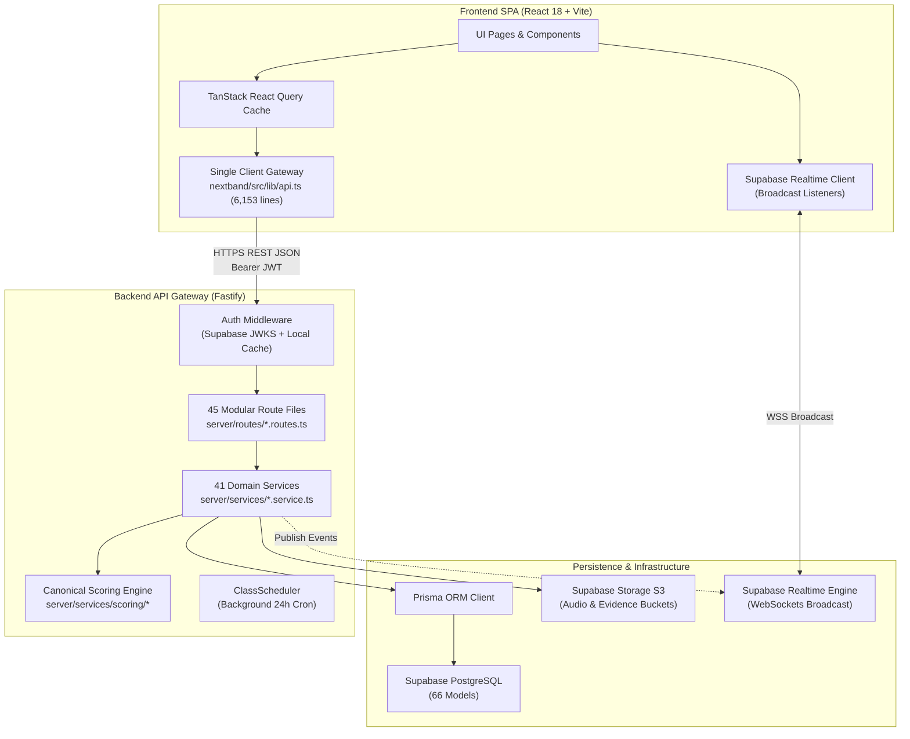
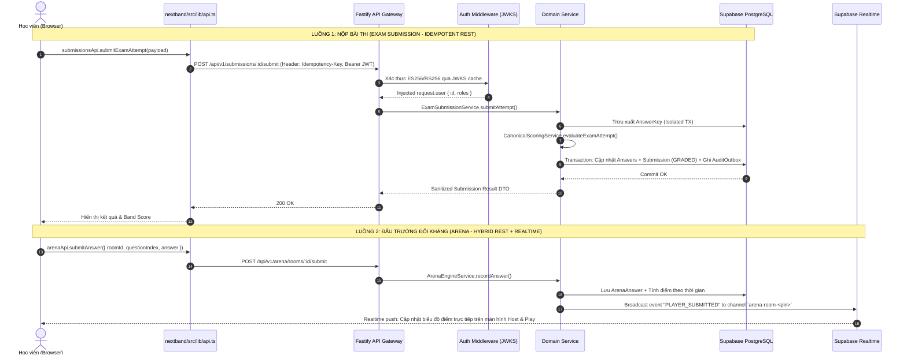

# KIẾN TRÚC HIỆN TẠI — NEXTBAND LMS (CURRENT ARCHITECTURE MAP)

> **Ngày lập báo cáo:** 16 tháng 10, 2026  
> **Người thực hiện:** Principal Software Architect  
> **Kho lưu trữ:** NextBand IELTS LMS (`d:/handover/ielts` / `/home/admindanielts/ielts-dictation`)  
> **Phương pháp tiếp cận:** Khảo sát thực nghiệm mã nguồn (Evidence-First), đối chiếu dependency thực tế, không suy đoán.

---

## 1. TỔNG QUAN HỆ THỐNG (SYSTEM CONTEXT)

NextBand (ARIS IELTS LMS) là hệ thống web application phục vụ quản lý đào tạo, thi thử, chấm điểm IELTS chuẩn quốc tế, và cung cấp các module luyện học tương tác (Reading Challenge, Reading Case Autopsy, English Idioms, Vocabulary C1, Arena Game).

Hệ thống được tổ chức theo mô hình **Monorepo kết hợp (Hybrid Monorepo)** gồm:
- **Frontend SPA:** React 18, Vite, TypeScript, TailwindCSS, Shadcn UI, TanStack Query (`nextband/`).
- **Backend API Gateway:** Fastify 4, TypeScript, Node.js (`server/`).
- **Persistence Layer:** PostgreSQL (qua Supabase) quản lý bởi Prisma ORM (`prisma/schema.prisma` với 66 models).
- **Serverless API Proxy:** Vercel Serverless Function (`api/index.js`, đóng gói từ `scripts/bundle-api.mjs`).
- **Realtime Event Bus:** Supabase Realtime Channels (dùng cho phòng thi đấu đối kháng Arena và thông báo tức thời).

---

## 2. FRONTEND ENTRY POINTS & ROUTING TOPOLOGY

Frontend được khởi tạo tại [`nextband/src/main.tsx`](file:///d:/handover/ielts/nextband/src/main.tsx) và định tuyến tập trung tại [`nextband/src/App.tsx`](file:///d:/handover/ielts/nextband/src/App.tsx).

Toàn bộ 807 dòng của `App.tsx` định nghĩa hệ thống phân cấp gồm 4 Layouts chính:

1. **`PublicLayout` (Khách vãng lai & Học viên công khai):**
   - Trang chủ (`/`), Giới thiệu (`/about`), Phương pháp (`/method`), Khóa học (`/courses`), Đội ngũ (`/teachers`), Kết quả (`/results`), Tuyển dụng (`/careers`), Liên hệ (`/contact`).
   - Kiểm tra đầu vào: `/assessment`, `/assessment/result/:sessionId`, `/placement-exam/:sessionId`.
   - Học liệu luyện đọc & từ vựng công khai:
     - `/reading-universe`, `/reading-case/:caseId` ([`ReadingCasePage.tsx`](file:///d:/handover/ielts/nextband/src/pages/public/reading/ReadingCasePage.tsx))
     - `/english-idioms`, `/english-idioms/:unitId` ([`EnglishIdiomsHubPage.tsx`](file:///d:/handover/ielts/nextband/src/pages/public/reading/EnglishIdiomsHubPage.tsx))
     - `/reading-challenge`, `/reading-challenge/unit/:unitNumber` ([`ChallengeUnitPage.tsx`](file:///d:/handover/ielts/nextband/src/features/reading-challenge/pages/ChallengeUnitPage.tsx))
     - `/vocab-c1` ([`VocabC1Page.tsx`](file:///d:/handover/ielts/nextband/src/pages/public/vocab-c1/VocabC1Page.tsx))
     - `/speaking-forecast` (`SpeakingForecastHub`, `SpeakingForecastSeason`, `SpeakingForecastTopic`)
     - `/cambridge/exam`, `/cambridge/room/:roomCode`
2. **`ClientLayout` (Học viên chính thức đã đăng nhập - Yêu cầu role `student`):**
   - Không gian học tập: `/my-courses`, `/courses/:id`, `/my-submissions`, `/submissions/:id`.
   - Phòng thi tiêu chuẩn: `/exams/:id/take` ([`ExamInterface.tsx`](file:///d:/handover/ielts/nextband/src/pages/ExamInterface.tsx)).
   - Phân tích & Tái cấu trúc tư duy: `/student-analytics`, `/visual-reconstruction/:submissionId`, `/attendance-progress`.
3. **`AdminLayout` (Giáo viên, Học vụ, Quản trị viên - Yêu cầu role `teacher`, `academic_admin`, `super_admin`):**
   - Điều hành: `/admin/dashboard`, `/admin/courses`, `/admin/exams`, `/admin/users`, `/admin/students`.
   - Vận hành lớp học: `/admin/classes`, `/admin/classes/:id/workspace` ([`ClassWorkspace/`](file:///d:/handover/ielts/nextband/src/pages/admin/ClassWorkspace/)), `/admin/class-league`.
   - Chấm thi & Giám định: `/admin/submissions/:id/grade`, `/admin/check-attempt/:id`, `/admin/teacher-workspace`.
   - Trực quan hóa học thuật: `/admin/academic-intelligence/*` (`AcademicIntelligenceDashboard`, `EvidenceExplorerPage`, `DiagnosticExplorerPage`, `OntologyMatrixPage`).
4. **`MinimalLayout` (Phòng thi đấu Arena toàn màn hình):**
   - Quản trị Host: `/arena/host/:pin` ([`ArenaHostPage.tsx`](file:///d:/handover/ielts/nextband/src/pages/arena/ArenaHostPage.tsx)).
   - Người chơi học viên: `/arena/join`, `/arena/play/:pin` ([`ArenaPlayPage.tsx`](file:///d:/handover/ielts/nextband/src/pages/arena/ArenaPlayPage.tsx)).

---

## 3. BACKEND ROUTES, SERVICES, REPOSITORIES & DATA MODELS

Backend được tổ chức theo cấu trúc Fastify:

### 3.1. Routes (`server/routes/` - 45 route files)
Các route phân rã theo URL prefix `/api/v1/*`. Điểm đáng chú ý:
- Hầu hết các route file vừa định nghĩa schema Zod/Fastify, vừa giải nén request, vừa gọi trực tiếp các phương thức của `Service` hoặc truy vấn trực tiếp `prisma`.
- Chỉ có 4 domain có file `Controller` riêng biệt trong `server/controllers/`:
  - `class.controller.ts`
  - `submission.controller.ts`
  - `speaking-evidence.controller.ts`
  - `academic-intelligence.controller.ts`

### 3.2. Services (`server/services/` - 41 service files)
Đây là tầng chứa phần lớn quy tắc nghiệp vụ của hệ thống:
- **Nhóm Khảo thí & Chấm điểm:** `exam-submission.service.ts` (1,918 dòng), `submission-state-machine.ts`, `cambridge-scoring.ts`, và thư mục con `server/services/scoring/` (7 files).
- **Nhóm Lớp học & Vận hành:** `class.service.ts` (1,902 dòng), `class-scheduler.service.ts`, `attendance.service.ts`, `tuition.service.ts`, `periodic-report.service.ts`.
- **Nhóm Gamification Arena:** `arena-room.service.ts`, `arena-engine.service.ts`, `arena-bank.service.ts`, `arena-pin.service.ts`.
- **Nhóm Học thuật & Chẩn đoán:** `diagnostic.service.ts`, `academic-diagnostic.service.ts`, `student-model.service.ts`, `evidence-ledger.service.ts`, `ontology.service.ts`, `risk-engine.service.ts`.
- **Nhóm Hạ tầng & Hỗ trợ:** `notification.service.ts`, `branch.service.ts`, `room.service.ts`, `room-collision.service.ts`, `authorization.service.ts`, `speakingStorage.service.ts`, `whisperStt.service.ts`, `geminiWritingDiagnostic.service.ts`.

### 3.3. Repositories (`server/repositories/` - 4 files)
Khảo sát cho thấy tầng Repository **chưa được áp dụng đồng bộ**:
- Chỉ có 4 file: `class.repository.ts`, `submission.repository.ts`, `speaking-evidence.repository.ts`, `invitation.repository.ts`.
- 37 services còn lại truy vấn trực tiếp thông qua instance toàn cục `prisma.*` được import từ `server/plugins/prisma.js`.

### 3.4. Schema & Data Models (`prisma/schema.prisma` - 66 Models)
Dữ liệu có độ chuẩn hóa cao (3NF) với các nhóm model chính:
- **Identity & Access:** `User`, `UserRole`, `UserBranch`, `TeacherProfile`.
- **Course & LMS:** `Course`, `Lesson`, `LessonResource`, `Class`, `ClassSession`, `ClassStudent`, `ClassAttendance`, `Enrollment`, `EnrollmentAuditLog`.
- **Exam Engine:** `Exam`, `ExamSection`, `QuestionGroup`, `Question`, `QuestionVersion`, `ExamSubmission`, `Answer`, `AnswerEvaluationEvidence`.
- **Arena Realtime:** `ArenaRoom`, `ArenaParticipant`, `ArenaAnswer`.
- **Academic Intelligence:** `SkillNode`, `QuestionSkillTag`, `ErrorDefinition`, `StudentErrorEpisode`, `StudentSkillEvidence`, `StudentSkillMastery`, `CognitiveWord`, `UserVocabulary`.
- **Auditing & Outbox:** `AuditOutbox`, `IdempotencyRecord`.

---

## 4. LUỒNG DỮ LIỆU & GIAO THỨC TRUYỀN THÔNG (DATA FLOWS)

---

## 5. ĐÁNH GIÁ CHI TIẾT 6 DOMAIN TRỌNG YẾU

### 5.1. Domain Exam & Chấm điểm (Authoritative Exam & Grading)
- **Trách nhiệm:** Quản lý ngân hàng đề thi, bài làm của học sinh, đảm bảo Fastify là trọng tài chấm điểm duy nhất (*Sole Authority*), bảo vệ answer-key tuyệt đối.
- **Entry Points:** `server/routes/exams.routes.ts`, `server/routes/submissions.routes.ts`, `nextband/src/pages/ExamInterface.tsx`.
- **Trạng thái thực tế:** Rất tốt. Thư mục `server/services/scoring/` được bóc tách dạng pure function, độc lập với framework, có bộ test vi phân 80 fixtures vàng (`scoring_differential.test.ts`).
- **Điểm yếu ranh giới:** Xuất hiện logic trùng lặp `isManualGradingRequired` và `isAutoGradedExam` giữa [`nextband/src/lib/examSkillHelper.ts`](file:///d:/handover/ielts/nextband/src/lib/examSkillHelper.ts) và [`server/utils/examSkillHelper.ts`](file:///d:/handover/ielts/server/utils/examSkillHelper.ts).

### 5.2. Domain Vận hành Lớp học (Class Management & Workspace)
- **Trách nhiệm:** Vòng đời lớp học (Draft $\rightarrow$ Active $\rightarrow$ Completed $\rightarrow$ Archived), thời khóa biểu, điểm danh, bài tập về nhà, phân công giáo viên, đồng bộ tiến độ hoàn thành khóa học.
- **Entry Points:** `server/routes/classes.routes.ts`, `server/services/class.service.ts`, `nextband/src/pages/admin/ClassWorkspace/`.
- **Trạng thái thực tế:** Kiến trúc phía Frontend rất mẫu mực: chia rõ `WorkspaceProvider.tsx`, `features/attendance/`, `features/students/`, `tabs/`.
- **Điểm yếu ranh giới:** File backend [`server/services/class.service.ts`](file:///d:/handover/ielts/server/services/class.service.ts) dài 1,902 dòng, đảm nhận quá nhiều trách nhiệm: quản lý sĩ số, tính toán bảng xếp hạng, cascade enrollment, scheduler kiểm tra vắng học, và xử lý holiday rules.

### 5.3. Domain Đấu trường Realtime (Arena Gamification)
- **Trách nhiệm:** Tổ chức trận đấu trắc nghiệm thời gian thực giữa các học sinh trong lớp học.
- **Entry Points:** `server/routes/arena.routes.ts`, `nextband/src/pages/arena/ArenaHostPage.tsx`, `ArenaPlayPage.tsx`, `nextband/src/lib/arena/`.
- **Trạng thái thực tế:** Mô hình kiến trúc Dual-Channel (Fastify REST Mutation + Supabase Broadcast Events) vận hành chính xác và có độ trễ thấp. Bộ test 10 suites chứng minh state machine chặt chẽ.
- **Điểm yếu ranh giới:** Đã từng bị lỗi import module dở dang (`doer-questions-bank.data.ts`) do chưa có cơ chế kiểm tra sự tồn tại của data files tĩnh trước khi commit.

### 5.4. Domain Reading Challenge
- **Trách nhiệm:** 20 bài luyện đọc hiểu chuyên sâu theo quy trình 10 bước (Pre-reading $\rightarrow$ Vocab $\rightarrow$ Passage $\rightarrow$ Comprehension $\rightarrow$ Idioms $\rightarrow$ Summary $\rightarrow$ Dictation $\rightarrow$ Grammar $\rightarrow$ Writing $\rightarrow$ Review).
- **Entry Points:** `nextband/src/features/reading-challenge/pages/ChallengeHubPage.tsx`, `ChallengeUnitPage.tsx`.
- **Trạng thái thực tế:** Cấu trúc thư mục kiểu feature slice rất đẹp (`components/steps/01..10`, `data/units/unit01..20`, `hooks/`).
- **Điểm yếu ranh giới:** **Hoàn toàn ngắt kết nối với Backend Database**. Tiến độ học viên chỉ lưu trên `localStorage` trình duyệt. Nếu học viên đổi máy hoặc xóa cache trình duyệt, toàn bộ kết quả 20 unit sẽ mất sạch.

### 5.5. Domain Reading Case Autopsy & Cognitive Dictionary
- **Trách nhiệm:** Khám phá bài đọc học thuật theo phương pháp "Khám nghiệm hiện trường vụ án" (Case Autopsy) kết hợp từ điển tri nhận ngữ nghĩa (*Cognitive Linguistics*).
- **Entry Points:** `nextband/src/pages/public/reading/ReadingCasePage.tsx`, `nextband/src/features/reading/`.
- **Trạng thái thực tế:** Logic sư phạm tri nhận rất sâu sắc (`humanizationEngine.ts`, `semanticValidator.ts`).
- **Điểm yếu ranh giới nghiêm trọng:**
  - **Tách rời vật lý:** File giao diện chính `ReadingCasePage.tsx` lại nằm ở `pages/public/reading/`, trong khi components và services lại nằm ở `features/reading/`.
  - **Static Data Bloat:** 15 file từ điển `case001Dictionary.ts` $\rightarrow$ `case015Dictionary.ts` nặng 1.56 MB được import tĩnh toàn bộ vào bundle, đẩy kích thước file chunk `ReadingCasePage.js` lên **1.45 MB** (vượt cảnh báo 800 kB của Vite).

### 5.6. Domain English Idioms
- **Trách nhiệm:** Học thành ngữ tiếng Anh qua ngữ cảnh, nguồn gốc từ nguyên (Etymology), phát âm audio và 5 bài tập tương tác.
- **Entry Points:** `nextband/src/pages/public/reading/EnglishIdiomsCatalogPage.tsx`, `EnglishIdiomsHubPage.tsx`.
- **Trạng thái thực tế:** Giao diện trực quan, âm thanh phong phú.
- **Điểm yếu ranh giới nghiêm trọng:**
  - **God Component:** File [`EnglishIdiomsHubPage.tsx`](file:///d:/handover/ielts/nextband/src/pages/public/reading/EnglishIdiomsHubPage.tsx) dài **2,179 dòng** gộp toàn bộ audio player, state máy nghe, 5 chế độ bài tập tương tác, chấm điểm, modal chúc mừng vào 1 file duy nhất.
  - Không có tầng lưu trữ backend (hoàn toàn dựa vào `localStorage`).

---

## 6. ĐIỂM NGHẼN KIẾN TRÚC TRUNG TÂM: `nextband/src/lib/api.ts` (GOD CLIENT GATEWAY)

Khảo sát mã nguồn xác nhận:
- File [`nextband/src/lib/api.ts`](file:///d:/handover/ielts/nextband/src/lib/api.ts) dài tới **6,153 dòng code**.
- Chứa định nghĩa của **40 namespace API con** (`coursesApi`, `examsApi`, `classesApi`, `submissionsApi`, `arenaApi`, `facultyApi`...).
- Được import bởi **126 files khác nhau** trong `nextband/src/`.
- **Chứa cả business logic:** Mapping dữ liệu (`toCanonicalClass`, `toCanonicalStudent`), tính toán hạn chót (`resolveEffectiveDeadline`), so sánh thứ tự bài tập (`compareHomeworkOrder`), và chuẩn hóa DTO qua các adapters.
- **Hậu quả thực tế:**
  1. *High Blast Radius:* Bất kỳ thay đổi nhỏ nào đối với 1 endpoint (như thêm trường cho `facultyApi`) đều đụng chạm vào file dùng chung của toàn hệ sinh thái.
  2. *Merge Conflict Hotspot:* Khi 2 lập trình viên hoặc subagent làm việc đồng thời trên 2 feature khác nhau (ví dụ: Arena và Class Attendance), xung đột git xảy ra 100% tại `api.ts`.
  3. *Type Coupling:* Mọi types của 40 domains bị dồn vào một không gian tên duy nhất.
