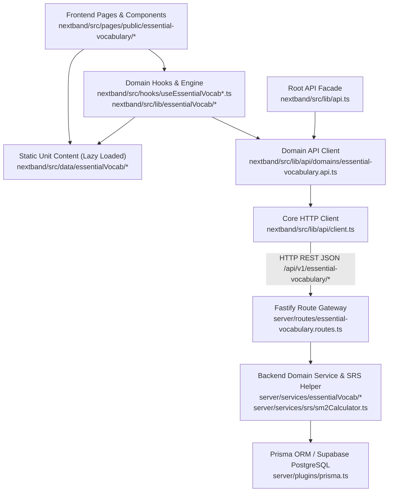

# ESSENTIAL VOCABULARY IN CONTEXT — TECHNICAL ARCHITECTURE & SPECIFICATION (`ESSENTIAL_VOCABULARY_SPEC.md`)

- **Document Status:** Approved Specification for Phase 2 Implementation (Unit 1 Vertical Slice)
- **Target Route Namespace:** `/essential-vocabulary` (Frontend) · `/api/v1/essential-vocabulary` (Backend)
- **Target Book Series:** *Essential Vocabulary in Context* (Learners Publishing / Scholastic, Books 1–6; Pilot: **Book 5, Unit 1 — "Looking good"**; Validated for cross-book compatibility with **Book 3**)
- **Architecture Governance:** Strictly bound by [`docs/architecture/SYSTEM_MAP.md`](./SYSTEM_MAP.md), [`docs/architecture/MODULE_BOUNDARIES.md`](./MODULE_BOUNDARIES.md), and [`AGENTS.md`](../../AGENTS.md).

---

## PHASE 0 — REPOSITORY & SOURCE PDF AUDIT FINDINGS

Before designing this specification, a full audit of the repository and the primary source PDFs (`Essential-Vocabulary-in-Context-5.pdf` and `Essential-Vocabulary-in-Context-3.pdf`) was conducted.

### 0.1 Repository Files Audited

| Layer | Inspected Files | Key Findings |
| :--- | :--- | :--- |
| **Architecture Governance** | [`docs/architecture/SYSTEM_MAP.md`](./SYSTEM_MAP.md)<br>[`docs/architecture/MODULE_BOUNDARIES.md`](./MODULE_BOUNDARIES.md)<br>[`scripts/sanity_check.mjs`](../../scripts/sanity_check.mjs) | Enforces 7 strict architectural gates: DAG dependency flow (Gate 1), Facade export parity (Gate 2), Zero RAM/mock fallback stores (Gate 3), Protected endpoints (Gate 4), Single Channel API with zero Prisma/Supabase leaks in `nextband/src` (Gate 5), Serverless bundle integrity via `scripts/bundle-api.mjs` (Gate 6), and Automated regression suite (Gate 7). |
| **Existing `vocab-in-use` Frontend** | [`nextband/src/data/vocabInUse/types.ts`](../../nextband/src/data/vocabInUse/types.ts)<br>[`nextband/src/data/vocabInUse/index.ts`](../../nextband/src/data/vocabInUse/index.ts)<br>[`nextband/src/pages/public/vocab-in-use/VocabInUsePage.tsx`](../../nextband/src/pages/public/vocab-in-use/VocabInUsePage.tsx)<br>[`nextband/src/hooks/useVocabInUseBookmarks.ts`](../../nextband/src/hooks/useVocabInUseBookmarks.ts) | `VocabInUseUnit` models Cambridge-style lessons (`theorySections` HTML + free-form `exercises` array + flat `glossary`). `useVocabInUseBookmarks.ts` implements an optimistic dual-mode persistence pattern (Guest `localStorage` under `nextband_viu_bookmarks_v1` with automatic one-time migration to PostgreSQL upon authentication via `nextband_viu_db_migrated_v1_${user.id}`). |
| **API Client & Facade** | [`nextband/src/lib/api/client.ts`](../../nextband/src/lib/api/client.ts)<br>[`nextband/src/lib/api.ts`](../../nextband/src/lib/api.ts)<br>[`nextband/src/lib/api/domains/vocab-in-use.api.ts`](../../nextband/src/lib/api/domains/vocab-in-use.api.ts) | `client.ts` provides `fetchWithAuth`, `handleResponse`, `getAuthHeaders`, and `ApiError`. Domain API modules (`*.api.ts`) must **only** import from `../client` and never from `../../api.ts`. `api.ts` re-exports domain modules and merges methods into the legacy `api` object for Gate 2 parity. |
| **Fastify Gateway & Routes** | [`server/routes/index.ts`](../../server/routes/index.ts)<br>[`server/routes/vocab-in-use.routes.ts`](../../server/routes/vocab-in-use.routes.ts)<br>[`server/routes/lexicon.routes.ts`](../../server/routes/lexicon.routes.ts) | `server/routes/index.ts` registers all `/api/v1/*` domain routes. Both `vocab-in-use.routes.ts` and `lexicon.routes.ts` duplicate inline SM-2 spaced repetition math (`interval: 1 -> 3 -> 7 -> 14 -> Math.round(interval * ease)`, `masteryScore: +0.25 / -0.20`, `masteryState: 0..3`). |
| **Database Schema** | [`prisma/schema.prisma`](../../prisma/schema.prisma) | `VocabInUseBookmark` (`vocab_in_use_bookmarks`, lines 1254–1291) is keyed by `@@unique([userId, unitId, lexiconId])` with single-POS snapshot fields (`word`, `pos`, `ipa`, `meaningVi`, `definitionEn`, `exampleEn`, `collocations`). There is **no** server-side unit exercise progress table for `vocab-in-use` (its exercise state lives only in browser `localStorage`). |
| **Text Normalization** | [`server/services/scoring/TextNormalizer.ts`](../../server/services/scoring/TextNormalizer.ts) | Provides deterministic text normalization (trimming, lowercase, smart-quote unification, hyphen/whitespace normalization) used by Listening/Reading scorers. |

### 0.2 Empirical Audit of Source PDFs (Book 5 & Book 3)

1. **Exact Unit 1 Glossary Count (`Essential-Vocabulary-in-Context-5.pdf`, PDF pp. 6–7 / Book pp. 5–6):**
   - Unit 1 (*Looking good*) contains **32 printed dictionary entries** corresponding to **33 headwords** (because entry #15 is `gem or gemstone`), **not 26**:
     - **Page 5 (14 entries):** `baggy` (*adj*), `bangle` (*n*), `bracelet` (*n*), `brooch` (*n*), `casual` (*adj*), `catwalk` (*n*), `cosmetics` (*pl n*), `designer` (*1 n, 2 adj*), `diamond` (*n*), `dress up` (*phr v*), `earring` (*n*), `elegant` (*adj*), `fashion` (*1 n, 2 adj*), `fashionable` (*adj*).
     - **Page 6 (18 entries):** `gem or gemstone` (*n*), `high-heeled` (*adj, said of shoes*), `in fashion` (*phrase*), `jewel` (*n*), `jewellery` (*n*), `loose-fitting` (*adj*), `low-cut` (*adj*), `make-up` (*n*), `model` (*1 n, 2 v*), `necklace` (*n*), `out of fashion` (*phrase*), `pearl` (*n*), `pendant` (*n*), `ring` (*n*), `ruby` (*n*), `smart` (*adj*), `style` (*n*), `tight-fitting` (*adj*).
2. **Multi-Sense, Compound POS, Inflections & Usage Constraints Across Books 3 & 5:**
   - **Multi-sense entries with numbered definitions & distinct POS:** e.g., `designer` (`1 noun`, `2 adjective`), `model` (`1 noun`, `2 verb` with inflections `models, modelling, modelled` or `modeling, modeled`), `digest` (`1 verb`, `2 noun` in Book 5 Unit 2).
   - **Compound POS on a single sense:** e.g., `telephone` (`noun and verb` in Book 5 Unit 5), `black` / `blue` / `brown` (`noun and adjective` in Book 3 Unit 1).
   - **Usage constraints & pronunciation notes:** e.g., `high-heeled` (`adjective (said of shoes)`), `cosmetics` (`plural noun`), `aged` (`adjective: 1 (one syllable) ... 2 (two syllables) ...` in Book 3 Unit 15).
3. **Exercise Structure Variations Across Units & Books (Book 3 vs. Book 5):**
   - **Stage 1 (Exercise 1 — Contextual Sentence MCQ):** Always 10 questions (`1`–`10`), 4 options `(1)`–`(4)` per question.
   - **Stage 2 (Exercise 2 — Lexical Relation / Collocation MCQ):** Always 5 questions (`1`–`5`), 4 options `(1)`–`(4)`, but exhibits **3 distinct prompt subtypes**:
     1. `synonym_replacement`: *"Choose the word or phrase that mostly closely means the same as the underlined word or phrase"* (Book 5 Units 1–14, 19–20; Book 3 Units 1–17).
     2. `verb_to_noun_collocation`: *"For each of the following verbs, choose the noun that goes with it"* (Book 5 Units 15, 17, 18; Book 3 Units 18, 19, 20).
     3. `noun_to_verb_collocation`: *"For each of the following nouns, choose the verb that goes with it"* (Book 5 Unit 16).
   - **Stage 3 (Exercise 3 — Guided Passage Cloze):** Always 5 numbered blanks `(1)`–`(5)` embedded in a cohesive passage, with **2 structural subtypes**:
     1. `box_word_bank`: Shared 10-word box `A`–`J` (5 correct words + 5 morphological/semantic distractors) — used in Book 5 Units 1–3, 5–16, 18–20 and Book 3 Units 1–5, 7–20.
     2. `inline_four_option`: Per-blank 4-option inline choices `(1)`–`(4)` — used in Book 5 Units 4 & 17 and Book 3 Unit 6.
   - **Stage 4 (Exercise 4 — Open Cloze Passage):**
     - In **Book 5**, Exercise 4 has **10 blanks** `(1)`–`(10)` (`totalQuestions = 10 + 5 + 5 + 10 = 30`).
     - In **Book 3**, Exercise 4 has **5 blanks** `(1)`–`(5)` (`totalQuestions = 10 + 5 + 5 + 5 = 25`, verified across all 20 units of Book 3).
     - **Architectural consequence:** Neither the TypeScript schema, the Exercise Engine, nor the Database schema may hardcode Stage 4 as 10 blanks or total unit questions as 30. All max scores must be dynamically derived from the unit schema.
4. **Duplicate Scan Anomaly in Book 5 PDF:**
   - In `Essential-Vocabulary-in-Context-5.pdf`, PDF pages 78–79 and PDF pages 80–81 are duplicate scans of Unit 13 pages 77–78. Content ingestion scripts must map by logical book page numbers rather than raw PDF page offsets.

### 0.3 Existing Reusable Services vs. Conflicts & Migration Risks

- **Reusable As-Is:**
  - `nextband/src/lib/api/client.ts` (`fetchWithAuth`, `handleResponse`, `ApiError`, `getAuthHeaders`).
  - `fastify.authenticate` middleware on backend routes.
  - Optimistic guest-to-authenticated sync pattern from `useVocabInUseBookmarks.ts`.
- **Requires Extraction into Shared Utility (No Behavioral Regression):**
  - The SM-2 calculation logic currently duplicated in `server/routes/lexicon.routes.ts` and `server/routes/vocab-in-use.routes.ts` should be extracted into a pure deterministic helper `server/services/srs/sm2Calculator.ts` (and mirrored on the client for guest mode in `nextband/src/lib/srs/sm2Calculator.ts`) so `lexicon`, `vocab-in-use`, and `essential-vocabulary` share one canonical algorithm.
- **Requires Dedicated Module Implementation (Cannot Reuse `vocab-in-use` Directly):**
  - `VocabInUseUnit` schema (flat glossary + HTML theory + untyped exercises) cannot represent multi-sense EVC entries, inflection tables, or the 4-stage scaffolded exercise pipeline.
  - `VocabInUseBookmark` table lacks `bookId` scoping (`unitId = 1` in EVC Book 5 vs. EVC Book 3 vs. VIU Unit 1 would collide or require brittle string mangling) and lacks server-side unit progress/attempt tracking.

---

## SECTION A — ARCHITECTURE

### A.1 Module Boundaries & Dependency Direction (DAG)

In strict compliance with **Gate 1 (Zero Circular Dependencies)** and **Gate 5 (Single Channel API)**, all dependencies flow strictly one way:



**Strict Boundary Rules:**
1. `nextband/src/lib/api/domains/essential-vocabulary.api.ts` **MUST ONLY** import HTTP primitives (`fetchWithAuth`, `handleResponse`, `getAuthHeaders`, `API_URL`, `ApiError`) from `../client` (and shared DTO types). It **MUST NEVER** import from `../../api.ts`.
2. `nextband/src/lib/api.ts` re-exports `essentialVocabularyApi` and spreads its methods into the root `api` facade to satisfy **Gate 2 (Facade Export Parity)**.
3. Frontend files under `nextband/src/pages/public/essential-vocabulary/**`, `nextband/src/hooks/**`, and `nextband/src/data/essentialVocab/**` **MUST NEVER** import `@prisma/client`, `server/*`, or `vocab-in-use` page components (**Gate 5**).

### A.2 Frontend Directory & Route Structure

**Routes registered in [`nextband/src/App.tsx`](../../nextband/src/App.tsx) (wrapped in `<Suspense>` with `lazy()`):**

| Route Path | Component | Responsibility |
| :--- | :--- | :--- |
| `/essential-vocabulary` | `EssentialVocabHubPage.tsx` | Book & 20-Unit overview grid, mastery KPIs, book filter (`evc-5`), search, and quick links to Review & Progress. |
| `/essential-vocabulary/unit/:unitSlug` | `EssentialVocabUnitPage.tsx` | Unit landing shell with tab/stage switcher (`Glossary` -> `Stage 1` -> `Stage 2` -> `Stage 3` -> `Stage 4`), unit progress bar, and mode selector. |
| `/essential-vocabulary/unit/:unitSlug/glossary` | `EssentialVocabGlossaryView.tsx` | Interactive A–Z contextual dictionary for the Unit (multi-sense cards, POS badges, inflections, example sentences, audio TTS, 1-click SM-2 bookmarking, "Words in this unit's exercises" filter). |
| `/essential-vocabulary/unit/:unitSlug/practice` | `EssentialVocabPracticeView.tsx` | 4-Stage Exercise Runner (`Stage 1: Contextual MCQ` -> `Stage 2: Synonym/Collocation` -> `Stage 3: Guided Cloze` -> `Stage 4: Open Cloze` with `Assisted` vs. `Hard` modes, instant grading, and wrong-answer bookmark prompts). |
| `/essential-vocabulary/review` | `EssentialVocabReviewPage.tsx` | Spaced Repetition (SM-2) Flashcard & Cloze Review queue for bookmarked words across EVC units. |
| `/essential-vocabulary/progress` | `EssentialVocabProgressPage.tsx` | Analytics dashboard: Best vs. Latest scores across all 4 stages per unit, attempt history timeline, and weak-word breakdown. |

> **Route Parameter Convention:** `:unitSlug` accepts either the canonical unit slug (e.g., `evc5-u1` or `1` defaulting to active book `evc-5`) and resolves deterministically via the Unit Registry.

**Frontend File Layout:**
```text
nextband/src/
├── data/essentialVocab/
│   ├── schema.ts                        # Zod + TypeScript definitions (Book, Unit, Glossary, Stages 1-4)
│   ├── registry.ts                      # Lightweight metadata index for all 20 units + dynamic import loader
│   └── books/
│       └── evc5/
│           ├── meta.ts                  # Book 5 metadata
│           └── unit01.looking-good.ts   # Lazy-loaded Unit 1 full dataset (validated at build/test time)
├── lib/essentialVocab/
│   ├── answerNormalizer.ts              # 4-tier Open Cloze normalizer & evaluator
│   ├── exerciseGrader.ts                # Deterministic Stage 1-4 grading engine
│   └── sm2Client.ts                     # Pure SM-2 state calculator (shared logic for guest fallback)
├── lib/api/domains/
│   └── essential-vocabulary.api.ts      # Domain API client (imports ONLY from ../client)
├── hooks/
│   ├── useEssentialVocabUnit.ts         # Dynamic unit loader + Zod runtime validation in dev/test
│   ├── useEssentialVocabProgress.ts     # Dual-mode (Auth DB + Guest localStorage) progress & attempt state
│   └── useEssentialVocabBookmarks.ts    # Dual-mode SM-2 bookmark state + guest-to-DB migration
└── pages/public/essential-vocabulary/
    ├── EssentialVocabHubPage.tsx
    ├── EssentialVocabUnitPage.tsx
    ├── EssentialVocabReviewPage.tsx
    ├── EssentialVocabProgressPage.tsx
    └── components/
        ├── GlossaryEntryCard.tsx
        ├── Stage1ContextualMcq.tsx
        ├── Stage2LexicalMcq.tsx
        ├── Stage3GuidedCloze.tsx
        ├── Stage4OpenCloze.tsx
        └── StageAttemptSummaryModal.tsx
```

### A.3 Backend Directory Structure

```text
server/
├── routes/
│   ├── index.ts                              # Registers essentialVocabularyRoutes under /api/v1/essential-vocabulary
│   └── essential-vocabulary.routes.ts        # Fastify endpoints (bookmarks, SM-2 review, unit progress, attempts, sync)
└── services/
    ├── srs/
    │   └── sm2Calculator.ts                  # Pure, deterministic SM-2 spaced repetition calculator
    └── essentialVocab/
        └── progressReconciler.ts             # Score aggregation (best vs. latest) & contentVersion reconciliation
```

### A.4 Data-Loading Strategy (No Monolithic Bundle)

- **Lightweight Hub Index (`registry.ts`):** Contains only `EvcBookMeta` and `EvcUnitSummary` (ID, unit number, title, theme, glossary entry count, stage question counts, `contentVersion`). Importing `registry.ts` adds `< 4 KB` to the Hub page bundle.
- **Per-Unit Dynamic Imports (`loadEvcUnit(bookId, unitNumber)`):** Each unit's full glossary and 4-stage exercises reside in its own module (`books/evc5/unit01.looking-good.ts`, `unit02.making-a-living.ts`, etc.) and are loaded on demand via `import()` when a student navigates to `/essential-vocabulary/unit/:unitSlug`.
- **Zero Database Content Duplication:** Static pedagogical content (definitions, passages, questions, answer keys) lives in versioned TypeScript modules validated by Zod. PostgreSQL stores **only** user-specific learning state (bookmarks, SM-2 scheduling, unit progress, and exercise attempt logs).

### A.5 Authentication, Public Access, Guest Mode & LocalStorage Sync

1. **Public Content Access (Approved Decision: Public Route like `/vocab-in-use`):**
   - All `/essential-vocabulary/*` frontend routes are publicly accessible without a feature flag or login wall.
   - Browsing the Hub, reading Unit Glossaries, practicing Stages 1–4 (with Assisted Mode as the default for first-time learners and a 1-click toggle to Hard Mode), and reviewing flashcards work seamlessly for both **Guest (unauthenticated)** and **Authenticated** users.
2. **Guest Persistence (`localStorage`):**
   - Bookmarks & SM-2 state: `nextband_evc_bookmarks_v1`
   - Unit progress & attempt history: `nextband_evc_progress_v1`
   - In-progress stage draft answers: `nextband_evc_draft_v1_${unitId}`
3. **Authenticated Persistence (PostgreSQL via Fastify API):**
   - All `/api/v1/essential-vocabulary/*` endpoints require `preHandler: [fastify.authenticate]` (**Gate 4**).
   - When an authenticated user completes a stage or bookmarks a word, state is persisted directly to PostgreSQL via `essentialVocabularyApi`.
4. **Guest-to-Authenticated Migration:**
   - Upon login, `useEssentialVocabBookmarks` and `useEssentialVocabProgress` check `nextband_evc_db_migrated_v1_${user.id}`.
   - If unmigrated guest data exists in `localStorage`, the client calls `POST /api/v1/essential-vocabulary/sync` once to idempotently merge guest bookmarks and historical attempts into PostgreSQL, then sets the migration flag.
5. **No Mock Fallbacks (Gate 3):**
   - If `user` is authenticated and an API request fails (e.g., network error or `500`), the hook **must throw/surface `ApiError`** to the UI toast/error boundary and **must not** silently pretend the server save succeeded via a hidden RAM store.

---

## SECTION B — CONTENT SCHEMA (TYPESCRIPT & ZOD)

All static unit files must satisfy the following TypeScript interfaces and Zod schemas (`nextband/src/data/essentialVocab/schema.ts`).

### B.1 Book & Unit Metadata Schema (`contentVersion` & Provenance)

```typescript
import { z } from 'zod';

export const EvcBookIdSchema = z.enum(['evc-1', 'evc-2', 'evc-3', 'evc-4', 'evc-5', 'evc-6']);
export type EvcBookId = z.infer<typeof EvcBookIdSchema>;

export const EvcPartOfSpeechSchema = z.enum([
  'noun',
  'plural noun',
  'verb',
  'adjective',
  'adverb',
  'phrasal verb',
  'phrase',
  'preposition',
  'conjunction',
  'noun and adjective',
  'noun and verb',
  'adjective and adverb',
]);
export type EvcPartOfSpeech = z.infer<typeof EvcPartOfSpeechSchema>;

export const EvcContentProvenanceSchema = z.object({
  sourceBookId: EvcBookIdSchema,
  sourceBookTitle: z.string().min(1),
  sourceUnitNumber: z.number().int().min(1).max(20),
  sourceBookPages: z.tuple([z.number().int().positive(), z.number().int().positive()]),
  sourcePdfPages: z.tuple([z.number().int().positive(), z.number().int().positive()]),
  answerKeyBookPage: z.number().int().positive(),
  verifiedBy: z.string().min(1),
  verifiedAtIso: z.string().datetime(),
  licenseStatus: z.enum(['public_access', 'internal_pilot_only', 'licensed_production', 'restricted']),
});
```

### B.2 Multi-Sense Vocabulary Layer Schema (`EvcGlossaryEntry`)

Supports single-sense entries (`baggy`), alternate headword entries (`gem or gemstone`), multi-sense entries with distinct POS (`designer: 1 noun, 2 adjective`; `model: 1 noun, 2 verb`), inflections (`models, modelling, modelled`), and usage constraints (`said of shoes`).

```typescript
export const EvcInflectionGroupSchema = z.object({
  rawText: z.string().min(1), // e.g., "(models, modelling, modelled or modeling, modeled)"
  forms: z.array(z.string().min(1)).min(1), // ["models", "modelling", "modelled", "modeling", "modeled"]
});

export const EvcWordSenseSchema = z.object({
  senseNumber: z.number().int().min(1), // 1 for single-sense; 1, 2, 3... for multi-sense
  pos: EvcPartOfSpeechSchema,
  usageConstraint: z.string().optional(), // e.g., "(said of shoes)" or "(one syllable)"
  inflections: EvcInflectionGroupSchema.optional(),
  definitionEn: z.string().min(1),
  meaningVi: z.string().min(1),
  examplesEn: z.array(z.string().min(1)).min(1),
  collocations: z.array(z.string().min(1)).default([]),
});

export const EvcGlossaryEntrySchema = z.object({
  entryId: z.string().regex(/^evc[1-6]-u\d{2}-w\d{2}$/), // e.g., "evc5-u01-w15"
  unitId: z.string().regex(/^evc[1-6]-u\d{2}$/),         // e.g., "evc5-u01"
  displayHeadword: z.string().min(1),                    // e.g., "gem or gemstone"
  primaryHeadword: z.string().min(1),                    // e.g., "gem"
  alternateHeadwords: z.array(z.string().min(1)).default([]), // e.g., ["gemstone"]
  ipa: z.string().optional(),
  senses: z.array(EvcWordSenseSchema).min(1),
  testedInStages: z.array(z.number().int().min(1).max(4)).default([]),
});
export type EvcGlossaryEntry = z.infer<typeof EvcGlossaryEntrySchema>;
```

### B.3 Four-Stage Exercise Layer Schema (Supporting Books 3 & 5)

```typescript
export const EvcMcqOptionSchema = z.object({
  optionNumber: z.union([z.literal(1), z.literal(2), z.literal(3), z.literal(4)]),
  text: z.string().min(1),
});

// STAGE 1: Exercise 1 — Contextual Sentence MCQ (10 items)
export const EvcStage1QuestionSchema = z.object({
  questionId: z.string().min(1), // e.g., "evc5-u01-s1-q01"
  questionNumber: z.number().int().min(1).max(10),
  promptWithBlank: z.string().includes('___'),
  options: z.tuple([
    EvcMcqOptionSchema,
    EvcMcqOptionSchema,
    EvcMcqOptionSchema,
    EvcMcqOptionSchema,
  ]),
  correctOptionNumber: z.union([z.literal(1), z.literal(2), z.literal(3), z.literal(4)]),
  canonicalAnswerText: z.string().min(1),
  linkedEntryId: z.string().min(1),
  linkedSenseNumber: z.number().int().min(1).default(1),
  explanationEn: z.string().min(1),
  explanationVi: z.string().optional(),
});

export const EvcStage1ExerciseSchema = z.object({
  stage: z.literal(1),
  exerciseType: z.literal('contextual_mcq'),
  instructions: z.string().min(1),
  questions: z.array(EvcStage1QuestionSchema).length(10),
});

// STAGE 2: Exercise 2 — Synonym Replacement OR Collocation Matching (5 items)
export const EvcStage2VariantSchema = z.enum([
  'synonym_replacement',
  'verb_to_noun_collocation',
  'noun_to_verb_collocation',
]);

export const EvcStage2QuestionSchema = z.object({
  questionId: z.string().min(1), // e.g., "evc5-u01-s2-q01"
  questionNumber: z.number().int().min(1).max(5),
  variant: EvcStage2VariantSchema,
  sentenceContext: z.string().optional(), // Present for synonym_replacement
  targetWordOrPhrase: z.string().min(1),  // Underlined phrase OR prompt verb/noun
  options: z.tuple([
    EvcMcqOptionSchema,
    EvcMcqOptionSchema,
    EvcMcqOptionSchema,
    EvcMcqOptionSchema,
  ]),
  correctOptionNumber: z.union([z.literal(1), z.literal(2), z.literal(3), z.literal(4)]),
  canonicalAnswerText: z.string().min(1),
  targetLinkedEntryId: z.string().optional(),
  answerLinkedEntryId: z.string().min(1),
  explanationEn: z.string().min(1),
  explanationVi: z.string().optional(),
});

export const EvcStage2ExerciseSchema = z.object({
  stage: z.literal(2),
  exerciseType: z.literal('lexical_relation_mcq'),
  variant: EvcStage2VariantSchema,
  instructions: z.string().min(1),
  questions: z.array(EvcStage2QuestionSchema).length(5),
});

// STAGE 3: Exercise 3 — Guided Passage Cloze (Boxed A-J OR Inline 4-Option, 5 blanks)
export const EvcWordBankItemSchema = z.object({
  letter: z.enum(['A', 'B', 'C', 'D', 'E', 'F', 'G', 'H', 'I', 'J']),
  word: z.string().min(1),
  isDistractor: z.boolean(),
});

export const EvcStage3BoxBlankSchema = z.object({
  blankId: z.string().min(1), // e.g., "evc5-u01-s3-b01"
  blankNumber: z.number().int().min(1).max(5),
  correctLetter: z.enum(['A', 'B', 'C', 'D', 'E', 'F', 'G', 'H', 'I', 'J']),
  canonicalAnswerText: z.string().min(1),
  linkedEntryId: z.string().min(1),
  linkedSenseNumber: z.number().int().min(1).default(1),
  explanationEn: z.string().min(1),
});

export const EvcStage3InlineBlankSchema = z.object({
  blankId: z.string().min(1),
  blankNumber: z.number().int().min(1).max(5),
  options: z.tuple([
    EvcMcqOptionSchema,
    EvcMcqOptionSchema,
    EvcMcqOptionSchema,
    EvcMcqOptionSchema,
  ]),
  correctOptionNumber: z.union([z.literal(1), z.literal(2), z.literal(3), z.literal(4)]),
  canonicalAnswerText: z.string().min(1),
  linkedEntryId: z.string().min(1),
  linkedSenseNumber: z.number().int().min(1).default(1),
  explanationEn: z.string().min(1),
});

export const EvcStage3ExerciseSchema = z.discriminatedUnion('variant', [
  z.object({
    stage: z.literal(3),
    exerciseType: z.literal('guided_passage_cloze'),
    variant: z.literal('box_word_bank'),
    instructions: z.string().min(1),
    passageTitle: z.string().optional(),
    passageTemplate: z.string().includes('{{1}}'), // Contains {{1}} .. {{5}}
    wordBank: z.array(EvcWordBankItemSchema).length(10),
    blanks: z.array(EvcStage3BoxBlankSchema).length(5),
  }),
  z.object({
    stage: z.literal(3),
    exerciseType: z.literal('guided_passage_cloze'),
    variant: z.literal('inline_four_option'),
    instructions: z.string().min(1),
    passageTitle: z.string().optional(),
    passageTemplate: z.string().includes('{{1}}'),
    blanks: z.array(EvcStage3InlineBlankSchema).length(5),
  }),
]);
```

### B.4 Stage 4 Open Cloze & Four-Tier Answer Normalizer Specification

Per the book's Answer Key notice (*"The answers provided for Exercise 4 in all the units are suggested answers only. Other answers are also acceptable, depending on the context"*), we must **not** blindly accept every dictionary synonym (which would mark ungrammatical or collocationally wrong words as correct). Instead, each blank in Stage 4 defines a strict **4-tier answer specification**:

1. **`canonicalAnswer`**: The exact printed answer from the Answer Key (e.g., `designers` for Blank 1, `jewellery` for Blank 4). Graded as **`CORRECT_CANONICAL` (1.0 pt)**.
2. **`acceptedGrammaticalVariants`**: Deterministic orthographic (UK/US spelling) or hyphenation/inflectional variants that are unconditionally grammatical in the blank's syntactic slot (e.g., `jewelry` for `jewellery`; `makeup` for `make-up`). Graded as **`CORRECT_VARIANT` (1.0 pt)**.
3. **`verifiedContextualAlternatives`**: Human-verified vocabulary items from the Unit that fit both the syntactic slot (plural/singular agreement, determiner compatibility) and semantic context of the passage (e.g., in Unit 1 Blank 5 *"dazzling necklaces of pearls, (5) ___ and diamonds"*, `gems`, `gemstones`, or `jewels` are syntactically plural nouns denoting precious stones not yet repeated in that clause). Graded as **`CORRECT_VERIFIED_ALT` (1.0 pt)** with a note showing the canonical answer.
4. **`unverifiedSuggestedAnswers`**: Semantically related words from the unit that a student might try (e.g., singular `ruby` instead of plural `rubies` in Blank 5, or `smart` in Blank 8) which require morphological correction or have weaker contextual fit. Graded as **`INCORRECT_NEAR_MISS` (0.0 pt)** with targeted pedagogical feedback explaining *why* the canonical form (`rubies`) is required.

```typescript
export const EvcStage4BlankSchema = z.object({
  blankId: z.string().min(1), // e.g., "evc5-u01-s4-b01"
  blankNumber: z.number().int().min(1).max(10),
  canonicalAnswer: z.string().min(1),
  acceptedGrammaticalVariants: z.array(z.string().min(1)).default([]),
  verifiedContextualAlternatives: z.array(z.string().min(1)).default([]),
  unverifiedSuggestedAnswers: z
    .array(
      z.object({
        value: z.string().min(1),
        feedbackReason: z.string().min(1),
      })
    )
    .default([]),
  linkedEntryId: z.string().min(1),
  linkedSenseNumber: z.number().int().min(1).default(1),
  grammaticalHint: z.string().min(1), // Shown in Assisted Mode (e.g., "plural noun")
  explanationEn: z.string().min(1),
});

export const EvcStage4ExerciseSchema = z.object({
  stage: z.literal(4),
  exerciseType: z.literal('open_cloze_passage'),
  instructions: z.string().min(1),
  passageTitle: z.string().optional(),
  passageTemplate: z.string().includes('{{1}}'), // {{1}}..{{10}} in Book 5; {{1}}..{{5}} in Book 3
  blanks: z.array(EvcStage4BlankSchema).min(5).max(10),
});

export const EvcUnitDataSchema = z.object({
  unitId: z.string().regex(/^evc[1-6]-u\d{2}$/), // e.g., "evc5-u01"
  bookId: EvcBookIdSchema,
  unitNumber: z.number().int().min(1).max(20),
  title: z.string().min(1),
  themeCategory: z.string().min(1),
  contentVersion: z.number().int().min(1),       // Incremented whenever answers/questions change
  provenance: EvcContentProvenanceSchema,
  glossary: z.array(EvcGlossaryEntrySchema).min(20),
  exercises: z.object({
    stage1: EvcStage1ExerciseSchema,
    stage2: EvcStage2ExerciseSchema,
    stage3: EvcStage3ExerciseSchema,
    stage4: EvcStage4ExerciseSchema,
  }),
});
export type EvcUnitData = z.infer<typeof EvcUnitDataSchema>;
```

**Deterministic Normalization Function (`nextband/src/lib/essentialVocab/answerNormalizer.ts`):**
```typescript
export type OpenClozeMatchTier =
  | 'CORRECT_CANONICAL'
  | 'CORRECT_VARIANT'
  | 'CORRECT_VERIFIED_ALT'
  | 'INCORRECT_NEAR_MISS'
  | 'INCORRECT';

export function normalizeEvcToken(raw: string): string {
  return raw
    .trim()
    .toLowerCase()
    .replace(/[\u2018\u2019]/g, "'")
    .replace(/[\u2010-\u2015]/g, '-')
    .replace(/\s+/g, ' ');
}
```
- The normalizer **never** strips hyphens automatically between arbitrary words unless the non-hyphenated form is listed in `acceptedGrammaticalVariants` (because hyphenation is a tested orthographic feature in IELTS/EVC for compound adjectives like `high-heeled`, `tight-fitting`, `loose-fitting`, `low-cut`).

---

## SECTION C — DATABASE MODEL & PERSISTENCE STRATEGY

### C.1 Evaluation: Reuse `VocabInUseBookmark` vs. Dedicated EVC Tables

1. **Why `VocabInUseBookmark` (`vocab_in_use_bookmarks`) Should Not Be Overloaded:**
   - `VocabInUseBookmark` uses `unitId Int` with `@@unique([userId, unitId, lexiconId])`. Because `vocab-in-use` already occupies `unitId = 1..100`, storing EVC Book 5 Unit 1 (`unitId = 1`) and EVC Book 3 Unit 1 (`unitId = 1`) in `VocabInUseBookmark` would either cause collisions or require synthetic integer offset hacks.
   - EVC entries have multi-sense definitions, inflections, and `sourceStage` metadata ("bookmarked from Stage 4 wrong answer") that do not exist on `VocabInUseBookmark`.
2. **Decision:**
   - Define three dedicated, book-series-aware Prisma models for the EVC domain (`EssentialVocabBookmark`, `EssentialVocabUnitProgress`, and `EssentialVocabAttempt`) keyed by `bookId` (`"evc-5"`) and `unitId` (`"evc5-u01"`).
   - **Share the SM-2 Engine** (`server/services/srs/sm2Calculator.ts`) across `UserVocabulary`, `VocabInUseBookmark`, and `EssentialVocabBookmark`, and expose a unified Vocabulary Universe adapter interface so the future Vocabulary Universe hub can query due flashcards across all modules without coupling their underlying lesson schemas.

### C.2 Prisma Models (To Be Added in Phase 2)

```prisma
model EssentialVocabBookmark {
  id               String    @id @default(cuid())
  userId           String    @map("user_id")
  bookId           String    @map("book_id")        // e.g. "evc-5", "evc-3"
  unitId           String    @map("unit_id")        // e.g. "evc5-u01"
  entryId          String    @map("entry_id")       // e.g. "evc5-u01-w15"
  senseNumber      Int       @default(1) @map("sense_number")

  // Denormalized snapshot for fast offline/review rendering
  headword         String
  pos              String
  ipa              String?
  meaningVi        String    @map("meaning_vi")
  definitionEn     String    @map("definition_en")
  exampleEn        String    @map("example_en")
  inflectionsText  String?   @map("inflections_text")
  sourceContext    String    @default("glossary") @map("source_context") // "glossary" | "stage_1" | "stage_2" | "stage_3" | "stage_4"

  // Canonical SM-2 Spaced Repetition State (shared contract with sm2Calculator.ts)
  masteryScore     Float     @default(0.0) @map("mastery_score")
  masteryState     Int       @default(0)   @map("mastery_state") // 0: New, 1: Learning, 2: Review, 3: Mastered
  ease             Float     @default(2.5)
  interval         Int       @default(0)
  step             Int       @default(0)
  due              DateTime?
  lastReviewedAt   DateTime? @map("last_reviewed_at")
  reps             Int       @default(0)
  lapses           Int       @default(0)
  history          Json      @default("[]")

  createdAt        DateTime  @default(now()) @map("created_at")
  updatedAt        DateTime  @updatedAt @map("updated_at")

  user             User      @relation(fields: [userId], references: [id], onDelete: Cascade)

  @@unique([userId, unitId, entryId, senseNumber])
  @@index([userId, due])
  @@index([userId, bookId, unitId])
  @@map("evc_bookmarks")
}

model EssentialVocabUnitProgress {
  id                  String    @id @default(cuid())
  userId              String    @map("user_id")
  bookId              String    @map("book_id")          // e.g. "evc-5"
  unitId              String    @map("unit_id")          // e.g. "evc5-u01"
  contentVersion      Int       @default(1) @map("content_version")

  // Dynamic max scores (supports 30 questions in Book 5 and 25 questions in Book 3)
  stage1MaxScore      Int       @default(10) @map("stage1_max_score")
  stage2MaxScore      Int       @default(5)  @map("stage2_max_score")
  stage3MaxScore      Int       @default(5)  @map("stage3_max_score")
  stage4MaxScore      Int       @default(10) @map("stage4_max_score")
  totalMaxScore       Int       @default(30) @map("total_max_score")

  // Best scores (never decrease on retry)
  bestStage1Score     Int?      @map("best_stage1_score")
  bestStage2Score     Int?      @map("best_stage2_score")
  bestStage3Score     Int?      @map("best_stage3_score")
  bestStage4Score     Int?      @map("best_stage4_score")
  bestTotalScore      Int       @default(0) @map("best_total_score")
  bestAccuracyPct     Float     @default(0.0) @map("best_accuracy_pct")

  // Latest scores (reflect most recent attempt of each stage)
  latestStage1Score   Int?      @map("latest_stage1_score")
  latestStage2Score   Int?      @map("latest_stage2_score")
  latestStage3Score   Int?      @map("latest_stage3_score")
  latestStage4Score   Int?      @map("latest_stage4_score")
  latestTotalScore    Int       @default(0) @map("latest_total_score")
  latestAccuracyPct   Float     @default(0.0) @map("latest_accuracy_pct")

  // Counters & status
  completedStagesMask Int       @default(0) @map("completed_stages_mask") // Bitmask: 1=S1, 2=S2, 4=S3, 8=S4 (15 = All 4 completed)
  attemptsCount       Int       @default(0) @map("attempts_count")
  needsRevalidation   Boolean   @default(false) @map("needs_revalidation") // True if unit contentVersion increased with breaking changes
  firstCompletedAt    DateTime? @map("first_completed_at")
  lastPracticedAt     DateTime  @default(now()) @map("last_practiced_at")
  createdAt           DateTime  @default(now()) @map("created_at")
  updatedAt           DateTime  @updatedAt @map("updated_at")

  user                User      @relation(fields: [userId], references: [id], onDelete: Cascade)
  attempts            EssentialVocabAttempt[]

  @@unique([userId, unitId])
  @@index([userId, bookId])
  @@map("evc_unit_progress")
}

model EssentialVocabAttempt {
  id                  String    @id @default(cuid())
  progressId          String    @map("progress_id")
  userId              String    @map("user_id")
  bookId              String    @map("book_id")
  unitId              String    @map("unit_id")
  contentVersion      Int       @map("content_version")
  stage               Int       // 1, 2, 3, or 4 (or 0 for full-unit submission)
  mode                String    @default("assisted") // "assisted" | "hard"
  score               Int
  maxScore            Int       @map("max_score")
  accuracyPct         Float     @map("accuracy_pct")
  durationSec         Int       @default(0) @map("duration_sec")
  answersSnapshot     Json      @map("answers_snapshot") // Item-by-item submitted answers + grading tier
  wrongEntryIds       Json      @default("[]") @map("wrong_entry_ids")
  clientAttemptKey    String?   @unique @map("client_attempt_key") // Idempotency key for guest-to-DB sync
  submittedAt         DateTime  @default(now()) @map("submitted_at")

  progress            EssentialVocabUnitProgress @relation(fields: [progressId], references: [id], onDelete: Cascade)
  user                User      @relation(fields: [userId], references: [id], onDelete: Cascade)

  @@index([userId, unitId, stage, submittedAt])
  @@map("evc_exercise_attempts")
}
```

### C.3 Best Score vs. Latest Score Aggregation Rules

When a user submits an attempt for Stage $k \in \{1, 2, 3, 4\}$ with score $S_k$ out of $M_k$:
1. An immutable `EssentialVocabAttempt` row is inserted (deduplicated by `clientAttemptKey` if present).
2. On `EssentialVocabUnitProgress`:
   - `latestStage{k}Score = S_k`
   - `bestStage{k}Score = max(bestStage{k}Score ?? 0, S_k)`
   - `completedStagesMask = completedStagesMask | (1 << (k - 1))`
   - `bestTotalScore = (bestStage1Score ?? 0) + (bestStage2Score ?? 0) + (bestStage3Score ?? 0) + (bestStage4Score ?? 0)`
   - `latestTotalScore = (latestStage1Score ?? 0) + (latestStage2Score ?? 0) + (latestStage3Score ?? 0) + (latestStage4Score ?? 0)`
   - `bestAccuracyPct = round((bestTotalScore / totalMaxScore) * 100, 1)`
   - `latestAccuracyPct = round((latestTotalScore / totalMaxScore) * 100, 1)`
   - If `completedStagesMask === 15` and `firstCompletedAt === null`, set `firstCompletedAt = now()`.

### C.4 Content Versioning & Migration Strategy (`contentVersion`)

Each unit definition carries an integer `contentVersion` (starting at `1`).
- **Minor Editorial Fix (typo in explanation, Vietnamese translation refinement):** `contentVersion` remains unchanged (`1`). Existing progress is unaffected.
- **Scoring/Answer Change (adding a newly verified alternative answer in Stage 4 or correcting an answer key):**Increment `contentVersion` (`2`).
  - When a user loads the Unit or Progress API, if `progress.contentVersion < unit.contentVersion`:
    1. Historical `EssentialVocabAttempt` rows remain untouched with their recorded `contentVersion`.
    2. If `stageMaxScores` changed, `progressReconciler.ts` recalculates `bestAccuracyPct` and `latestAccuracyPct` against the new denominator or flags `needsRevalidation = true` with a non-intrusive badge ("Unit updated — re-run Stage 4 to refresh score").
    3. Existing `bestStageScores` are **never** wiped to zero.

---

## SECTION D — API CONTRACT (`/api/v1/essential-vocabulary`)

All endpoints are registered in `server/routes/essential-vocabulary.routes.ts`, mounted under `/api/v1/essential-vocabulary` in [`server/routes/index.ts`](../../server/routes/index.ts), and protected by `preHandler: [fastify.authenticate]` (**Gate 4**).

### D.1 Endpoints Overview

| Method & Path | Purpose | Request Query / Body | Response DTO |
| :--- | :--- | :--- | :--- |
| `GET /api/v1/essential-vocabulary/progress` | Fetch user's unit progress rows & recent attempts across a book | `?bookId=evc-5` | `{ success: true, data: { units: EvcUnitProgressDto[], summary: EvcBookProgressSummaryDto } }` |
| `GET /api/v1/essential-vocabulary/progress/:unitId` | Fetch detailed progress + attempt history for one unit | `?limit=20` | `{ success: true, data: { progress: EvcUnitProgressDto \| null, attempts: EvcAttemptDto[] } }` |
| `POST /api/v1/essential-vocabulary/attempts` | Record a completed Stage (1–4) attempt and update `best` & `latest` scores | `SubmitEvcAttemptRequestDto` | `{ success: true, data: { progress: EvcUnitProgressDto, attempt: EvcAttemptDto } }` |
| `GET /api/v1/essential-vocabulary/bookmarks` | List user's EVC bookmarks & SM-2 state | `?bookId=evc-5&unitId=evc5-u01&dueOnly=true` | `{ success: true, data: EvcBookmarkDto[] }` |
| `POST /api/v1/essential-vocabulary/bookmarks/toggle` | Toggle a bookmark (or bulk-bookmark wrong answers after a stage) | `ToggleEvcBookmarkRequestDto` | `{ success: true, action: 'ADDED' \| 'REMOVED', data: EvcBookmarkDto \| null, id: string }` |
| `POST /api/v1/essential-vocabulary/bookmarks/:id/review` | Submit SM-2 flashcard review rating (`AGAIN`, `HARD`, `GOOD`, `EASY`) | `{ rating: 'AGAIN' \| 'HARD' \| 'GOOD' \| 'EASY' }` | `{ success: true, data: EvcBookmarkDto }` |
| `POST /api/v1/essential-vocabulary/sync` | One-time idempotent migration of Guest `localStorage` bookmarks & attempts on login | `SyncEvcGuestDataRequestDto` | `{ success: true, syncedBookmarks: number, syncedAttempts: number }` |

### D.2 Request & Response DTO Schemas

```typescript
export interface SubmitEvcAttemptRequestDto {
  bookId: EvcBookId;
  unitId: string;                 // "evc5-u01"
  contentVersion: number;         // 1
  stage: 1 | 2 | 3 | 4;
  mode: 'assisted' | 'hard';
  score: number;
  maxScore: number;
   stageMaxScores: {
    stage1: number;
    stage2: number;
    stage3: number;
    stage4: number;
  };
  durationSec: number;
  clientAttemptKey: string;       // UUID/deterministic key for idempotency
  answersSnapshot: Array<{
    itemId: string;
    submittedValue: string | number;
    isCorrect: boolean;
    matchTier?: OpenClozeMatchTier;
    canonicalAnswer: string;
  }>;
  wrongEntryIds: string[];
}

export interface ToggleEvcBookmarkRequestDto {
  bookId: EvcBookId;
  unitId: string;
  entryId: string;
  senseNumber?: number;
  headword: string;
  pos: string;
  ipa?: string;
  meaningVi: string;
  definitionEn: string;
  exampleEn: string;
  inflectionsText?: string;
  sourceContext?: 'glossary' | 'stage_1' | 'stage_2' | 'stage_3' | 'stage_4';
}
```

### D.3 Error Handling Contract

- **400 Bad Request:** Returned when Zod payload validation fails (`{ error: 'VALIDATION_ERROR', message: '...', details: [...] }`).
- **401 Unauthorized:** Returned by `fastify.authenticate` when Bearer JWT is missing or expired.
- **404 Not Found:** Returned when reviewing a bookmark ID that does not exist or belongs to another user (`findFirst({ where: { id, userId } })` ownership check).
- **500 Internal Server Error:** Logged via `request.log.error(err)` and surfaced on the frontend as `ApiError(status, message)`.

---

## SECTION E — UNIT 1 PILOT SPECIFICATION & VERIFIED SOURCE INVENTORY

### E.1 Verified Unit 1 Glossary Inventory (32 Entries / 33 Headwords)

Verified directly against `Essential-Vocabulary-in-Context-5.pdf` (PDF pp. 6–7 / Book pp. 5–6):

| # | `entryId` | `displayHeadword` | POS & Senses | Inflections / Constraints | Tested In Stages |
| :--- | :--- | :--- | :--- | :--- | :--- |
| 1 | `evc5-u01-w01` | `baggy` | `adjective` (1 sense) | — | Stage 2 (Q4) |
| 2 | `evc5-u01-w02` | `bangle` | `noun` (1 sense) | — | Stage 2 (Q3), Stage 4 (B6) |
| 3 | `evc5-u01-w03` | `bracelet` | `noun` (1 sense) | — | Stage 2 (Q3) |
| 4 | `evc5-u01-w04` | `brooch` | `noun` (1 sense) | — | Stage 1 (distractor) |
| 5 | `evc5-u01-w05` | `casual` | `adjective` (1 sense) | — | Stage 1 (Q10), Stage 3 (Box H), Stage 4 (B8) |
| 6 | `evc5-u01-w06` | `catwalk` | `noun` (1 sense) | — | Stage 1 (distractor), Stage 3 (context) |
| 7 | `evc5-u01-w07` | `cosmetics` | `plural noun` (1 sense) | — | Stage 2 (Q1) |
| 8 | `evc5-u01-w08` | `designer` | Sense 1: `noun`<br>Sense 2: `adjective` | — | Stage 1 (Q3 - Sense 2), Stage 3 (Box A), Stage 4 (B1 - Sense 1 plural) |
| 9 | `evc5-u01-w09` | `diamond` | `noun` (1 sense) | — | Stage 1 (distractor), Stage 4 (context) |
| 10 | `evc5-u01-w10` | `dress up` | `phrasal verb` (1 sense) | — | Stage 1 (Q5) |
| 11 | `evc5-u01-w11` | `earring` | `noun` (1 sense) | — | Stage 4 (B10 plural) |
| 12 | `evc5-u01-w12` | `elegant` | `adjective` (1 sense) | — | Stage 2 (Q2) |
| 13 | `evc5-u01-w13` | `fashion` | Sense 1: `noun`<br>Sense 2: `adjective` | — | Stage 3 (B2 / Box F) |
| 14 | `evc5-u01-w14` | `fashionable` | `adjective` (1 sense) | — | Stage 3 (B4 / Box B) |
| 15 | `evc5-u01-w15` | `gem or gemstone` | `noun` (1 sense; `primaryHeadword: "gem"`, `alternateHeadwords: ["gemstone"]`) | — | Stage 2 (Q5 prompt) |
| 16 | `evc5-u01-w16` | `high-heeled` | `adjective` (1 sense) | `(said of shoes)` | Stage 1 (Q1), Stage 4 (B2) |
| 17 | `evc5-u01-w17` | `in fashion` | `phrase` (1 sense) | — | Stage 1 (distractor) |
| 18 | `evc5-u01-w18` | `jewel` | `noun` (1 sense) | — | Stage 2 (Q5) |
| 19 | `evc5-u01-w19` | `jewellery` | `noun` (1 sense; UK/US variant `jewelry`) | — | Stage 1 (Q4), Stage 4 (B3) |
| 20 | `evc5-u01-w20` | `loose-fitting` | `adjective` (1 sense) | — | Stage 2 (Q4 prompt) |
| 21 | `evc5-u01-w21` | `low-cut` | `adjective` (1 sense) | — | Stage 1 (distractor) |
| 22 | `evc5-u01-w22` | `make-up` | `noun` (1 sense) | — | Stage 2 (Q1 prompt), Stage 4 (B9) |
| 23 | `evc5-u01-w23` | `model` | Sense 1: `noun`<br>Sense 2: `verb` | Sense 2: `(models, modelling, modelled or modeling, modeled)` | Stage 1 (Q9 - Sense 2), Stage 3 (B1 Sense 1 / Box E; B5 Sense 2 participle / Box J) |
| 24 | `evc5-u01-w24` | `necklace` | `noun` (1 sense) | — | Stage 4 (B4) |
| 25 | `evc5-u01-w25` | `out of fashion` | `phrase` (1 sense) | — | Stage 1 (Q8) |
| 26 | `evc5-u01-w26` | `pearl` | `noun` (1 sense) | — | Stage 1 (Q7 plural) |
| 27 | `evc5-u01-w27` | `pendant` | `noun` (1 sense) | — | Stage 1 (Q2) |
| 28 | `evc5-u01-w28` | `ring` | `noun` (1 sense) | — | Stage 4 (B7 plural) |
| 29 | `evc5-u01-w29` | `ruby` | `noun` (1 sense) | — | Stage 4 (B5 plural `rubies`) |
| 30 | `evc5-u01-w30` | `smart` | `adjective` (1 sense) | — | Stage 2 (Q2 prompt) |
| 31 | `evc5-u01-w31` | `style` | `noun` (1 sense) | — | Stage 3 (B3 / Box C) |
| 32 | `evc5-u01-w32` | `tight-fitting` | `adjective` (1 sense) | — | Stage 1 (Q6) |

### E.2 Verified Unit 1 Exercise Answer Key Inventory (30 Questions Total)

Verified directly against `Essential-Vocabulary-in-Context-5.pdf` (PDF pp. 8–11 & Answer Key PDF p. 129 / Book p. 125):

- **Stage 1 (Exercise 1 — 10 Contextual MCQs):**
  1. `Q1`: `(3) high-heeled` (*"Jane bought a pair of ___ shoes for the party."*)
  2. `Q2`: `(4) pendant` (*"Around her neck she wore a silver ___ on a thin chain."*)
  3. `Q3`: `(1) designer` (*"Only the richest people could afford to buy his ___ clothes."*)
  4. `Q4`: `(2) jewellery` (*"She keeps all her precious ___ in a locked box."*)
  5. `Q5`: `(4) dress up` (*"They decided to ___ as superheroes for the costume party."*)
  6. `Q6`: `(2) Tight-fitting` (*"___ jeans are uncomfortable to wear in hot weather."*)
  7. `Q7`: `(3) pearls` (*"The diver opened the oyster and found two Perfect ___ inside."*)
  8. `Q8`: `(4) out of fashion` (*"Those wide trousers were popular in the 1970s, but they are ___ now."*)
  9. `Q9`: `(1) model` (*"She was asked to ___ the new winter collection on the catwalk."*)
  10. `Q10`: `(3) casual` (*"At the weekend, he prefers to wear ___ clothes such as jeans and a T-shirt."*)
- **Stage 2 (Exercise 2 — 5 Synonym Replacement MCQs):**
  1. `Q1`: Underlined `make-up` $\rightarrow$ `(4) cosmetics`
  2. `Q2`: Underlined `smart` $\rightarrow$ `(1) elegant`
  3. `Q3`: Underlined `bangle` $\rightarrow$ `(3) bracelet`
  4. `Q4`: Underlined `loose-fitting` $\rightarrow$ `(4) baggy`
  5. `Q5`: Underlined `gems` $\rightarrow$ `(2) jewels`
- **Stage 3 (Exercise 3 — 5-Blank Boxed Cloze Passage; Box `A`–`J`: `A designer`, `B fashionable`, `C style`, `D popular`, `E model`, `F fashion`, `G designing`, `H casual`, `I colour`, `J modelling`):**
  1. `Blank 1`: `(E) model`
  2. `Blank 2`: `(F) fashion`
  3. `Blank 3`: `(C) style`
  4. `Blank 4`: `(B) fashionable`
  5. `Blank 5`: `(J) modelling`
- **Stage 4 (Exercise 4 — 10-Blank Open Cloze Passage: *Betty Bling*):**

| Blank | Canonical Answer | Accepted Grammatical Variants | Verified Contextual Alternatives | Unverified / Near-Miss Feedback Triggers |
| :--- | :--- | :--- | :--- | :--- |
| `(1)` | `designers` | — | — | `designer` (requires plural noun after *"famous clothes ___"*) |
| `(2)` | `high-heeled` | — | `designer`, `fashionable`, `elegant` | `high heeled` (requires hyphen in compound modifier before *shoes*) |
| `(3)` | `jewellery` | `jewelry` | — | `jewel`, `jewels` (requires uncountable mass noun after *"valuable ___"*) |
| `(4)` | `necklace` | — | `pendant` | `necklaces` (requires singular countable noun after *"a diamond ___"*) |
| `(5)` | `rubies` | — | `gems`, `gemstones`, `jewels` | `ruby` (requires plural noun parallel with *"pearls, ___ and diamonds"*) |
| `(6)` | `bangles` | — | `bracelets` | `bangle`, `bracelet` (requires plural noun after *"five gold ___"*) |
| `(7)` | `rings` | — | — | `ring` (requires plural noun before *"on her fingers"*) |
| `(8)` | `casual` | — | `loose-fitting`, `baggy` | — |
| `(9)` | `make-up` | `makeup` | `cosmetics` | — |
| `(10)` | `earrings` | — | — | `earring` (requires plural noun for *"a pair of pearl ___ on her ears"*) |

### E.3 Assisted Mode vs. Hard Mode UX Specification (Stage 4)

- **Assisted Mode (Default for first-time learners):**
  - Displays a collapsible **"Unit Headword Reference Strip"** (alphabetical base headwords from the unit) and grammatical slot hints (e.g., `plural noun`, `compound adjective`) on hover/focus.
  - Note: Students must still inflect base headwords properly (e.g., `designer` $\rightarrow$ `designers`, `ruby` $\rightarrow$ `rubies`).
- **Hard Mode (Exam Readiness):**
  - Hides the headword reference strip and grammatical slot hints, matching the printed book's open cloze challenge.
  - Mode is recorded on `EssentialVocabAttempt.mode` (`'assisted' | 'hard'`).

### E.4 Pilot Unit 1 Acceptance Criteria Checklist

1. **Glossary Completeness:** Renders all 32 entries (33 headwords including `gem or gemstone`), displaying multi-sense numbering (`designer`, `fashion`, `model`), inflections (`models, modelling, modelled...`), usage constraints (`(said of shoes)`), Vietnamese meanings, and audio pronunciation.
2. **4-Stage Exercise Execution:** User can complete Stages 1, 2, 3, and 4 sequentially or jump directly to any stage; used words in Stage 3 Box `A`–`J` visually strike through as blanks are filled.
3. **Deterministic Grading:** Submitting each stage grades answers immediately using `exerciseGrader.ts` and the 4-tier normalizer for Stage 4, displaying item-level explanations and distinguishing canonical vs. verified alternative matches vs. morphological near-misses.
4. **Non-Destructive Progress Persistence:** Retrying a stage with a lower score updates `latestStage{k}Score` and logs a new `EssentialVocabAttempt` while preserving `bestStage{k}Score` and `bestTotalScore`.
5. **Wrong-Answer Bookmarking & SM-2 Review:** Upon stage completion, any missed items offer a 1-click **"Bookmark Missed Words for Review"** action that populates `evc_bookmarks` with `sourceContext: "stage_X"` and schedules them in `/essential-vocabulary/review`.

---

## SECTION F — TESTING & VERIFICATION STRATEGY

All tests will be executed via Vitest and Playwright prior to completing Phase 2/3:

1. **Schema & Content Integrity Tests (`tests/unit/essential-vocab-schema.test.ts`):**
   - Validates `unit01.looking-good.ts` against `EvcUnitDataSchema`.
   - Asserts `glossary.length === 32`, total distinct headwords `=== 33`, Stage 1 `=== 10`, Stage 2 `=== 5`, Stage 3 `=== 5` (with 10 box items `A`–`J`), Stage 4 `=== 10`, and verifies that every `linkedEntryId` resolves to an existing `entryId` in `unit01.glossary`.
2. **Open Cloze 4-Tier Normalizer & Grader Tests (`tests/unit/essential-vocab-grader.test.ts`):**
   - Verifies exact canonical matches (`designers`, `rubies`), UK/US orthographic variants (`jewellery` / `jewelry`, `make-up` / `makeup`), verified contextual alternatives (`bracelets` for Blank 6), and morphological near-miss rejection (`designer` for Blank 1, `ruby` for Blank 5, `earring` for Blank 10) with specific pedagogical feedback.
3. **SM-2 Calculator & Progress Reconciler Unit Tests (`tests/unit/essential-vocab-progress.test.ts`):**
   - Proves that submitting a retry with a lower score updates `latestStageScore` without reducing `bestStageScore`.
   - Proves `contentVersion` upgrade handling preserves `bestStageScores` and recalculates accuracy safely for both 30-question (Book 5) and 25-question (Book 3) units.
4. **API & Database Integration Tests (`tests/integration/essential-vocab.routes.test.ts`):**
   - Tests `GET/POST /api/v1/essential-vocabulary/*` auth enforcement (`401` without JWT), multi-user tenant isolation (User A cannot read/review User B's bookmarks or progress), and idempotent guest sync (`clientAttemptKey` deduplication).
5. **Sanity Check & Circular Dependency Verification:**
   - `npx madge --circular --extensions ts server/ nextband/src/` must report **0 circular dependencies**.
   - `node scripts/sanity_check.mjs` must pass all **7 Gates**.

---

## SECTION G — SEVEN ARCHITECTURAL GATES MAPPING & ACCEPTANCE QUESTIONS

### G.1 Explicit Mapping to the 7 Architectural Gates (`SYSTEM_MAP.md` & `MODULE_BOUNDARIES.md`)

| Gate | Architectural Requirement | How `/essential-vocabulary` Complies |
| :--- | :--- | :--- |
| **Gate 1** | **Zero Circular Dependencies (DAG)** | `essential-vocabulary.api.ts` imports **only** from `../client` and `../../../data/essentialVocab/schema`. It never imports `../../api.ts`. `api.ts` re-exports `essentialVocabularyApi` downward. |
| **Gate 2** | **API Facade Export Parity** | `essentialVocabularyApi` is both exported as a named domain module in `nextband/src/lib/api.ts` and spread into the legacy `api` object (`...essentialVocabularyApi`). |
| **Gate 3** | **Zero In-Memory Mock Fallbacks** | No `localStore` or fake RAM fallback arrays exist in `essential-vocabulary.api.ts`. Authenticated API failures throw canonical `ApiError` instances. Guest `localStorage` is strictly scoped to unauthenticated guest mode in React hooks. |
| **Gate 4** | **Protected Mutation Endpoints** | Every route in `server/routes/essential-vocabulary.routes.ts` (`GET /progress`, `POST /attempts`, `GET /bookmarks`, `POST /bookmarks/toggle`, `POST /bookmarks/:id/review`, `POST /sync`) requires `preHandler: [fastify.authenticate]` and scopes all Prisma queries by `request.user.id`. |
| **Gate 5** | **Single Channel API (No Prisma in `nextband/src`)** | Zero `@prisma/client` or direct Supabase queries in `nextband/src`. All database persistence flows through `essential-vocabulary.api.ts` $\rightarrow$ `/api/v1/essential-vocabulary/*`. |
| **Gate 6** | **Serverless Bundle Integrity** | `server/routes/essential-vocabulary.routes.ts` is registered in `server/routes/index.ts` and bundled cleanly by `node scripts/bundle-api.mjs` into `api/_bundled/index.js`. |
| **Gate 7** | **Automated Regression Suite** | Dedicated unit and integration tests (`essential-vocab-*.test.ts`) validate schema, 4-tier grading, progress aggregation, and API security alongside existing regression suites. |

---

### G.2 Direct Answers to the 3 Core Architectural Questions

#### Question 1: *Can `vocab-in-use` infrastructure be reused without violating module boundaries?*
- **Answer:** **Shared infrastructure primitives CAN and WILL be reused, whereas `vocab-in-use` UI components, content types, and database tables MUST NOT be directly imported or overloaded.**
- **Technical Proof:**
  1. **What we reuse cleanly:** The HTTP transport client (`nextband/src/lib/api/client.ts`), Fastify JWT authentication (`fastify.authenticate`), the pure SM-2 spaced repetition math (extracted into `server/services/srs/sm2Calculator.ts` and `nextband/src/lib/essentialVocab/sm2Client.ts`), and the optimistic Guest `localStorage` $\rightarrow$ Authenticated DB migration pattern.
  2. **Why we do not import `vocab-in-use` internals:** Importing `VocabInUsePage.tsx` or `useVocabInUseBookmarks.ts` into `/essential-vocabulary` would create cross-feature coupling between two independent public modules and corrupt `vocab_in_use_bookmarks` (which keys units by an un-namespaced `Int` `unitId` and lacks multi-sense/stage-attempt tracking). Keeping `/essential-vocabulary` in its own vertical slice preserves clean module boundaries while sharing the underlying SRS and API infrastructure.

#### Question 2: *Can Unit 1 operate independently even before Vocabulary Universe exists?*
- **Answer:** **Yes — 100% independently from end to end.**
- **Technical Proof:**
  1. `/essential-vocabulary` is a self-contained module with its own Hub (`/essential-vocabulary`), Unit view (`/essential-vocabulary/unit/evc5-u01`), Glossary (`/essential-vocabulary/unit/evc5-u01/glossary`), 4-Stage Practice runner (`/essential-vocabulary/unit/evc5-u01/practice`), SM-2 Review queue (`/essential-vocabulary/review`), and Progress dashboard (`/essential-vocabulary/progress`).
  2. It has zero runtime dependencies on Vocabulary Universe routes or tables.
  3. At the same time, because `EssentialVocabBookmark` uses the exact same SM-2 state fields (`masteryScore`, `masteryState`, `ease`, `interval`, `step`, `due`, `reps`, `lapses`) as `VocabInUseBookmark` and `UserVocabulary`, when Vocabulary Universe is introduced later (Stage 6 of the roadmap), its aggregator service can query due cards and mastery KPIs across all vocabulary modules via a simple read-only union adapter without modifying a single line of Unit 1's exercise or glossary code.

#### Question 3: *If Essential Vocabulary 3 is added later, will database or exercise engine changes be required?*
- **Answer:** **No database schema changes and no exercise engine changes will be required.**
- **Technical Proof (Verified against `Essential-Vocabulary-in-Context-3.pdf`):**
  1. **Multi-Book Namespacing in DB & Schema:** Every schema entity and database table (`evc_bookmarks`, `evc_unit_progress`, `evc_exercise_attempts`) includes `bookId` (`'evc-1' | ... | 'evc-6'`) and a book-prefixed `unitId` (`'evc3-u01'` vs. `'evc5-u01'`). Adding Book 3 (`evc-3`) requires zero SQL migrations.
  2. **Dynamic Question & Blank Counts (25 vs. 30 Questions):** Our audit of `Essential-Vocabulary-in-Context-3.pdf` revealed that Book 3 has **5 blanks** in Stage 4 (`10 + 5 + 5 + 5 = 25` questions per unit), whereas Book 5 has **10 blanks** in Stage 4 (`10 + 5 + 5 + 10 = 30` questions per unit). Because `EvcStage4ExerciseSchema` validates `.min(5).max(10)` blanks and `EssentialVocabUnitProgress` stores per-unit `stage1MaxScore..stage4MaxScore` and `totalMaxScore` dynamically, both 25-question units (Book 3) and 30-question units (Book 5) run on the exact same database tables and grading engine.
  3. **All Prompt & POS Variants Covered:** Both Book 3 and Book 5 use the same 3 Stage-2 variants (`synonym_replacement`, `verb_to_noun_collocation`, `noun_to_verb_collocation`), the same 2 Stage-3 variants (`box_word_bank` and `inline_four_option`), and compound POS tags (`noun and adjective` in Book 3 Unit 1; `noun and verb` in Book 5 Unit 5)—all of which are already first-class citizens in `EvcUnitDataSchema`. Adding Book 3 will only require adding data files under `nextband/src/data/essentialVocab/books/evc3/`.
