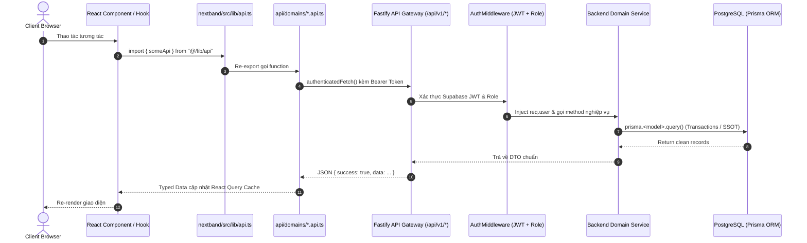

# BẢN ĐỒ HỆ THỐNG — NEXTBAND IELTS LMS (SYSTEM MAP)

> **Cập nhật:** 16 tháng 10, 2026  
> **Trạng thái:** Đã xác minh qua khảo sát source code thực tế.  
> **Nguyên tắc:** Ghi nhận hiện trạng thực tế đang chạy, không ghi nhận các mong muốn lý thuyết.

---

## 1. CÁC ENTRY POINTS CHÍNH

### 1.1. Frontend SPA
- **Root Entry:** [`nextband/src/main.tsx`](file:///d:/handover/ielts/nextband/src/main.tsx) — Khởi tạo React 18, React Query Client Provider, Toaster, và Auth Context.
- **Routing Engine:** [`nextband/src/App.tsx`](file:///d:/handover/ielts/nextband/src/App.tsx) — Định tuyến tập trung toàn bộ hệ thống qua 4 Layouts:
  - `PublicLayout`: Trang chủ (`/`), kiểm tra đầu vào (`/assessment`), học liệu mở (`/reading-universe`, `/reading-case/:caseId`, `/english-idioms`, `/vocab-c1`, `/speaking-forecast`).
  - `ClientLayout`: Không gian học tập của học viên chính thức (`/my-courses`, `/courses/:id`, `/my-submissions`, `/exams/:id/take`, `/student-analytics`).
  - `AdminLayout`: Bàn làm việc của giáo viên & quản trị viên (`/admin/dashboard`, `/admin/classes`, `/admin/classes/:id/workspace`, `/admin/submissions/:id/grade`, `/admin/teacher-workspace`, `/admin/academic-intelligence/*`).
  - `MinimalLayout`: Phòng đấu đối kháng tương tác thời gian thực (`/arena/host/:pin`, `/arena/play/:pin`).

### 1.2. Backend Fastify API Gateway
- **Server Entry:** [`server/server.ts`](file:///d:/handover/ielts/server/server.ts) — Khởi tạo Fastify instance, nạp cấu hình môi trường từ [`server/config/env.ts`](file:///d:/handover/ielts/server/config/env.ts), đăng ký plugins (CORS, JWT, RateLimit, Prisma) và đăng ký route registry tại [`server/routes/index.ts`](file:///d:/handover/ielts/server/routes/index.ts).
- **Serverless Production Entry:** [`api/index.js`](file:///d:/handover/ielts/api/index.js) (và bản sao đồng bộ [`nextband/api/index.js`](file:///d:/handover/ielts/nextband/api/index.js)) — Được đóng gói tự động qua [`scripts/bundle-api.mjs`](file:///d:/handover/ielts/scripts/bundle-api.mjs) thành một standalone serverless bundle chạy trên Vercel Serverless Function.

---

## 2. CÁC DOMAIN NGHIỆP VỤ (BUSINESS DOMAINS)

1. **Quản lý học viên & Lớp học (Class Operations & Student Lifecycle):**
   - Backend: [`server/services/class.service.ts`](file:///d:/handover/ielts/server/services/class.service.ts), `class-attendance.routes.ts`, `attendance.service.ts`.
   - Frontend: `nextband/src/pages/admin/ClassWorkspace/`, `nextband/src/lib/classContext.ts`.
2. **Khảo thí & Chấm thi IELTS (Examination & Canonical Scoring):**
   - Backend: `server/services/scoring/` (`ieltsCanonicalEngine.ts`, `ieltsWritingGrader.ts`), `exam.service.ts`, `submission.service.ts`.
   - Frontend: `nextband/src/pages/ExamInterface.tsx`, `nextband/src/pages/admin/SubmissionGrade.tsx`.
3. **Phòng thi đối kháng trực tiếp (Game Arena):**
   - Backend: `server/services/arena.service.ts`, `server/routes/arena.routes.ts`.
   - Frontend: `nextband/src/pages/arena/ArenaHostPage.tsx`, `ArenaPlayPage.tsx`, sử dụng Supabase Realtime Channels.
4. **Học liệu tự học tương tác (Public Self-Study Hubs):**
   - *Reading Challenge:* [`nextband/src/features/reading-challenge/`](file:///d:/handover/ielts/nextband/src/features/reading-challenge/).
   - *Reading Case Autopsy:* [`nextband/src/pages/public/reading/ReadingCasePage.tsx`](file:///d:/handover/ielts/nextband/src/pages/public/reading/ReadingCasePage.tsx).
   - *English Idioms Catalog:* [`nextband/src/pages/public/reading/EnglishIdiomsHubPage.tsx`](file:///d:/handover/ielts/nextband/src/pages/public/reading/EnglishIdiomsHubPage.tsx).
   - *Vocabulary C1:* [`nextband/src/pages/public/vocab-c1/VocabC1Page.tsx`](file:///d:/handover/ielts/nextband/src/pages/public/vocab-c1/VocabC1Page.tsx).
   - *Speaking Forecast:* [`nextband/src/lib/api/domains/speaking-forecast.api.ts`](file:///d:/handover/ielts/nextband/src/lib/api/domains/speaking-forecast.api.ts).
5. **Giám sát & Đánh giá học thuật (Academic Intelligence & Radar):**
   - Backend: `server/services/academicIntelligence.service.ts`, `server/services/studentRisk.service.ts`.
   - Frontend: `nextband/src/pages/admin/AcademicIntelligenceDashboard.tsx`, `EvidenceExplorerPage.tsx`.

---

## 3. LUỒNG REQUEST VÀ DATA FLOW

---

## 4. CÁC MODULE DÙNG CHUNG (SHARED CORE)

1. **Network Primitives:** [`nextband/src/lib/api/client.ts`](file:///d:/handover/ielts/nextband/src/lib/api/client.ts) — Cung cấp `API_BASE_URL`, `getAuthToken()`, `authenticatedFetch()`, `fetchWithResilience()`, `ApiError`.
2. **API Facade:** [`nextband/src/lib/api.ts`](file:///d:/handover/ielts/nextband/src/lib/api.ts) — Điểm truy cập tương thích ngược duy nhất cho toàn bộ Frontend components.
3. **Database Client:** [`server/plugins/prisma.ts`](file:///d:/handover/ielts/server/plugins/prisma.ts) — Đăng ký PrismaClient singleton dùng chung toàn backend.
4. **Auth Middleware:** [`server/middlewares/auth.middleware.ts`](file:///d:/handover/ielts/server/middlewares/auth.middleware.ts) — Xác thực JWT và đồng bộ UserRole từ database SSOT.

---

## 5. DATABASE, STORAGE VÀ DỊCH VỤ NGOÀI

- **Database:** PostgreSQL trên Supabase Cloud, cấu hình bảng qua [`prisma/schema.prisma`](file:///d:/handover/ielts/prisma/schema.prisma) (66 models).
- **Storage:** Supabase Storage S3 Buckets:
  - `audio-submissions`: File thu âm Speaking & bài nộp học viên.
  - `evidence-artifacts`: Chứng chỉ, bảng điểm vinh danh.
- **External Realtime:** Supabase WebSockets dùng cho kênh broadcast của phòng Arena và Notification.

---

## 6. CÁC PHẦN CHƯA ĐƯỢC XÁC MINH (UNVERIFIED / GAP)

1. **Vercel Edge Gateway Production Headers:** Hành vi chuyển hướng x-forwarded-uri khi rewrite routing trên Vercel production đối với các route đặc biệt.
2. **Khả năng chịu tải đồng thời của Cron Scheduler:** `server/services/classScheduler.ts` chạy chu kỳ quét 24h đối với lớp học trong môi trường Serverless function (cần cron job kích hoạt ngoài từ Vercel Cron).
