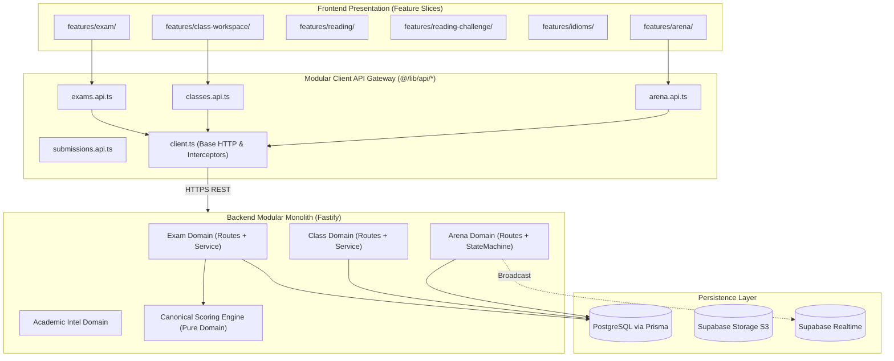

# KIẾN TRÚC MỤC TIÊU — NEXTBAND LMS (TARGET ARCHITECTURE SPECIFICATION)

> **Ngày phê duyệt đề xuất:** 16 tháng 10, 2026  
> **Kiến trúc sư trưởng:** Principal Software Architect  
> **Phong cách kiến trúc:** Modular Monolith theo định hướng Domain-Driven Design (DDD)  
> **Chiến lược tiếp cận:** Chuyển đổi gia tăng từng bước nhỏ (*Incremental Refactoring*), **tuyệt đối không viết lại toàn bộ (*No Big-Bang Rewrite*)**.

---

## 1. NGUYÊN TẮC THIẾT KẾ & BẤT BIẾN KIẾN TRÚC (ARCHITECTURAL INVARIANTS)

Hệ thống NextBand sẽ duy trì mô hình **Modular Monolith**, nơi mã nguồn vẫn nằm trong cùng một repository nhưng các domain nghiệp vụ được phân tách rõ ràng về ranh giới dữ liệu, luồng điều khiển và hợp đồng giao tiếp (Contracts).



### 4 Bất biến Kiến trúc Cốt lõi (Non-Negotiable Invariants)

1. **Sole Authority Invariant (Thẩm quyền Chấm điểm Duy nhất):**
   - Fastify Backend là nơi duy nhất giữ đáp án gốc (*Answer Key*) và tính toán điểm số (*Score, Band Score*).
   - Frontend không bao giờ tự tính điểm để gửi lên Server lưu trữ.
2. **Single Channel API Invariant (Một Kênh Dữ liệu Duy nhất):**
   - 100% truy vấn dữ liệu từ Frontend UI phải đi qua REST API Gateway (`@/lib/api/*`).
   - Tuyệt đối cấm Frontend gọi trực tiếp `supabase.from(...)` hoặc `supabase.rpc(...)` để đọc/ghi database (được bảo vệ tự động bởi `sanity_check.mjs` Gate 5).
3. **Realtime Broadcast Only Invariant:**
   - Supabase Realtime Channels (`supabase.channel(...)`) chỉ dùng duy nhất cho mục đích truyền phát sự kiện tức thời (như nhịp nhảy câu hỏi trong Arena, chuông thông báo trực tiếp).
   - Mọi thao tác ghi/đổi trạng thái bắt buộc phải qua HTTP POST/PUT của Fastify.
4. **Feature Slice Encapsulation Invariant:**
   - Mỗi tính năng người dùng phức tạp phải tự đóng gói: Trang (`pages/`), Giao diện (`components/`), Hooks (`hooks/`), Kiểu dữ liệu (`types/`), và Dữ liệu đặc thù (`data/`).

---

## 2. PHÂN TÁCH DANH MỤC: GIỮ NGUYÊN VS. CHIA NHỎ

| Module / Thành phần hiện tại | Quyết định Kiến trúc | Lý do & Căn cứ kỹ thuật |
| :--- | :---: | :--- |
| **`server/services/scoring/`** | **GIỮ NGUYÊN 100%** | Thiết kế cực kỳ mẫu mực: pure functions, không phụ thuộc framework, 80 bộ golden fixtures kiểm thử vi phân đạt độ tin cậy 100%. |
| **`server/middlewares/auth.middleware.ts`** | **GIỮ NGUYÊN 100%** | Xác thực bất đối xứng ES256/RS256 qua Supabase JWKS, bộ nhớ đệm TTL 60s, ngăn chặn triệt để giả mạo quyền từ `user_metadata`. |
| **`ClassWorkspace/` (Frontend)** | **GIỮ NGUYÊN CẤU TRÚC** | Đã phân chia rất tốt (`WorkspaceProvider`, `components/`, `features/attendance/`, `tabs/`). |
| **`scripts/sanity_check.mjs` (7 Gates)** | **GIỮ NGUYÊN & MỞ RỘNG** | Công cụ chốt chặn kiến trúc tự động hiệu quả nhất của dự án. |
| **`nextband/src/lib/api.ts` (6,153 lines)** | **CHIA NHỎ TỪNG BƯỚC** | Điểm nghẽn gây xung đột git, bán kính ảnh hưởng lớn (126 consumers). Cần chuyển thành `@/lib/api/<domain>.api.ts`. |
| **`nextband/src/features/reading/`** | **TẬP TRUNG HÓA & CODE-SPLIT** | Kéo `ReadingCasePage.tsx` từ `pages/public/reading/` về đúng feature slice. Chuyển 15 file từ điển tĩnh sang tải lười (*Dynamic Import*). |
| **`EnglishIdiomsHubPage.tsx` (2,179 lines)** | **TÁCH COMPONENT CON** | Tách audio controller, flashcard deck, 5 mini-exercise renderers ra khỏi file trang chính. |
| **`server/services/class.service.ts` (1,902 lines)** | **PHÂN RÃ SUB-SERVICES** | Tách riêng các trách nhiệm phụ: `class-enrollment.service.ts`, `class-progress-sync.service.ts`. |
| **`examSkillHelper.ts` (Song trùng logic)** | **HỢP NHẤT SSOT** | Đang bị copy-paste regex tại cả frontend và backend. Cần chuẩn hóa logic trả về từ Backend API. |

---

## 3. THIẾT KẾ CẢI TIẾN TRỌNG TÂM 1: PHÂN RÃ `nextband/src/lib/api.ts`

Thay vì một file khổng lồ 6,153 dòng, cấu trúc đích của `@/lib/api/` sẽ là một thư mục mô-đun:

```
nextband/src/lib/api/
├── client.ts                 # Base fetch wrapper, error handling, baseUrl, auth headers
├── index.ts                  # Re-export toản bộ domain APIs (Bảo toàn 100% tương thích ngược)
├── domains/
│   ├── auth.api.ts           # authApi
│   ├── classes.api.ts        # classesApi, classStudentsApi, sessionsApi
│   ├── courses.api.ts        # coursesApi, lessonsApi
│   ├── exams.api.ts          # examsApi, sectionsApi, questionsApi
│   ├── submissions.api.ts    # submissionsApi
│   ├── arena.api.ts          # arenaApi
│   ├── assessment.api.ts     # assessmentApi, assessmentAdminApi, cambridgeApi
│   ├── faculty.api.ts        # facultyApi
│   ├── evidence.api.ts       # evidenceApi
│   ├── intelligence.api.ts   # academicIntelligenceApi, radarApi
│   └── operations.api.ts     # branchesApi, roomsApi, tuitionApi, leadsApi...
```

### Chiến lược Tương thích Ngược Tuyệt đối (Zero-Breaking Change)
Tại `nextband/src/lib/api/index.ts` (hoặc giữ file `nextband/src/lib/api.ts` làm facade):
```typescript
// Re-export mọi API để 126 consumer files hiện tại KHÔNG CẦN sửa import
export * from "./domains/auth.api";
export * from "./domains/classes.api";
export * from "./domains/exams.api";
export * from "./domains/submissions.api";
export * from "./domains/arena.api";
export * from "./domains/faculty.api";
export * from "./domains/evidence.api";
// ...
```
> **Lợi ích:** Có thể tách từng domain một mà không gây gãy bất kỳ dòng code nào trên toàn bộ 126 trang/component đang sử dụng!

---

## 4. THIẾT KẾ CẢI TIẾN TRỌNG TÂM 2: CODE-SPLIT TỪ ĐIỂN READING CASE

### Vấn đề hiện tại:
File `readingDictionary.ts` import tĩnh cả 15 dictionaries:
```typescript
// HIỆN TẠI (Gây phình bundle 1.45 MB):
import { CASE_001_DICTIONARY } from "./case001Dictionary";
// ...
import { CASE_015_DICTIONARY } from "./case015Dictionary";
```

### Thiết kế đích (Tải lười theo bài học - Dynamic On-Demand Loading):
```typescript
// TARGET ARCHITECTURE:
const DICTIONARY_LOADERS: Record<string, () => Promise<{ [key: string]: VocabularyTerm }>> = {
  "case-001": () => import("./case001Dictionary").then(m => m.CASE_001_DICTIONARY),
  "case-002": () => import("./case002Dictionary").then(m => m.CASE_002_DICTIONARY),
  // ...
  "case-015": () => import("./case015Dictionary").then(m => m.CASE_015_DICTIONARY),
};

export async function loadCaseDictionary(caseId: string): Promise<Record<string, VocabularyTerm>> {
  const loader = DICTIONARY_LOADERS[caseId];
  if (!loader) return {};
  return await loader();
}
```
> **Lợi ích thực tế:**
> - Kích thước bundle của trang `ReadingCasePage.js` giảm ngay lập tức từ **1,452 kB $\longrightarrow$ ~180 kB** (giảm hơn 87%).
> - Mỗi bài học Case chỉ tải đúng file từ điển của bài đó khi học viên mở bài.

---

## 5. VÍ DỤ CẤU TRÚC THƯ MỤC MẪU CHO DOMAIN HOÀN CHỈNH

### Ví dụ: Domain Reading (`nextband/src/features/reading/`)

```
nextband/src/features/reading/
├── index.ts                      # Public API của feature slice
├── pages/
│   ├── ReadingUniversePage.tsx   # Di chuyển từ pages/public/reading/
│   └── ReadingCasePage.tsx       # Di chuyển từ pages/public/reading/
├── components/
│   ├── CaseAutopsyView.tsx
│   ├── CrimeSceneBlueprint.tsx
│   ├── ReadlangExplorationSidebar.tsx
│   └── WritingDebateChamber.tsx
├── hooks/
│   ├── useCaseReader.ts
│   └── useWordLookup.ts
├── services/
│   ├── dynamicDictionaryLoader.ts # Tải lười từng Case Dictionary
│   ├── humanizationEngine.ts      # Pure business logic sư phạm
│   └── semanticValidator.ts
├── data/
│   ├── case001Dictionary.ts       # Dữ liệu tĩnh chia nhỏ
│   └── ...
└── types/
    └── index.ts
```

---

## 6. NHỮNG THAY ĐỔI CHƯA ĐÁNG LÀM (WHAT NOT TO DO)

1. **Không chuyển sang Microservices:**
   - Lưu lượng hiện tại hoàn toàn nằm trong khả năng đáp ứng của Fastify (với throughput hàng chục ngàn req/s). Chuyển sang microservices sẽ gây phức tạp hóa hạ tầng, độ trễ mạng liên dịch vụ, và khó kiểm soát transaction.
2. **Không viết lại tầng Database:**
   - PostgreSQL và 66 Prisma models hiện tại đang phản ánh rất chính xác nghiệp vụ thực tế.
3. **Không áp dụng Repository Pattern máy móc cho toàn bộ 41 services:**
   - Chỉ áp dụng repository cho các domain có logic truy vấn phức tạp hoặc cần mock nhiều khi test (như `submission`, `class`, `speaking-evidence`). Các bảng cấu hình đơn giản (`site-settings`, `branch`) hoàn toàn có thể dùng Prisma inline trong service để giữ code ngắn gọn, dễ đọc.
