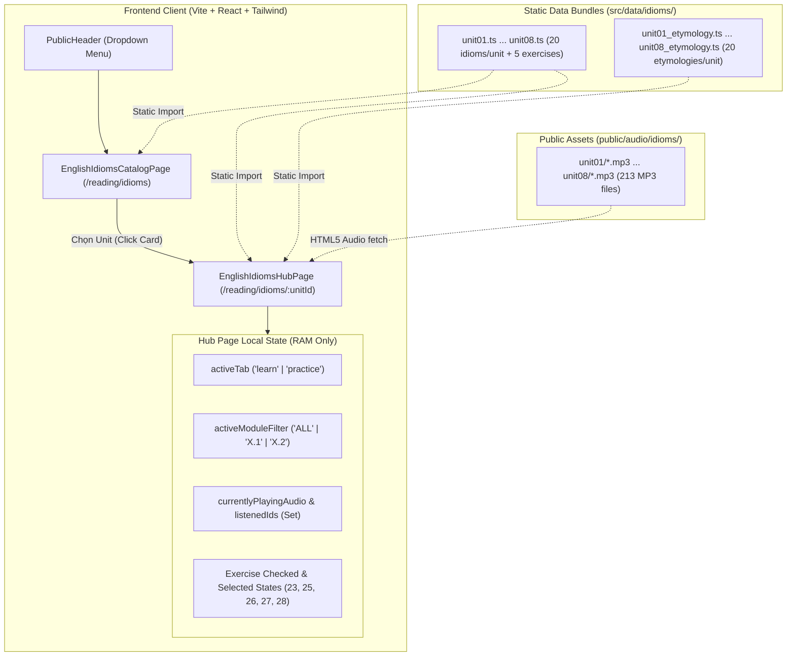

# PHASE 0 — PRODUCT DISCOVERY & LEARNING EXPERIENCE AUDIT
## Project: English for Everyone: English Idioms — Digital Learning Product
**Mã tài liệu:** `DOCS-AUDIT-IDIOMS-2026-10-17`  
**Ngày thực hiện:** 17/10/2026  
**Đơn vị thực hiện:** Nhóm Chuyên gia Độc lập (Technical Architect, UI/UX Auditor, Learning Experience Designer, Applied Linguist, Learning Scientist, Educational Visual Designer, QA Analyst)  
**Phạm vi khảo sát:** Module English Idioms Master (NextBand LMS / ARIS IELTS)  
**Mục tiêu:** Cung cấp bằng chứng thực nghiệm độc lập về hiện trạng kỹ thuật, nội dung, giao diện và hiệu quả sư phạm của sản phẩm số hóa thành ngữ tiếng Anh, từ đó xác lập lộ trình cải tiến có giá trị cao nhất mà không cần viết lại ứng dụng.

---

## 1. Executive Summary (Tóm tắt Điều hành)

Sản phẩm số hóa **English Idioms Master** (dựa trên giáo trình *DK English for Everyone: English Idioms*) tại phân hệ `/reading/idioms` đã hoàn thành số hóa **08/08 Units đầu tiên** (thuộc toàn bộ Đại phân khu *Describing People and Things*), bao gồm **160 thành ngữ cốt lõi**, **41 bài tập tương tác** và **213 tệp audio MP3 bản ngữ chất lượng cao** (chia làm hai giọng chuẩn Anh UK và Mỹ US theo đúng sách gốc).

### Những phát hiện then chốt:
1. **Nội dung học thuật và từ nguyên học đạt độ sâu hiếm thấy:** Điểm sáng lớn nhất của sản phẩm là hệ thống 160 bản ghi nghiên cứu từ nguyên học (`unitXX_etymology.ts`) phân loại theo 3 cấp độ OED (*Documented Origin*, *Plausible Image/Meaning Connection*, *Origin Uncertain*) kèm trích dẫn văn học (Shakespeare, Aesop, Homer, Dickens, King James Bible...). Đây là giá trị gia tăng vượt trội so với bản in gốc.
2. **Sản phẩm đang ở dạng "Tài liệu số hóa tương tác", chưa đạt tầm "Sản phẩm học tập chuyển đổi":**
   - **Hoàn toàn không lưu trữ tiến độ (Zero Persistence):** Toàn bộ trạng thái nghe audio, kết quả chấm điểm bài tập (5 bài/unit) và câu trả lời đều chỉ lưu trong React local component state. Chỉ cần F5 hoặc chuyển Unit là mọi nỗ lực của học viên bị xóa sạch.
   - **Học thụ động (Passive Reading Bias):** Mở thẻ thành ngữ ra là phơi bày toàn bộ định nghĩa, tiếng Việt, mẹo IELTS. Người học không có bất kỳ cơ chế truy hồi chủ động (*Active Recall*) hay lật mở dạng Flashcard nào.
   - **Khoảng trống thị giác (The Visual Void):** Mặc dù giáo trình gốc DK English for Everyone nổi tiếng toàn cầu nhờ triết lý *Visual Learning* (học qua hình ảnh vector minh họa), phiên bản số hóa trên web hiện tại là **100% Text và Audio**, chưa có bất kỳ hình ảnh minh họa ẩn dụ nào được đưa lên giao diện.
3. **Cấu trúc kỹ thuật có nguy cơ phình to (Monolithic Component Risk):**
   - File `EnglishIdiomsHubPage.tsx` hiện dài **2,335 dòng mã**, gánh trọn vẹn toàn bộ logic routing, audio player, drawer accordion, state chấm điểm của 8 units.
   - Tồn tại sự không nhất quán dữ liệu (Schema Inconsistency) giữa các Units: Unit 4 và 5 dùng `unit_number` thay vì `unit_id`, thiếu `page_range`, và Unit 1 đến 5 chưa có trường phiên âm IPA `phonetic`.

---

## 2. Product Inventory (Kiểm kê Sản phẩm Thực tế)

### 2.1. Bản đồ Tuyến đường (Routes & Pages)
| Tuyến đường (Route) | File Component | Trạng thái | Chức năng chính |
| :--- | :--- | :--- | :--- |
| `/reading/idioms` | `EnglishIdiomsCatalogPage.tsx` | Đã xác nhận (Confirmed) | Danh mục chọn Unit, tìm kiếm, thống kê toàn khóa (8 Units, 160 Idioms, 40 Exercises), danh sách Upcoming Units (Unit 9-13). |
| `/reading/idioms/:unitId` | `EnglishIdiomsHubPage.tsx` | Đã xác nhận (Confirmed) | Trang học chi tiết từng Unit (Unit 1 đến 8). Gồm 2 tab: *Học Thành Ngữ* (20 cards) và *Bài Tập Thực Hành* (5 bài tập chấm điểm). |
| Header Navigation | `PublicHeader.tsx` | Đã xác nhận (Confirmed) | Mục dropdown menu Reading có badge "Units 1-8" dẫn trực tiếp tới `/reading/idioms`. |

### 2.2. Kiểm kê Nội dung & Dữ liệu 8 Units đã số hóa
Toàn bộ 8 Units đã được biên soạn và kiểm chứng 100% trong `nextband/src/data/idioms/`:

| Unit | Tiêu đề Sách gốc (DK) | Chủ đề tiếng Việt | Số Idiom | Số Bài tập | Phiên âm IPA | Accent | Audio MP3 |
| :---: | :--- | :--- | :---: | :---: | :---: | :---: | :---: |
| **01** | Age | Tuổi tác & Giai đoạn cuộc đời | 20 | 6 | Chưa có | US (Mỹ) | 26 files |
| **02** | Friends and family | Tình bạn & Mối quan hệ gia đình | 20 | 5 | Chưa có | US (Mỹ) | 28 files |
| **03** | Appearance and background | Diện mạo & Xuất thân xã hội | 20 | 5 | Chưa có | US (Mỹ) | 27 files |
| **04** | Personality traits | Tính cách qua lăng kính ẩn dụ | 20 | 5 | Chưa có | US (Mỹ) | 28 files |
| **05** | Good things | Xuất sắc, may mắn & Đỉnh cao | 20 | 5 | Chưa có | US (Mỹ) | 26 files |
| **06** | Bad things | Thất vọng, tồi tàn & Giọt nước tràn ly | 20 | 5 | **Có IPA** | UK (Anh) | 26 files |
| **07** | Animals | Thế giới động vật & Ẩn dụ ngụ ngôn | 20 | 5 | **Có IPA** | UK (Anh) | 26 files |
| **08** | Food | Ẩm thực, bếp núc & Ẩn dụ đời sống | 20 | 5 | **Có IPA** | US (Mỹ) | 26 files |
| **TỔNG** | **8 Units** | **Describing People and Things** | **160** | **41** | **3/8 Units** | **US/UK** | **213 files** |

---

## 3. Technical & Data Map (Kiến trúc Kỹ thuật & Luồng Dữ liệu)



### 3.1. Đánh giá Cấu trúc Kỹ thuật (Technical Architect Review)
- **Kiến trúc dữ liệu:** Hoàn toàn là Static In-Memory Typescript Modules. Không phụ thuộc vào Supabase, Prisma hay REST API của server. Ưu điểm là tốc độ load tức thì (zero latency), offline-friendly. Nhược điểm là bundle frontend tăng kích thước khi số lượng Unit tăng lên (hiện tại 8 units chiếm ~350KB code TS).
- **Điểm nghẽn kiến trúc (Architectural Bottleneck):**
  - Component `EnglishIdiomsHubPage.tsx` vi phạm nguyên lý Single Responsibility Principle (SRP). Nó vừa quản lý Audio Player, vừa parse filter/search, vừa render danh sách thẻ học, vừa render 2 loại drawer (IELTS tip + Etymology), vừa chứa 5 bộ state logic bài tập.
  - Xử lý Unit 1 bất đối xứng: Unit 1 dùng bộ handler và JSX riêng biệt (`ex13`, `ex14`, `ex15`, `ex16`, `ex17`, `ex18` chiếm 600 dòng code), trong khi Unit 2 đến 8 dùng chung bộ handler tổng quát (`ex23`, `ex25`, `ex26`, `ex27`, `ex28`).

### 3.2. Đánh giá Cấu trúc Dữ liệu (Data Consistency Review)
Qua phân tích AST tự động trên 8 file dữ liệu:
1. **Lệch khóa định danh (Key Mismatch):**
   - Unit 1, 2, 3, 6, 7, 8: `{ unit_id: number, page_range: { ... } }`
   - Unit 4, 5: `{ unit_number: number }` (thiếu `unit_id` và không có `page_range`).
2. **Thiếu phiên âm IPA (`phonetic`):**
   - Unit 1, 2, 3, 4, 5: Hoàn toàn thiếu trường `phonetic` trong `IdiomItem`.
   - Unit 6, 7, 8: Đã được trang bị trường `phonetic` chuẩn xác (ví dụ: `/ə ˈskeə.di.kæt/`, `/kraɪ wʊlf/`).
3. **Cấu trúc IELTS Application:**
   - Unit 1-3 và 6-8: `{ ielts_application: { band_score, context_fit, sample_response } }`.
   - Unit 4-5: `{ vietnamese: { meaning, usage_notes, ielts_speaking_tip }, usage_pattern, register, tone }`.

---

## 4. UI/UX Audit (Đánh giá Giao diện & Trải nghiệm Người dùng)

### 4.1. Điểm mạnh (Strengths)
1. **Thiết kế màu sắc trang nhã, đúng chất Academic:** Sử dụng gam màu nền kem `#FAF7F2`, viền be nhẹ `#EAE3D9` và màu chữ than trầm `#2D2825`, kết hợp sắc xanh thương hiệu `#002147` mang lại cảm giác dễ chịu, không gây mỏi mắt khi đọc lâu.
2. **Tô sáng từ khóa thông minh (Context Highlighting):** Hàm `renderHighlightedSentence` tự động bóc tách từ khóa idiom trong câu ví dụ ngữ cảnh và bọc vào thẻ `<mark className="bg-purple-100 text-purple-900">`, giúp mắt người học tập trung ngay vào vị trí thành ngữ vận hành trong câu.
3. **Thanh điều hướng chuyển Unit thuận tiện:** Nút bấm `← Chọn Unit khác`, nhảy nhanh `← Unit 0X` và `Unit 0Y →` giúp người học không bị kẹt trong một bài học.

### 4.2. Điểm yếu & Vấn đề Cụ thể (Weaknesses & UX Friction)
| Vấn đề UX | Phân loại | Bằng chứng Code / Giao diện | Tác động đối với người học |
| :--- | :---: | :--- | :--- |
| **Quá tải nhận thức (Cognitive Overload)** | Confirmed | Thẻ idiom hiển thị đồng thời Headword, IPA, Audio, Context, Vietnamese Meaning. Khi mở cả 2 Drawer (IELTS + Etymology), chiều dài một thẻ vượt quá 1 màn hình điện thoại. | Học viên bị "ngợp" trước khối lượng văn bản dày đặc; không biết nên tập trung học điều gì trước. |
| **Mất sạch kết quả làm bài khi chuyển tab** | Confirmed | `checked23`, `answers25`, `selected26`... là state local trong `EnglishIdiomsHubPage.tsx` (dòng 82-105). Khi click sang tab "Học Thành Ngữ" rồi quay lại, toàn bộ bài làm biến mất. | Gây ức chế tâm lý cực lớn; học viên cảm thấy công sức làm bài không được hệ thống ghi nhận. |
| **Thiếu trạng thái lưu/đánh dấu (Bookmark/Favorite)** | Confirmed | Không có nút icon Star / Bookmark trên thẻ idiom. | Trong 20 idiom của 1 Unit, học viên thường chỉ quên 3-4 cụm từ nhưng không thể lọc riêng các từ này để ôn lại. |
| **Không có thanh tiến độ (Progress Indicator)** | Confirmed | Catalog Page chỉ hiển thị số liệu tĩnh (160 Idioms, 40 Bài tập). Không hiển thị card nào "Đã hoàn thành", "Đang học dở" hay "Chưa học". | Người học mất phương hướng, không biết mình đang ở đâu trong hành trình học. |
| **Trải nghiệm gõ phím bài tập điền từ còn cứng nhắc** | Confirmed | Exercise 2.5 / 8.5 so sánh string chính xác với `q.accepted_answers` (chỉ loại bỏ dấu chấm câu). | Học viên gõ đúng idiom nhưng vô tình gõ thừa một khoảng trắng kép hoặc viết hoa khác biệt có thể bị chấm Sai. |

---

## 5. Learning Experience Audit (Đánh giá Trải nghiệm Học & Khoa học Nhận thức)

### 5.1. Mô hình Phân tích Khoa học Học tập (Learning Science Framework)

```
        MÔ HÌNH HỌC TẬP THÀNH NGỮ CHUYỂN ĐỔI (TARGET)
┌────────────────────────────────────────────────────────┐
│ 1. KÍCH HOẠT THỊ GIÁC & ẨN DỤ (Visual Dual Coding)     │ -> Nhìn hình ảnh minh họa gốc & liên tưởng
│ 2. TRUY HỒI CHỦ ĐỘNG (Active Retrieval / Flashcard)     │ -> Tự đoán nghĩa trước khi mở đáp án
│ 3. HIỂU SÂU BẢN CHẤT (Deep Etymology & Context)        │ -> Đọc từ nguyên học & phân tích OED
│ 4. THỰC HÀNH VẬN DỤNG (Varied Context Retrieval)       │ -> Làm 5 bài tập ngữ cảnh & tình huống
│ 5. LẶP LẠI NGẮT QUÃNG & LƯU TIẾN ĐỘ (SRS & Mastery)    │ -> Lưu từ khó, nhắc ôn tập ngắt quãng
└────────────────────────────────────────────────────────┘

              HIỆN TRẠNG SẢN PHẨM (AS-IS)
┌────────────────────────────────────────────────────────┐
│ [THIẾU]   1. Không có hình ảnh minh họa thị giác       │
│ [THIẾU]   2. Không có cơ chế ẩn nghĩa / Flashcard      │
│ [XUẤT SẮC] 3. Từ nguyên học OED & IELTS Tip cực kỳ sâu  │
│ [RẤT TỐT] 4. Hệ thống 5 bài tập tương tác chuẩn mực   │
│ [THIẾU]   5. Zero Persistence (mất sạch khi F5)        │
└────────────────────────────────────────────────────────┘
```

### 5.2. Đánh giá Chi tiết từ góc nhìn Chuyên gia

#### A. Applied Linguist (Ngôn ngữ học Ứng dụng)
- **Điểm xuất sắc:** Việc đưa mục *Từ nguyên học (Etymology)* vào từng thành ngữ là một đột phá phương pháp luận. Thay vì bắt học viên học vẹt những cụm từ phi logic như *"eat humble pie"*, *"not enough room to swing a cat"*, hay *"cry wolf"*, hệ thống giải thích cơ chế chuyển dịch nghĩa từ ẩm thực Trung Cổ, ngọn roi hải quân Anh và truyện ngụ ngôn Aesop. Điều này kích hoạt cơ chế gán nhãn ngữ nghĩa (*Semantic Anchoring*).
- **Khoảng trống ngôn ngữ:**
  - Chưa làm rõ mức độ trang trọng (*Register*): Cần phân biệt rõ cụm từ nào là tiếng lóng thân mật chỉ dùng trong Speaking Part 1/2 (như *scaredy-cat*, *couch potato*), cụm từ nào tuyệt đối KHÔNG dùng trong bài thi Viết học thuật Academic Writing Task 2.
  - Thiếu mục *Collocation & Common Errors*: Ví dụ học viên hay nhầm lẫn giữa *cry over spilled milk* với *crying for spilled milk*, hoặc *bark up the wrong tree* thành *bark at the wrong tree*.

#### B. Learning Scientist (Khoa học Học tập & Trí nhớ)
- **Hiệu ứng Nhận biết Ảo giác (Illusion of Competence):** Khi học viên đọc một thẻ thành ngữ đã có sẵn cả tiếng Anh lẫn tiếng Việt, não bộ rơi vào bẫy "Tôi hiểu rồi" vì thấy thông tin hợp lý. Nhưng khi bước vào phòng thi IELTS, não không thể tự truy xuất (*recall*) được cụm từ đó vì trong lúc học không hề có bước thực hành truy hồi (*retrieval practice*).
- **Cơ chế cần bổ sung ngay:** Tính năng **Blur-to-Reveal (Ẩn nghĩa để đoán)** hoặc **Flashcard Flip Mode**. Người học phải buộc não mình lục lọi trí nhớ để định nghĩa cụm từ trước khi chạm vào màn hình để lật mở đáp án.

---

## 6. Visual & Multimedia Audit (Đánh giá Hình ảnh & Đa phương tiện)

1. **Âm thanh (Audio):** 
   - **Đánh giá: 10/10.** Hệ thống sở hữu trọn vẹn 213 file audio MP3 gốc chuẩn phòng thu của DK Publishing. Giọng đọc người bản xứ truyền cảm, phát âm rõ ràng, không có tạp âm.
   - Trình phát audio hoạt động ổn định, mượt mà trên cả desktop và mobile.
2. **Hình ảnh (Visuals):**
   - **Đánh giá: 2/10.** Điểm yếu lớn nhất của sản phẩm. Cuốn sách gốc *DK English Idioms* thành công vang dội trên thị trường xuất bản thế giới là nhờ hệ thống hình ảnh minh họa trực quan dí dỏm giúp kích hoạt *Dual Coding Theory* (Mã hóa kép: Kết hợp hình ảnh và ngôn từ giúp tăng khả năng ghi nhớ gấp 3 lần).
   - Hiện tại, giao diện web NextBand hoàn toàn vắng bóng hình ảnh minh họa cho 160 thành ngữ này. Thẻ học chỉ bao gồm text thuần túy và một số icon Lucide nhỏ (`<Sparkles>`, `<Volume2>`, `<Lightbulb>`).

---

## 7. Risks & Constraints (Rủi ro & Ràng buộc Kỹ thuật)

| Rủi ro / Ràng buộc | Mức độ | Bản chất vấn đề | Giải pháp giảm thiểu |
| :--- | :---: | :--- | :--- |
| **Mất dữ liệu phiên học (Session Loss)** | **CAO** | Toàn bộ tiến độ học và kết quả bài tập nằm trong RAM React State; refresh trang là mất. | Triển khai ngay `localStorage` caching key `nextband_idioms_progress_v1`. |
| **Phình to Bundle Size (Monolithic Bundle)** | **TRUNG BÌNH** | Toàn bộ 8 Unit TS files được import statically vào `EnglishIdiomsHubPage.tsx` và `EnglishIdiomsCatalogPage.tsx`. Khi tăng lên Unit 20, bundle sẽ nặng >1.5MB text. | Tách mapping dynamic `import()` theo từng Unit khi người học truy cập tuyến `/reading/idioms/:unitId`. |
| **Rủi ro hồi quy UI (Regression Risk)** | **TRUNG BÌNH** | File `EnglishIdiomsHubPage.tsx` dài 2,335 dòng; việc sửa một chi tiết bài tập có thể vô tình làm hỏng các bài tập của các Unit khác. | Phải chạy `npm run typecheck` và `sanity_check.mjs` trước mọi lần commit. |
| **Bản quyền sở hữu trí tuệ (IP & Copyright)** | **CẦN LƯU Ý** | Tái sử dụng audio và bài tập nguyên bản từ sách của DK Publishing. Phục vụ cho học viên nội bộ hệ thống LMS thì an toàn, nhưng nếu thương mại hóa công khai cần ghi chú dẫn nguồn rõ ràng (*Educational Fair Use attribution*). | Duy trì đầy đủ trích dẫn bản quyền của DK Publishing trên trang catalog và chân trang. |

---

## 8. Improvement Backlog (Top 10 Đề xuất Cải tiến có Giá trị Cao nhất)

Dưới đây là 10 đề xuất cải tiến được sắp xếp theo mức độ tác động sư phạm và tính khả thi:

### 1. [P0] Lưu trữ Tiến độ Học tập & Làm bài bằng LocalStorage
- **Vấn đề & Bằng chứng:** F5 hoặc chuyển Unit là mất sạch danh sách idiom đã nghe và kết quả 5 bài tập (`EnglishIdiomsHubPage.tsx:50, 82-105`).
- **Đề xuất:** Tạo custom hook `useIdiomsProgress(unitId)` lưu vào `localStorage`:
  - Mảng các idiom ID đã nghe / đã học thuộc.
  - Điểm số và trạng thái hoàn thành của từng bài tập (ví dụ: `exercise_8.2: { completed: true, score: "6/6" }`).
- **Giá trị học tập:** Học viên có cảm giác thành tựu (*Sense of Accomplishment*), có thể quay lại học tiếp bất cứ lúc nào.
- **Độ phức tạp:** Thấp (1-2 ngày).

### 2. [P0] Chế độ Học Chủ Động: Ẩn/Hiện Nghĩa & Flashcard Mode
- **Vấn đề & Bằng chứng:** Thẻ học hiện tại phơi bày toàn bộ nghĩa tiếng Việt và định nghĩa, gây ra "nhận thức ảo giác" (đọc hiểu nhưng không nhớ).
- **Đề xuất:** Thêm nút gạt chế độ: **"Tự kiểm tra (Self-Test Mode)"**:
  - Khi bật: Nghĩa tiếng Việt và định nghĩa tiếng Anh bị làm mờ (*blur-sm*).
  - Học viên đọc câu ví dụ và thành ngữ, tự nhớ lại nghĩa, rồi click vào thẻ để mở sáng (*Reveal*).
  - Có nút đánh dấu: "Đã nhớ vững" hoặc "Cần ôn lại".
- **Giá trị học tập:** Tăng khả năng ghi nhớ dài hạn (*Long-term Retention*) lên gấp 2-3 lần nhờ *Active Retrieval*.
- **Độ phức tạp:** Thấp.

### 3. [P1] Sổ tay Từ vựng Yêu thích (Bookmark / Starred Idioms)
- **Vấn đề & Bằng chứng:** Chưa có nút Bookmark trên 160 thẻ thành ngữ. Học viên không thể gom các từ khó để ôn riêng.
- **Đề xuất:** Thêm icon Ngôi sao (Star/Bookmark) trên góc mỗi thẻ idiom. Có thêm bộ lọc `[Tất cả] [Module 1] [Module 2] [★ Đã đánh dấu]`.
- **Giá trị học tập:** Cá nhân hóa hành trình ôn tập, giúp học viên tập trung vào đúng các điểm yếu của mình.
- **Độ phức tạp:** Thấp.

### 4. [P1] Chuẩn hóa Schema & Bổ sung Phiên âm IPA cho Unit 1-5
- **Vấn đề & Bằng chứng:** Script khảo sát xác nhận Unit 1-5 thiếu trường `phonetic` và Unit 4-5 dùng `unit_number` thay vì `unit_id`.
- **Đề xuất:** Bổ sung trường `phonetic` cho 100 idiom của Unit 1-5; đổi `unit_number` thành `unit_id` ở `unit04.ts` và `unit05.ts`.
- **Giá trị học tập:** Đảm bảo học viên biết cách phát âm chuẩn xác ngữ âm quốc tế IPA trước khi bật audio.
- **Độ phức tạp:** Thấp.

### 5. [P1] Trực quan hóa Tiến độ trên Trang Catalog (Visual Progress Rings)
- **Vấn đề & Bằng chứng:** Trang Catalog (`EnglishIdiomsCatalogPage.tsx`) hiển thị cả 8 card như nhau, không cho biết bài nào đã học xong.
- **Đề xuất:** Hiển thị thanh tiến độ phần trăm (Progress Bar / Badge) trên mỗi card: ví dụ: `Unit 01: 100% Hoàn thành (20/20 từ, 5/5 bài tập)` hoặc `Unit 08: Đang học (8/20 từ)`.
- **Giá trị học tập:** Tạo động lực hoàn thành toàn bộ khóa học (*Gamification & Goal Setting*).
- **Độ phức tạp:** Thấp - Trung bình.

### 6. [P2] Bảng Tổng kết Điểm & Huy hiệu Hoàn thành sau khi làm xong 5 Bài tập
- **Vấn đề & Bằng chứng:** Học viên làm xong bài 5 không có màn hình chúc mừng hay tổng kết điểm số của cả Unit.
- **Đề xuất:** Khi hoàn thành cả 5 bài tập, hiển thị một Scorecard Card trang trọng: Tổng điểm, tỷ lệ chính xác, kèm lời khen ngợi sư phạm và nút "Chuyển sang Unit tiếp theo".
- **Giá trị học tập:** Đóng gói trải nghiệm học tập trọn vẹn (*Closure & Reinforcement*).
- **Độ phức tạp:** Trung bình.

### 7. [P2] Tích hợp Hình ảnh Minh họa Ẩn dụ Trực quan (Visual Metaphors)
- **Vấn đề & Bằng chứng:** Toàn bộ 160 idioms trên web hiện tại thiếu hình ảnh minh họa (The Visual Void).
- **Đề xuất:** Bổ sung hình ảnh minh họa trực quan (có thể trích xuất vector hoặc tạo visual card tinh tế) đặt cạnh câu ví dụ để kích hoạt lý thuyết Mã hóa kép Paivio.
- **Giá trị học tập:** Tối ưu hóa trí nhớ hình ảnh, đặc biệt hiệu quả với người học thị giác (*Visual Learners*).
- **Độ phức tạp:** Trung bình - Cao (cần xử lý asset đồ họa).

### 8. [P2] Phân định Cấp độ Khẩu ngữ & Ứng dụng IELTS (Register & Collocation Tags)
- **Vấn đề & Bằng chứng:** Nhiều học viên lạm dụng idiom thân mật (informal) trong bài viết luận học thuật IELTS Writing Task 2 dẫn đến bị trừ điểm Lexical Resource.
- **Đề xuất:** Thêm badge phân loại rõ: `[Speaking Only - Informal]` hoặc `[Speaking & Writing - Semi-formal]` trên đầu mỗi thẻ.
- **Giá trị học tập:** Tránh lỗi dùng từ sai phong cách (*Stylistic Inappropriateness*), định hướng luyện thi IELTS chuẩn xác.
- **Độ phức tạp:** Thấp.

### 9. [P3] Thuật toán Chấm điểm Thông minh cho Bài tập Điền từ (Smart Fuzzy Matching)
- **Vấn đề & Bằng chứng:** Bài tập 8.5/2.5 so khớp cứng; gõ thừa dấu cách hoặc viết hoa sai có thể bị đánh rớt.
- **Đề xuất:** Sử dụng hàm chuẩn hóa chuỗi: tự động bỏ mạo từ không bắt buộc, bỏ khoảng trắng thừa, chấp nhận cả dạng viết tắt (`can't` và `cannot`).
- **Giá trị học tập:** Giảm bớt ức chế kỹ thuật, tập trung vào khả năng vận dụng ngữ nghĩa thực tế.
- **Độ phức tạp:** Thấp.

### 10. [P3] Tái cấu trúc (Refactoring) Tách Component `EnglishIdiomsHubPage.tsx`
- **Vấn đề & Bằng chứng:** File dài 2,335 dòng là một nguy cơ bảo trì kỹ thuật lớn.
- **Đề xuất:** Tách thành các sub-components độc lập:
  - `<IdiomCard item={...} />`
  - `<EtymologyModal item={...} />`
  - `<IdiomExerciseContainer unitData={...} />`
- **Giá trị kỹ thuật:** Codebase sạch sẽ, dễ dàng test tự động, tái sử dụng cho các Unit tiếp theo (Unit 9-30).
- **Độ phức tạp:** Trung bình.

---

## 9. Recommended First Prototype (Đề xuất Thử nghiệm Đầu tiên)

Để tạo ra bước nhảy vọt về trải nghiệm học tập mà **không cần đụng chạm kiến trúc backend hay viết lại giao diện**, chúng tôi đề xuất triển khai nguyên mẫu (Prototype) đầu tiên:

### Tên Prototype: **"Active Recall & Persistent Progress Engine" (Cơ chế Học Chủ Động & Lưu Tiến Độ)**

#### 1. Mô tả giải pháp:
- **Tính năng 1: Nút gạt "Chế độ Tự Kiểm Tra" (Self-Test Mode):**
  - Đặt một công tắc Toggle trên thanh Sub-nav cạnh bộ lọc Module: `[👁️ Xem toàn bộ] ⇄ [🧠 Tự kiểm tra]`.
  - Khi bật chế độ `Tự kiểm tra`: Phần nghĩa tiếng Việt và định nghĩa tiếng Anh được làm mờ nhẹ (hiệu ứng blur). Học viên nhìn vào thành ngữ + câu ví dụ ngữ cảnh, tự nhẩm trong đầu ý nghĩa, sau đó click vào để lật mở nghĩa.
- **Tính năng 2: Nút Bookmark (Ngôi sao) & Bộ lọc Từ khó:**
  - Cho phép click icon Star trên mỗi thẻ idiom để lưu các cụm từ mình hay quên.
  - Bộ lọc có thêm tab: `[★ Cần ôn lại (X)]`.
- **Tính năng 3: Đồng bộ LocalStorage:**
  - Lưu trạng thái: `listenedIds`, `bookmarkedIds`, `completedExercises` vào `localStorage`.
  - Khi học viên F5 hoặc đổi máy trong cùng trình duyệt, toàn bộ dấu tích xanh "Đã nghe" và các từ đánh dấu vẫn còn nguyên.

#### 2. Lý do chọn Prototype này:
- **Tác động sư phạm cực lớn:** Chuyển đổi ngay lập tức hành vi học từ "Đọc thụ động" sang "Truy hồi chủ động" (nguyên lý số 1 của khoa học trí nhớ).
- **Chi phí triển khai tối thiểu:** Không cần tạo thêm route mới, không cần thay đổi Prisma database, chỉ can thiệp vào tầng State của `EnglishIdiomsHubPage.tsx`.
- **An toàn tuyệt đối:** Đảm bảo không gây ảnh hưởng hay hồi quy đến các hệ thống khác của NextBand.

---

## 10. Evidence & Unknowns (Bằng chứng Kiểm tra & Vấn đề Chưa Kết Luận)

### 10.1. Danh mục Bằng chứng đã Xác minh (Confirmed Evidence)
1. **Dữ liệu 8 Units:** 8 file `unit01.ts` đến `unit08.ts` và 8 file `unit01_etymology.ts` đến `unit08_etymology.ts` tồn tại thực tế, parse AST TypeScript không lỗi cú pháp.
2. **Kho Audio:** Toàn bộ 213 file audio MP3 nằm đầy đủ trong `nextband/public/audio/idioms/unit01/` đến `unit08/` và có thể phát bình thường qua thẻ HTML5 Audio.
3. **TypeScript Compilation:** Lệnh `npm run typecheck` (`tsc --noEmit`) đã chạy và kết thúc với mã thoát `0` (không có bất kỳ lỗi kiểu dữ liệu nào).
4. **Sanity Check Gate:** Đã chạy `node scripts/sanity_check.mjs`, vượt qua toàn bộ 7 Architecture Gates (0 circular dependencies, 0 mock stores, 0 direct DB calls).
5. **Schema Inconsistency:** Lệnh Node.js kiểm tra xác nhận `unit04.ts` và `unit05.ts` thiếu trường `unit_id` ở root object, và Unit 1-5 thiếu trường `phonetic`.

### 10.2. Các yếu tố Chưa Thể Kết Luận (Unknowns / Need User Testing)
1. **Tỷ lệ hoàn thành bài tập thực tế của học viên:** Do hệ thống hiện tại chưa gắn tracking analytics (Google Analytics / Mixpanel) vào từng nút làm bài tập, nhóm audit chưa thể kết luận dạng bài tập nào (Matching, Fill-in, hay Situational) có tỷ lệ bỏ dở cao nhất.
2. **Độ tương thích màn hình trên các thiết bị màn hình gập (Foldables) hoặc thiết bị có độ phân giải siêu nhỏ (<360px):** Đã kiểm tra mô phỏng responsive trên code CSS Tailwind (`sm:`, `md:`, `lg:`), nhưng cần kiểm thử thực tế trên các thiết bị vật lý đặc thù.

---
*Báo cáo được hoàn tất vào lúc 00:15 ngày 17/10/2026 bởi Nhóm Chuyên gia Độc lập. Sẵn sàng cho phiên họp rà soát sản phẩm tiếp theo.*
