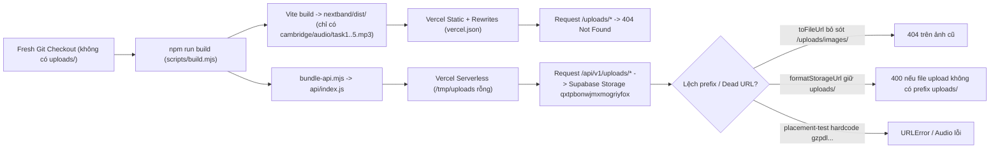
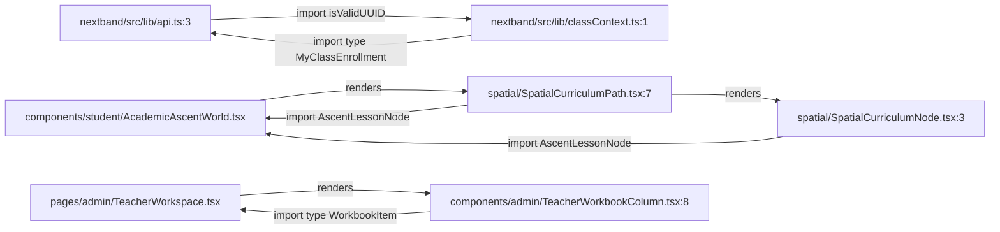
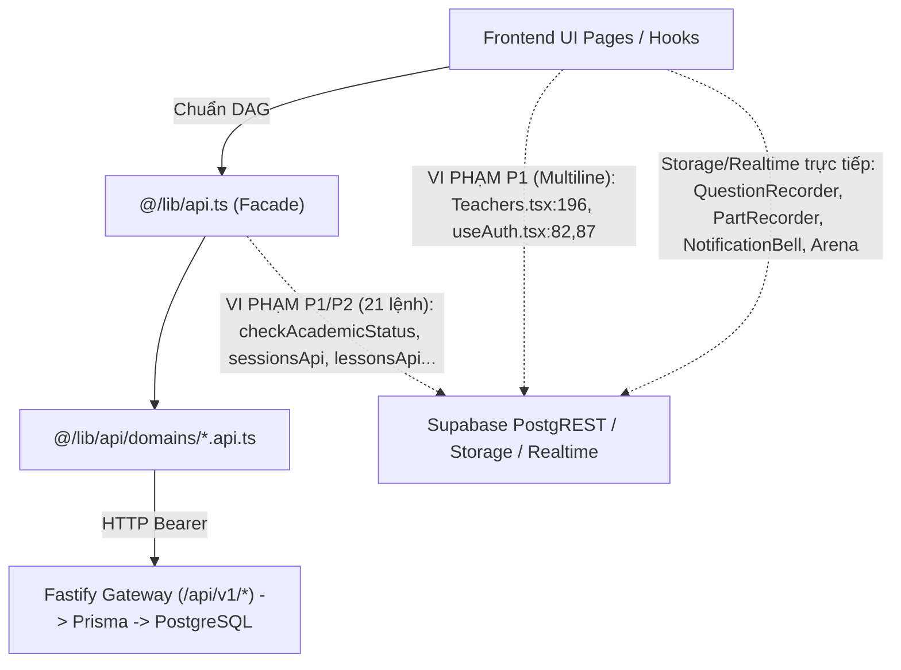
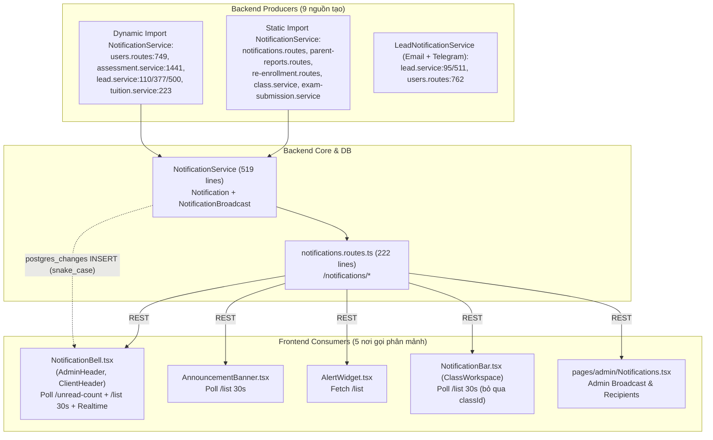
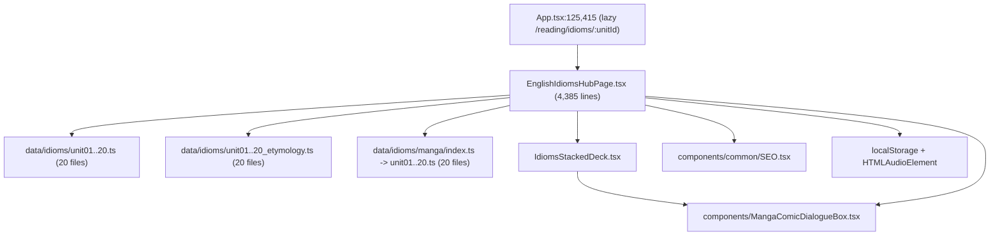
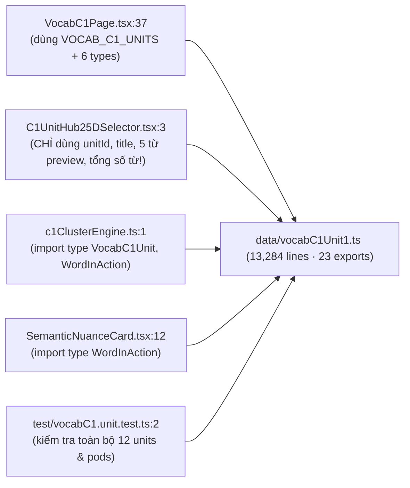

# PHASE 3 — PRE-REFACTOR ARCHITECTURE ASSESSMENT

> **Ngày đánh giá:** 19/11/2026  
> **Phạm vi:** Toàn bộ Monorepo NextBand LMS (`nextband/src`, `server/`, `prisma/`, `scripts/`, `vercel.json`)  
> **Trạng thái:** **READ-ONLY ASSESSMENT** — Chưa chỉnh sửa bất kỳ dòng mã nguồn, schema database hay dữ liệu tệp nào; chưa thực hiện deploy production.

---

## 0. TỔNG QUAN ĐIỀU HÀNH & 3 PHÁT HIỆN CHẶN TRIỂN KHAI (CRITICAL STOP-SIGNS)

Trước khi bước vào tái cấu trúc các God Files và kiến trúc nội bộ, cuộc khảo sát đã phát hiện **3 rủi ro nghiêm trọng** cần được kiểm soát ngay lập tức:

> [!CAUTION]
> **1. STORAGE SAFETY BLOCKER — 188/277 tệp local chưa tồn tại trên Supabase Storage CDN (`qxtpbonwjmxmogriyfox`)**  
> Sau khi Phase 2 (commit `8e1df4957`) ngừng track `uploads/` và `nextband/public/uploads/` trong Git, việc kiểm tra HTTP `HEAD` trực tiếp lên 277 tệp duy nhất đang nằm trên đĩa máy dev (`uploads/`: 275 tệp = 224.50 MB; `nextband/public/uploads/`: 276 tệp = 230.57 MB) cho thấy:
> - Trên CDN chính thức `https://qxtpbonwjmxmogriyfox.supabase.co/storage/v1/object/public/exam-assets/`: **88/169 tệp audio** và **100/107 tệp ảnh** trả về **HTTP 400 (MISSING)**.
> - Trên production hiện tại `https://nextband.site/uploads/...`: các mẫu thử đều trả về **HTTP 404**.
> - Các domain Supabase cũ (`gzpdlqxjggyxlkeatvvf`, `dmamqxiukfiyhfbbcqsq`) không còn truy cập được (`URLError`).  
> **Kết luận bắt buộc:** **TUYỆT ĐỐI KHÔNG ĐƯỢC XÓA** thư mục `uploads/` và `nextband/public/uploads/` tại local cho tới khi chạy truy vấn đối chiếu Database Production và backfill các tài sản đang còn tham chiếu lên `qxtpbonwjmxmogriyfox`.

> [!WARNING]
> **2. ĐIỂM MÙ CỦA SANITY CHECK (GATES 1 & 5)**  
> - **Gate 1 ([`scripts/sanity_check.mjs:13`](file:///d:/handover/ielts/scripts/sanity_check.mjs#L13)):** Chỉ chạy `madge --extensions ts` và không truyền `--ts-config nextband/tsconfig.app.json`, bỏ sót **4 circular dependencies thực tế** trong `nextband/src/` (đã xác nhận bằng `npx madge --circular --extensions ts,tsx --ts-config nextband/tsconfig.app.json nextband/src/`).
> - **Gate 5 ([`scripts/sanity_check.mjs:74`](file:///d:/handover/ielts/scripts/sanity_check.mjs#L74)):** Dùng `git grep` một dòng và loại trừ toàn bộ `nextband/src/lib/api.ts`, bỏ sót các lời gọi `supabase\n  .from(...)` xuống dòng tại [`Teachers.tsx:196`](file:///d:/handover/ielts/nextband/src/pages/admin/Teachers.tsx#L196), [`useAuth.tsx:82,87`](file:///d:/handover/ielts/nextband/src/hooks/useAuth.tsx#L82-L90), cùng **21 lệnh gọi bảng DB trực tiếp** trong [`nextband/src/lib/api.ts`](file:///d:/handover/ielts/nextband/src/lib/api.ts) (trong đó **11 lệnh nằm trong các method chết** không còn caller).

> [!IMPORTANT]
> **3. PHÌNH BUNDLE GOD FILES + THIẾU LƯỚI TEST + CƠ HỘI BẬT STRICT TYPESCRIPT NHANH**  
> - [`EnglishIdiomsHubPage.tsx`](file:///d:/handover/ielts/nextband/src/pages/public/reading/EnglishIdiomsHubPage.tsx) (4,385 dòng, 74 `useState`, 60 static import = 2,325.3 KB raw TS) sinh ra chunk nặng nhất hệ thống: **`EnglishIdiomsHubPage-Ciz8UDv2.js` = 2,025.9 KB**, nhưng hiện có **0 unit test**.
> - [`vocabC1Unit1.ts`](file:///d:/handover/ielts/nextband/src/data/vocabC1Unit1.ts) (13,284 dòng, 679.1 KB) bị đóng gói toàn bộ vào **`VocabC1Page-DX0WsK1T.js` = 625.7 KB** (#4 chunk lớn nhất).
> - **Cơ hội Quick-Win Type Safety:** Toàn bộ Frontend hiện chỉ có **44 lỗi** khi bật `--noImplicitAny`, và toàn bộ Backend chỉ có **35 lỗi** khi bật `--strict` (tổng 79 lỗi nhỏ).

---

## 1. BƯỚC 1 — ĐÁNH GIÁ AN TOÀN LƯU TRỮ (STORAGE SAFETY)

### 1.1. Danh mục toàn bộ tham chiếu tới `uploads/` và `public/uploads/`

| Vị trí (`file:line`) | Vai trò hiện tại | Phụ thuộc local disk? | Rủi ro trên Fresh Checkout / Vercel Deploy |
| :--- | :--- | :---: | :--- |
| [`vercel.json:34`](file:///d:/handover/ielts/vercel.json#L34) | Rewrite loại trừ `/((?!api\|assets\|favicon\|logo\|Logo\|uploads).*)` | **Có** | Route `/uploads/*` kỳ vọng file tĩnh trong `nextband/dist/uploads/`, nhưng từ commit `8e1df4957` thư mục này không còn trong Git ➔ trả 404. |
| [`nextband/vite.config.ts:17-21`](file:///d:/handover/ielts/nextband/vite.config.ts#L17-L21) | Proxy `/uploads` sang `http://localhost:3001` khi dev local | Dev local | Chỉ chạy khi dev local có backend ở port 3001 và thư mục `uploads/` tồn tại. |
| [`server/app.ts:204-223`](file:///d:/handover/ielts/server/app.ts#L204-L223) | Đăng ký `@fastify/static` phục vụ prefix `/uploads/` từ `UPLOAD_DIR` | **Có** | Trên serverless dùng `/tmp/uploads` (ephemeral, rỗng mỗi cold start); trên local đọc `process.cwd()/uploads`. |
| [`server/config/env.ts:68,139`](file:///d:/handover/ielts/server/config/env.ts#L68) | Khai báo `UPLOAD_DIR` mặc định `"uploads"` | Cấu hình | Truyền vào `server/app.ts` static plugin. |
| [`server/routes/uploads.routes.ts:48-361`](file:///d:/handover/ielts/server/routes/uploads.routes.ts#L48-L361) | `POST /uploads`, `/uploads/image`, `/uploads/audio`, `DELETE /uploads` | **Không** | Ghi/xóa trực tiếp vào Supabase Storage bucket `exam-assets` tại path `images/<file>` và `audio/<file>`. |
| [`server/utils/file.ts:26-49`](file:///d:/handover/ielts/server/utils/file.ts#L26-L49) | `toFileUrl()` (dùng bởi `auth`, `courses`, `exams`, `sections`, `users`, `assessment`) | **Bán phần (BUG)** | Map `/uploads/audio/<f>` ➔ `exam-assets/audio/<f>`, nhưng **BỎ SÓT `/uploads/images/<f>`** (rơi xuống `${APP_URL}/uploads/images/<f>` ➔ 404 trên fresh deploy). |
| [`nextband/src/lib/api.ts:46-70`](file:///d:/handover/ielts/nextband/src/lib/api.ts#L46-L70) | `formatStorageUrl()` (21+ component gọi) | **Lệch prefix (BUG)** | Chuyển file đơn lẻ thành `uploads/audio/<f>` hoặc `uploads/images/<f>` và gọi `getPublicUrl(cleanPath)` ➔ tạo path `exam-assets/uploads/audio/<f>`, **lệch prefix** so với `uploads.routes.ts` (`audio/<f>`) và `toFileUrl()`. |
| [`nextband/src/lib/api.ts:1616-1650`](file:///d:/handover/ielts/nextband/src/lib/api.ts#L1616-L1650) | `uploadsApi.uploadImage/Audio` & `deleteFile` | **Không (BUG)** | Frontend tự upload thẳng lên `supabase.storage.from("exam-assets")` bỏ qua Fastify API; `deleteFile` (L1647) là **stub rỗng** `return { success: true }`, làm rò rỉ file mồ côi khi xóa từ `FileUpload.tsx:141` & `SectionEdit.tsx:59`. |
| [`nextband/src/lib/audioStorageService.ts:33-42,98-105`](file:///d:/handover/ielts/nextband/src/lib/audioStorageService.ts#L98-L105) | `AudioStorageService.parse()` & `resolvePlayableUrl()` | Giữ prefix cũ | Map `uploads/audio/<f>` sang `exam-assets` giữ nguyên prefix `uploads/audio/<f>`. |
| [`SiteLogo.tsx:35-40`](file:///d:/handover/ielts/nextband/src/components/common/SiteLogo.tsx#L35-L40), [`Settings.tsx:91-99`](file:///d:/handover/ielts/nextband/src/pages/admin/Settings.tsx#L91-L99), [`rich-text-editor.tsx:414,494`](file:///d:/handover/ielts/nextband/src/components/ui/rich-text-editor.tsx#L414-L419) | Xử lý preview URL bắt đầu bằng `/uploads` | **Có** | Ghép `${VITE_API_URL_BASE}/uploads/...` ➔ sẽ lỗi 404 nếu trong DB còn bản ghi lưu relative `/uploads/...` trên Vercel. |
| [`speakingStorage.service.ts:158,203`](file:///d:/handover/ielts/server/services/speakingStorage.service.ts#L158) & [`speakingStorage.routes.ts:150-151`](file:///d:/handover/ielts/server/routes/speakingStorage.routes.ts#L150-L151) | Chuẩn hóa đường dẫn audio nói | Legacy path | Giữ tương thích với đường dẫn legacy `uploads/audio/`. |
| [`server/data/placement-test/questions.ts:73`](file:///d:/handover/ielts/server/data/placement-test/questions.ts#L73) | Audio bài thi Placement Test | **DEAD DOMAIN BUG** | Hardcode URL domain cũ đã chết: `https://gzpdlqxjggyxlkeatvvf.supabase.co/.../1787423782098-cambridge-ielts-13-academic-listening-1-audio-1.mp3`. (File này đã xác minh trả **HTTP 200** trên `qxtpbonwjmxmogriyfox`). |
| [`server/routes/cambridge.routes.ts:10,153`](file:///d:/handover/ielts/server/routes/cambridge.routes.ts#L10) | Stream audio Cambridge từ `server/data/cambridge/audio/Task 1..5.mp3` (43.55 MB) | **Có** | Không nằm trong `vercel.json:7` `includeFiles`. Tuy nhiên Frontend hiện đọc tĩnh `/cambridge/audio/task1..5.mp3` từ `nextband/public/cambridge/audio/` (vẫn còn track trong Git). |

> [!NOTE]
> **Ghi chú bảo mật phụ trợ:** Các script di trú cũ trong [`scripts/archive/migrations/migrate_storage.mjs`](file:///d:/handover/ielts/scripts/archive/migrations/migrate_storage.mjs) và [`evidence/forensics/migration/upload_assets.mjs`](file:///d:/handover/ielts/evidence/forensics/migration/upload_assets.mjs) vẫn còn chuỗi service key của các project Supabase đã ngưng hoạt động. Dù không dùng ở runtime, cần rà soát dọn khỏi lịch sử/archive nếu muốn giữ vệ sinh bảo mật repo.

### 1.2. Xác minh nguồn lưu trữ bền vững (Local Disk vs Supabase Storage CDN)

Kiểm kê thực tế trên ổ đĩa và kiểm tra `HEAD` request song song tới Supabase CDN `https://qxtpbonwjmxmogriyfox.supabase.co/storage/v1/object/public/exam-assets/` (thử cả prefix trực tiếp `<type>/<file>` và `uploads/<type>/<file>`):

| Thư mục / Nguồn kiểm tra | Số lượng tệp | Dung lượng | Tệp duy nhất chỉ có ở nguồn này | Kết quả kiểm chứng trên CDN `qxtpbonwjmxmogriyfox` |
| :--- | :---: | :---: | :--- | :--- |
| `uploads/` (local) | 275 | 224.50 MB | `audio/1787334923457-559467f6-67b1-41a1-a968-2b91d697941e.webm` | Đã gộp vào tập 277 tệp kiểm tra bên dưới |
| `nextband/public/uploads/` (local) | 276 | 230.57 MB | `entrance test/cambridge-ielts-13-academic-listening-1-audio-1.mp3`, `images/1773499038023-d3cc6ecd-6cc9-42c8-a49a-776a00d8f151.png` | Đã gộp vào tập 277 tệp kiểm tra bên dưới |
| **Tổng hợp duy nhất (Audio)** | **169** | — | 143 `.mp3`, 7 `.wav`, 20 `.webm` (giao nhau) | **81 HTTP 200 (OK)** · **88 HTTP 400 (MISSING)** |
| **Tổng hợp duy nhất (Images)** | **107** | — | 18 `.jpg`, 4 `.jpeg`, 85 `.png` | **7 HTTP 200 (OK)** · **100 HTTP 400 (MISSING)** |
| **Khác (`entrance test/`)** | **1** | — | `cambridge-ielts-13-academic-listening-1-audio-1.mp3` | Thiếu ở `entrance test/`, nhưng **HTTP 200** ở `audio/1787423782098-cambridge-ielts-13-academic-listening-1-audio-1.mp3` |
| `https://nextband.site/uploads/...` | 20 mẫu thử | — | 10 audio + 10 image ngẫu nhiên | **20/20 HTTP 404** (production không có `public/uploads/`) |

### 1.3. Quy trình Deploy & Khả năng phục hồi sau Fresh Checkout



- **Khả năng phục hồi sau Fresh Checkout:**
  - **Code & Build:** Phục hồi **100%** (build pass, app chạy được, các tính năng upload mới stream thẳng lên `qxtpbonwjmxmogriyfox`).
  - **Media cũ (`188` file thiếu trên CDN):** Nếu một bản ghi trong PostgreSQL production (`questions`, `question_groups`, `courses`, `profiles`, `site_settings`, `student_evidence`, `faculty_profiles`) còn trỏ tới 1 trong 188 file này qua `/uploads/...`, fresh checkout hoặc deploy mới sẽ làm **vỡ ảnh / mất audio vĩnh viễn** nếu xóa `uploads/` local trước khi đối chiếu.

### 1.4. Giao thức kiểm tra bắt buộc (Read-Only SQL Audit) trước khi dọn `uploads/` local

Chạy truy vấn read-only sau trên Production PostgreSQL (chỉ đọc, không sửa DB) để xác định xem có bản ghi nào đang tham chiếu 188 tệp thiếu hay `/uploads/` hay `gzpdlqxjggyxlkeatvvf`:

```sql
SELECT 'questions.audio_url' AS source, id, audio_url AS url FROM questions WHERE audio_url LIKE '%/uploads/%' OR audio_url LIKE '%gzpdlqxjggyxlkeatvvf%'
UNION ALL
SELECT 'questions.question_text', id, substring(question_text from 1 for 200) FROM questions WHERE question_text LIKE '%/uploads/%' OR question_text LIKE '%gzpdlqxjggyxlkeatvvf%'
UNION ALL
SELECT 'question_groups.audio_url', id, audio_url FROM question_groups WHERE audio_url LIKE '%/uploads/%' OR audio_url LIKE '%gzpdlqxjggyxlkeatvvf%'
UNION ALL
SELECT 'question_groups.passage', id, substring(passage from 1 for 200) FROM question_groups WHERE passage LIKE '%/uploads/%' OR passage LIKE '%gzpdlqxjggyxlkeatvvf%'
UNION ALL
SELECT 'sections.audio_url', id, audio_url FROM sections WHERE audio_url LIKE '%/uploads/%' OR audio_url LIKE '%gzpdlqxjggyxlkeatvvf%'
UNION ALL
SELECT 'courses.thumbnail_url', id, thumbnail_url FROM courses WHERE thumbnail_url LIKE '%/uploads/%' OR thumbnail_url LIKE '%gzpdlqxjggyxlkeatvvf%'
UNION ALL
SELECT 'profiles.avatar_url', user_id, avatar_url FROM profiles WHERE avatar_url LIKE '%/uploads/%' OR avatar_url LIKE '%gzpdlqxjggyxlkeatvvf%'
UNION ALL
SELECT 'site_settings.logo_url', id, logo_url FROM site_settings WHERE logo_url LIKE '%/uploads/%' OR logo_url LIKE '%gzpdlqxjggyxlkeatvvf%'
UNION ALL
SELECT 'answers.audio_url', id, audio_url FROM answers WHERE audio_url LIKE '%/uploads/%' OR audio_url LIKE '%gzpdlqxjggyxlkeatvvf%'
UNION ALL
SELECT 'student_evidence.certificate_url', id, certificate_url FROM student_evidence WHERE certificate_url LIKE '%/uploads/%' OR certificate_url LIKE '%gzpdlqxjggyxlkeatvvf%'
UNION ALL
SELECT 'faculty_profiles.avatar_url', id, avatar_url FROM faculty_profiles WHERE avatar_url LIKE '%/uploads/%' OR avatar_url LIKE '%gzpdlqxjggyxlkeatvvf%';
```

---

## 2. BƯỚC 2 — ĐÁNH GIÁ NỢ KIẾN TRÚC & BẢN ĐỒ PHỤ THUỘC (ARCHITECTURE DEBT)

### 2.1. REM-B1: Circular Dependencies (Phụ thuộc vòng)

- **Kết quả quét thực tế bằng `madge` (kèm `--ts-config` và `.tsx`):**
  - **Backend (`server/` — 271 files):** ✅ **0 vòng lặp**.
  - **Frontend (`nextband/src/` — 855 files):** ❌ **4 vòng lặp thực tế** bị [`scripts/sanity_check.mjs:13`](file:///d:/handover/ielts/scripts/sanity_check.mjs#L13) bỏ sót do thiếu `--extensions ts,tsx` và `--ts-config nextband/tsconfig.app.json`.



| # | Chuỗi vòng lặp | Nguyên nhân gốc | Phương án gỡ bỏ an toàn (giữ nguyên Public API) |
| :- | :--- | :--- | :--- |
| 1 | `lib/api.ts` ↔ `lib/classContext.ts` | `api.ts:3` import runtime `isValidUUID` từ `classContext.ts`, trong khi `classContext.ts:1` import `MyClassEnrollment` từ `api.ts`. | Chuyển `interface MyClassEnrollment` sang [`types/domain.types.ts`](file:///d:/handover/ielts/nextband/src/types/domain.types.ts) (hoặc `lib/api/types.ts`), `api.ts` & `classContext.ts` cùng import từ đó và re-export lại. |
| 2–3 | `AcademicAscentWorld.tsx` ↔ `SpatialCurriculumPath.tsx` ↔ `SpatialCurriculumNode.tsx` | Hai component con import type `AscentLessonNode` ngược lên parent page/container. | Tách `AscentLessonNode` ra `components/student/spatial/types.ts`; `AcademicAscentWorld.tsx` re-export lại để bảo toàn API. |
| 4 | `TeacherWorkspace.tsx` ↔ `TeacherWorkbookColumn.tsx` | `TeacherWorkbookColumn.tsx:8` import `type WorkbookItem` từ page `TeacherWorkspace.tsx`. | Tách `WorkbookItem` (và các shared workspace types) ra `components/admin/teacherWorkspace.types.ts`; re-export tại `TeacherWorkspace.tsx`. |
| Gate | [`scripts/sanity_check.mjs:13`](file:///d:/handover/ielts/scripts/sanity_check.mjs#L13) | Thiếu `.tsx` và `--ts-config`. | Sau khi gỡ 4 vòng trên, nâng cấp Gate 1 thành `npx madge --circular --extensions ts,tsx --ts-config nextband/tsconfig.app.json nextband/src/ && npx madge --circular --extensions ts --ts-config tsconfig.json server/`. |

---

### 2.2. REM-B3: UI / Database Separation (Phân tách UI và Cơ sở dữ liệu)



| Phân loại | File & Dòng | Bảng / Dịch vụ Supabase gọi trực tiếp | Tình trạng sử dụng & Đánh giá | Hành động đề xuất |
| :--- | :--- | :--- | :--- | :--- |
| **P1 · UI/Hook DB Call** | [`Teachers.tsx:196-200`](file:///d:/handover/ielts/nextband/src/pages/admin/Teachers.tsx#L196-L200) | `profiles` (`select("user_id, id").eq("email", ...)`) | Bị Gate 5 bỏ sót do viết multiline. Admin UI query thẳng bảng `profiles`. | Bổ sung hoặc gọi REST endpoint `usersApi.findByEmail()` / để `usersApi.update()` xử lý resolve theo email ở Backend. |
| **P1 · Hook DB Call** | [`useAuth.tsx:82-90`](file:///d:/handover/ielts/nextband/src/hooks/useAuth.tsx#L82-L90) | `profiles`, `user_roles` | Lấy `is_active`, `full_name`, `avatar_url`, `roles` trực tiếp từ PostgREST mỗi khi boot session. | Chuyển sang gọi `GET /api/v1/auth/me` (route này hiện **đã có sẵn** ở `server/routes/auth.routes.ts` và đang có 0 caller!). |
| **P1 · Dead DB Calls trong `api.ts`** | [`api.ts:2272-2580`](file:///d:/handover/ielts/nextband/src/lib/api.ts#L2272-L2580) (`checkAcademicStatus`, `previewFutureScheduleUpdate`, `applyFutureScheduleUpdate`, `claimProfileOnLogin`) | **11 lệnh `supabase.from(...)`** (`classes`, `class_sessions`, `attendance`, `class_students`, `exam_submissions`, `profiles`, `user_roles`) | **0 caller trên toàn bộ UI và tests.** Thậm chí `claimProfileOnLogin` ghi thẳng vào `user_roles` (nguy cơ bảo mật nếu RLS hở). | **Xóa thẳng** 4 method chết này (giữ lại endpoint `/classes/claim-profile` vốn đã được `useAuth.tsx:72` gọi qua Fastify). |
| **P2 · Live DB Calls trong `api.ts`** | [`api.ts:140`](file:///d:/handover/ielts/nextband/src/lib/api.ts#L140) (`authApi.updateProfile`), [`1565`](file:///d:/handover/ielts/nextband/src/lib/api.ts#L1565) (`readOnlySupabaseFallback`), [`2810,2876,2965,3021`](file:///d:/handover/ielts/nextband/src/lib/api.ts#L2810-L3021) (`sessionsApi`), [`3170-3206`](file:///d:/handover/ielts/nextband/src/lib/api.ts#L3170-L3206) (`lessonsApi.getClassLessons`) | **10 lệnh `supabase.from(...)`** | Đang chạy thật trong UI (`Profile`, `ClassWorkspace`, `CourseDetail`). Riêng `readOnlySupabaseFallback` là fallback CORE-009 khi Gateway gián đoạn. | Di dời lần lượt `authApi.updateProfile` (`PUT /auth/profile`), `sessionsApi`, `lessonsApi.getClassLessons` sang Fastify API; khóa Gate 5 bằng regex multiline. |
| **P2 · Storage/Realtime/Dead Imports** | `uploadsApi` (`api.ts:1619-1642`), `QuestionRecorder.tsx:243`, `PartRecorder.tsx:102`, `NotificationBell.tsx:81`, `ArenaHostPage.tsx:363`, `ArenaPlayPage.tsx:324`; Dead imports: `SpeakingTranscriptViewer.tsx:8`, `ArenaJoinPage.tsx:9` | Supabase Storage & Realtime | Storage upload nên đi qua `/api/v1/uploads` (hoặc signed upload URL); Realtime giữ có kiểm soát qua hook; 2 import thừa xóa ngay. | Xóa 2 dead imports trước; chuẩn hóa Storage delete/upload sau Track 0. |

---

### 2.3. REM-C1: Notification Architecture (Kiến trúc Thông báo)



**7 điểm nợ kiến trúc đã xác minh trong hệ thống thông báo:**

1. **Polling dư thừa 4–5 lần & phân mảnh Query Keys:** [`NotificationBell.tsx:167-183`](file:///d:/handover/ielts/nextband/src/components/navigation/NotificationBell.tsx#L167-L183) gọi song song cả `/notifications/unread-count` lẫn `/notifications?limit=30` mỗi 30 giây, dù [`notifications.routes.ts:24`](file:///d:/handover/ielts/server/routes/notifications.routes.ts#L24) **đã trả sẵn `unreadCount`** trong response của `GET /notifications`. Đồng thời `AnnouncementBanner` và `NotificationBar` lại mở thêm 2 vòng poll 30 giây riêng biệt. Các query key không thống nhất (`["notifications-unread-count"]`, `["notifications-list"]`, `["announcements-banner"]`, `["alerts-widget"]`, `["workspace-notification-bar", classId]`) khiến đánh dấu đã đọc ở chỗ này không cập nhật đồng bộ chỗ khác (`NotificationBar` thậm chí nhận prop `classId` nhưng không truyền vào API hay lọc theo lớp).
2. **Lỗi Casing Realtime (`snake_case` vs `camelCase`):** Trong [`NotificationBell.tsx:92-122`](file:///d:/handover/ielts/nextband/src/components/navigation/NotificationBell.tsx#L92-L122), payload từ Supabase `postgres_changes` trả về cột DB `snake_case` (`entity_type`, `entity_id`, `is_read`), nhưng code UI lại đọc `newNotif.entityType`, `newNotif.entityId` (luôn là `undefined`) ➔ làm hỏng invalidate cache bài nộp, bỏ lọt bộ lọc học viên và điều hướng link sai khi nhận thông báo realtime.
3. **Lọc bảo mật phía Client lặp lại 2 nơi & sai `unreadCount` học viên:** Cả [`NotificationBell.tsx:188-210`](file:///d:/handover/ielts/nextband/src/components/navigation/NotificationBell.tsx#L188-L210) và [`AnnouncementBanner.tsx:35-56`](file:///d:/handover/ielts/nextband/src/components/AnnouncementBanner.tsx#L35-L56) đều copy-paste bộ lọc chuỗi tiếng Việt (`"lead mới"`, `"đăng ký tài khoản"`, `entityType === "LEAD"`) để giấu thông báo nội bộ khỏi học viên; ngoài ra dòng 216 tính `unreadCount` chỉ trên 30 bản ghi đầu. Việc lọc đối tượng cần được xử lý từ lúc phát (`notifyUsersByRole`) hoặc trên query Backend.
4. **Truy vấn N+1 trong `listAdminBroadcasts`:** [`notification.service.ts:322-350`](file:///d:/handover/ielts/server/services/notification.service.ts#L322-L350) chạy `await Promise.all(broadcasts.map(() => prisma.notification.count(...)))`, phát sinh 20 query `COUNT` riêng lẻ mỗi lần mở trang Admin Notifications.
5. **Cron dọn dẹp chưa được nối lịch:** Endpoint `POST /notifications/maintenance/cleanup` ([`notifications.routes.ts:204`](file:///d:/handover/ielts/server/routes/notifications.routes.ts#L204)) đã tồn tại nhưng chưa được cấu hình trong [`vercel.json`](file:///d:/handover/ielts/vercel.json#L10-L19) hay [`cron.routes.ts`](file:///d:/handover/ielts/server/routes/cron.routes.ts).
6. **Rò rỉ lỗi 500 & thiếu Zod validation:** [`notifications.routes.ts:178-181`](file:///d:/handover/ielts/server/routes/notifications.routes.ts#L178-L181) trả raw `err.message`, còn [`notifications.routes.ts:16-17`](file:///d:/handover/ielts/server/routes/notifications.routes.ts#L16-L17) parse query thủ công.
7. **Gắn chặt Realtime vào UI Component:** Logic kết nối Supabase channel nằm trực tiếp trong `NotificationBell.tsx` thay vì đóng gói trong một shared hook `useNotifications()` dùng chung query key từ `queryKeys.ts`.

---

### 2.4. REM-D1: Type Safety (Độ an toàn kiểu TypeScript)

| Vùng mã nguồn (Production, loại trừ tests) | Tổng files | Files chứa `any` | Số lần `any` | `@ts-ignore` / `@ts-expect-error` | `as unknown as` | Cấu hình Compiler hiện tại |
| :--- | :---: | :---: | :---: | :---: | :---: | :--- |
| **Frontend (`nextband/src/`)** | 734 | 207 (28.2%) | **1,276** | 0 / 0 | 16 | `strict: true`, **`noImplicitAny: false`** ([`nextband/tsconfig.app.json:18-21`](file:///d:/handover/ielts/nextband/tsconfig.app.json#L18-L21)) |
| **Backend (`server/`)** | 183 | 84 (45.9%) | **804** | 0 / 0 | 3 | **`strict: false`** ([`tsconfig.json:8`](file:///d:/handover/ielts/tsconfig.json#L8)) |
| **ESLint (`nextband/eslint.config.js`)** | — | — | — | `ban-ts-comment: off` | — | `@typescript-eslint/no-explicit-any: off`, `no-unused-vars: off` |

- **Top điểm nóng `any`:**
  - *Frontend:* `lib/api.ts` (101), `TeacherWorkspace.tsx` (49), `Classes.tsx` (45), `EnglishIdiomsHubPage.tsx` (39), `SubmissionDetail.tsx` (39), `SectionEdit.tsx` (36), `ExamInterface.tsx` (35).
  - *Backend:* `assessment.service.ts` (81), `exam-submission.service.ts` (62), `class.controller.ts` (47), `users.routes.ts` (41), `submission.controller.ts` (32).
- **Phát hiện High-ROI Compiler Ratchet (đã chạy kiểm thử thực tế với `tsc`):**
  - Chạy `tsc -p nextband/tsconfig.app.json --noImplicitAny --noEmit` chỉ báo **44 lỗi** trên toàn bộ 734 file Frontend (`EnglishIdiomsHubPage.tsx`: 19, `WritingGrader.tsx`: 10, `SubmissionGrade.tsx`: 3, `SubmissionDetail.tsx`: 3, `ClassAttendancePage.tsx`: 2, `StudentAttendanceTimeline.tsx`: 2, `useUnitProgress.ts`: 2, `ListeningSection.tsx`: 1, `SpeakingSection.tsx`: 1, `TeacherWorkspace.tsx`: 1).
  - Chạy `tsc -p tsconfig.json --strict --noEmit` chỉ báo **35 lỗi** trên toàn bộ Backend + Scripts + Tests (trong đó chỉ ~10–12 lỗi nằm ở production `server/services/`: `exam-submission.service.ts` [5], `cambridge-placement.service.ts` [2], `arena-bank.service.ts` [1], `arena-engine.service.ts` [1], còn lại ở `server/tests/` và `scripts/`).
  - **Chiến lược:** Chặn rò rỉ mới trước bằng cách sửa 79 lỗi nhẹ này để bật `noImplicitAny: true` (FE) và `strict: true` (BE), sau đó mới dần thay 2,080 `any` tường minh theo từng domain.

---

### 2.5. REM-D2: Dead Exports (Export dư thừa)

Quét **790 top-level exports** tại `nextband/src/lib/`, `server/utils/`, `server/services/`, `server/schemas/` và toàn bộ method trên `*Api` objects:

| Nhóm phân loại | Số lượng | Bằng chứng cụ thể | Hành động an toàn |
| :--- | :---: | :--- | :--- |
| **1. Over-exported internal helpers** (0 caller ngoài, >=1 lần dùng nội bộ cùng file) | **44 value exports** | `extractApiError` (`api.ts`), `openDB` (`draftStore.ts`), `getLocalLeads` (`contactService.ts`), `normalizeEvcToken` (`answerNormalizer.ts`), `isListeningMatch/isReadingMatch/isGrammarMatch` (`examSkillHelper.ts`), `ARIS_REALMS/getRealmByBand/accuracyToIeltsBand` (`studentJourney.ts`), `BANDS/normalise/median5` (`cambridge-scoring.ts`), `getRemainingSeconds` (`exam-submission.service.ts`), `SPEAKING_BUCKET/RETENTION_DURATIONS_MS` (`speakingStorage.service.ts`), `checkPhoneQuerySchema` (`lead.schema.ts`), v.v. | **CHỈ GỠ TỪ KHÓA `export`**, TUYỆT ĐỐI KHÔNG XÓA HÀM (vì hàm vẫn đang chạy nội bộ). |
| **2. Dead `*Api` methods không còn UI caller** | **24 methods** (gồm **11 method Supabase legacy chết** + 13 method chưa nối UI) | *Chết/Legacy Supabase (xóa an toàn):* `classesApi.checkAcademicStatus`, `previewFutureScheduleUpdate`, `applyFutureScheduleUpdate`, `claimProfileOnLogin`, `updateStudentStatus`, `statsApi.getAdminStats`, `submissionsApi.getLatestByExam`, `retake`, `getStudentAcademicEvidence`, `cambridgeApi.listSessions`, `overrideGate`. *Lưu ý:* `readOnlySupabaseFallback`, `regrade`, `createSession` có caller nội bộ trong `api.ts`; `branchesApi.update`, `roomsApi.update`, `invitationsApi.generate`, `referralsApi.validateCode`, `interventionsApi.transition/delete` là SDK wrapper cho route backend có sẵn (xác nhận trước khi xóa). | Gỡ bỏ nhóm legacy Supabase chết trong `api.ts`; giữ hoặc kiểm tra nhu cầu với các wrapper domain. |
| **3. Dead Type / Interface exports** | **196 types** | Tập trung ở `api.ts` (19), `arena/types.ts` (13), `huanCoState.ts` (8), `cambridge-scoring.ts` (8), `draftStore.ts` (6), `diagnostic.service.ts` (6). | Gỡ `export` (chuyển sang nội bộ) hoặc xóa type thật sự không dùng ở file đó. |
| **4. Test-Only Value Exports** | **51 exports** | `normalizeExamData/Section/CourseData` (`api.ts`), `isPlaceholderText`, `quarantineCorruptedDraft`, `timeToMinutes`, `mapRawScoreToArisLevel`, v.v. | **GIỮ NGUYÊN `export`** (hoặc gắn JSDoc `@internal`) để không làm gãy test suite. |
| **5. Dead UI Imports** | **2 imports** | `SpeakingTranscriptViewer.tsx:8` (`supabase`), `ArenaJoinPage.tsx:9` (`supabase`). | Xóa 2 dòng import thừa. |
| **6. HOLD Modules** | **4 files** | `competencyEvidence.ts`, `academic-diagnostic.service.ts`, `evidence-ledger.service.ts`, `ontology.service.ts`. | **KHÔNG CHẠM VÀO** (theo quy ước `HOLD — UNWIRED`). |

---

## 3. BƯỚC 3 — PHÂN TÍCH CHUYÊN SÂU GOD FILES

### 3.1. `nextband/src/pages/public/reading/EnglishIdiomsHubPage.tsx` (4,385 dòng · 213.0 KB · Chunk build: `2,025.9 KB`)

#### Trách nhiệm đang bị trộn lẫn (6 miền nghiệp vụ trong 1 component):
1. **Tổng hợp dữ liệu tĩnh khổng lồ (L25–65, L333–415):** Import tĩnh 20 `unit01..20.ts` + 20 `unit01..20_etymology.ts` + `MANGA_BY_UNIT` kéo theo 20 `manga/unit01..20.ts` (tổng **2,325.3 KB** raw TypeScript), dùng chuỗi ternary 20 nhánh lồng nhau để tra cứu và tính toán `allIdioms` / `filteredIdioms` không memoize ở mỗi lần render.
2. **Trình phát Audio & Theo dõi tiến độ nghe (L83, L90–105, L172, L280–322):** Quản lý `audioRef`, trạng thái đang phát và đọc/ghi `localStorage["nb_idioms_listened_v1"]`.
3. **Quản lý Bookmark, Drawer & Highlight từ khóa (L80–87, L108–138, L443–498):** Lưu `localStorage["nextband_bookmarked_idioms"]`, state đóng/mở từng drawer etymology/manga/micro-quiz và parser highlight cụm từ trong câu.
4. **Điều phối chuyển Unit & Reset thủ công (L69–75, L141–169, L1302–1326):** Gọi lặp lại **20 hàm `reset*()` riêng lẻ** ở cả `useEffect([unitId])` lẫn `handleSelectUnit`.
5. **Giao diện Học (Learn Tab — L1436–2118, ~682 dòng):** Toggle 2.5D Deck vs Grid, render thẻ thành ngữ 4 sub-tab (`Ngữ cảnh`, `Bản đồ Ẩn dụ`, `Phản xạ`, `Manga Doraemon`).
6. **20 bộ máy trạng thái & trình chấm điểm Bài tập Thực hành (Practice Tab — L174–277, L500–1300, L2119–4385, ~3,168 dòng = 72% file):** Trộn lẫn **74 `useState`**, **39 `any` tường minh**, **19 lỗi `noImplicitAny`** cho 20 biến thể bài tập (Unit 1 riêng `1.3..1.8`, Units 2–20 chung, và các nhánh vá cho Unit 9, Unit 11, Unit 12, Unit 13, Unit 15).

#### Dependency Graph



*(Ghi chú: `EnglishIdiomsCatalogPage.tsx` hoàn toàn độc lập vì sử dụng mảng tĩnh `UNITS_CATALOG` riêng, không import `EnglishIdiomsHubPage` hay dữ liệu 20 unit).*

#### Các Module tách độc lập & Public API cần bảo toàn
- **Module dữ liệu:** `nextband/src/data/idioms/unitLoader.ts` (`loadIdiomUnitBundle(unitId)` dùng dynamic `import()` + cache Map ➔ giảm chunk khởi tạo từ **2,025.9 KB xuống ~150 KB**, tiết kiệm **92%**!).
- **Hooks & Utils:** `hooks/useIdiomAudio.ts`, `hooks/useIdiomBookmarks.ts`, `utils/highlightIdiom.tsx`.
- **Learn UI:** `components/IdiomLearnView.tsx`, `components/IdiomGridCard.tsx`.
- **Practice UI (`components/exercises/`):** Tách thành các component độc lập theo từng dạng bài (`GroupSortingExercise`, `FillBlanksExercise`, `ErrorCorrectionExercise`, `HangmanLetterFillExercise`, `MultipleChoiceExercise`, `SituationalJudgmentExercise`, `ImageMatchingExercise`, `AudioOrderExercise`, `WordOrderingExercise`, `AudioPictureMatchingExercise`, `DefinitionMatchingExercise`). Gắn `key={`${selectedUnitId}-${exerciseKey}`}` để React tự động reset state khi đổi Unit ➔ **xóa sạch 20 hàm `reset*()` và ~60 `useState` khỏi trang cha**.
- **Public API phải bảo toàn:** Default export `EnglishIdiomsHubPage`, URL `/reading/idioms/:unitId` (validate `1..20`, fallback về `1`), 2 khóa `localStorage` (`nb_idioms_listened_v1`, `nextband_bookmarked_idioms`), props của `IdiomsStackedDeck` & `MangaComicDialogueBox`, hành vi chấm điểm đặc thù của Units 1, 9, 11, 12, 13, 15.

#### Regression Risks & Các bước chia nhỏ
- **Rủi ro chính:** Hiện có **0 unit test**; cấu trúc JSON `exercises` không đồng nhất hoàn toàn giữa các unit (nhất là Unit 1, Unit 9 `9.6–9.8`, Unit 15 `15.2/15.5`); race condition nếu người dùng bấm `Next/Prev Unit` liên tục khi `loadIdiomUnitBundle` đang fetch async (cần cờ `cancelled` / request counter + skeleton loading).
- **Lộ trình 4 PR:** (1) Viết Characterization Tests cho Units 1, 2, 9, 15 + storage ➔ (2) Tách `unitLoader.ts` dynamic import (thu ngay -1.87 MB) ➔ (3) Tách hooks + Learn UI ➔ (4) Tách từng cụm Practice Exercise components và đối chiếu pass 100% với bộ Characterization Tests.

---

### 3.2. `nextband/src/data/vocabC1Unit1.ts` (13,284 dòng · 679.1 KB · Đóng gói trong `VocabC1Page` `625.7 KB`)

#### Trách nhiệm bị trộn lẫn & Dependency Graph
- File hiện gộp chung: **10 interfaces** (L1–124) + toàn bộ dữ liệu **12 Units C1** (`VOCAB_C1_UNIT_1` tại L125 đến `VOCAB_C1_UNIT_12` tại L12255, ~1,000 dòng/unit) + mảng tổng `VOCAB_C1_UNITS` (L13279).



#### Phương án tách độc lập & Public API cần bảo toàn
- Tạo cấu trúc `nextband/src/data/vocabC1/`:
  - `types.ts`: chứa 10 interfaces (`ContrastWordItem` .. `VocabC1Unit`).
  - `unit01.ts` .. `unit12.ts`: mỗi unit ~1,000 dòng (~55 KB).
  - `unitsMeta.ts`: metadata nhẹ (~3 KB) gồm `unitId`, `title`, `wordCount`, `previewWords` (5 từ đầu) phục vụ `C1UnitHub25DSelector`.
  - `loader.ts`: `loadVocabC1Unit(unitId: number): Promise<VocabC1Unit>` dùng dynamic `import()` + cache Map.
- **Bảo toàn Public API 100%:** Giữ `nextband/src/data/vocabC1Unit1.ts` làm **barrel facade** re-export đủ cả **23 symbols** (`10 interfaces` + `VOCAB_C1_UNIT_1..12` + `VOCAB_C1_UNITS`) để không làm gãy bất kỳ test hay caller nào. Sau đó chuyển 4 file production (`C1UnitHub25DSelector`, `VocabC1Page`, `c1ClusterEngine`, `SemanticNuanceCard`) sang dùng `types.ts` + `unitsMeta.ts` + `loader.ts` để Vite tree-shake mảng `VOCAB_C1_UNITS` khỏi chunk runtime ➔ giảm `VocabC1Page` từ **625.7 KB xuống ~110 KB** (-82%).

#### Regression Risks & Các bước chia nhỏ
- **Rủi ro chính:** Lỡ giữ 1 static import từ `vocabC1Unit1.ts` ở bất kỳ file runtime nào (kể cả `C1UnitHub25DSelector`) sẽ kéo ngược toàn bộ 679 KB vào bundle; trạng thái `loading` khi chuyển Unit ở `VocabC1Page` có thể làm `getPodsForUnit` nhận `undefined` nếu thiếu guard; `unitsMeta.ts` lệch với `unit01..12.ts` nếu không có test đối chiếu tự động.
- **Lộ trình 3 PR:** (1) Tách `types.ts` + `unit01..12.ts`, biến `vocabC1Unit1.ts` thành barrel re-export (0 thay đổi UI, `vocabC1.unit.test.ts` pass ngay) ➔ (2) Thêm `unitsMeta.ts` + `loader.ts` + test kiểm tra khớp 100% với `VOCAB_C1_UNITS` ➔ (3) Chuyển `C1UnitHub25DSelector` & `VocabC1Page` sang async loader và kiểm tra kích thước chunk `< 150 KB` bằng `npm run build:fe`.

---

## 4. BƯỚC 4 — KẾ HOẠCH TRIỂN KHAI (EXECUTION PLAN)

### 4.1. Ma trận Rủi ro × Lợi ích (Risk × Benefit Matrix)

| Hạng mục | Rủi ro Production hiện hữu | Rủi ro khi Refactor | Lợi ích (Impact) | Khối lượng | Khả năng Rollback | Thứ tự ưu tiên |
| :--- | :---: | :---: | :---: | :---: | :---: | :---: |
| **Storage Safety Audit & Fix (`toFileUrl`, `formatStorageUrl`, `placement-test`)** | **Rất Cao (188 tệp thiếu trên CDN)** | Thấp (nếu đọc DB trước) | **Bảo toàn dữ liệu & hết 404/400** | Nhỏ–Vừa | Cao | **Track 0 (P0)** |
| **REM-B1: Phá 4 vòng lặp + sửa Gate 1** | Thấp | **Rất Thấp (chỉ tách type)** | Khóa 0 circular deps thực sự | Rất Nhỏ | Tức thì | **Track 1 (P1)** |
| **REM-D1a: Bật `--noImplicitAny` (FE) & `--strict` (BE)** | Trung bình | **Rất Thấp (79 lỗi nhỏ)** | Chặn 100% lỗi thiếu type mới | Nhỏ | Tức thì | **Track 1 (P1)** |
| **`vocabC1Unit1.ts` Code-Splitting** | Trung bình (bundle nặng) | Thấp (chỉ 4 file consumer) | **-515 KB** chunk `VocabC1Page` | Vừa | Dễ | **Track 2 (P1)** |
| **REM-C1: Chuẩn hóa Notification & sửa Realtime bug** | Cao (hỏng realtime, trùng poll, N+1) | Trung bình | Giảm 75% poll + sửa push realtime | Vừa | Dễ | **Track 3 (P2)** |
| **REM-B3: Xóa DB bypass + siết Gate 5** | Cao (bypass auth/API + 11 dead calls) | Trung bình (cần test `useAuth`/sessions) | Tuân thủ 100% Single Channel API | Vừa–Lớn | Dễ | **Track 3 (P2)** |
| **`EnglishIdiomsHubPage.tsx` Code-Splitting & Refactor** | Cao (**chunk 2.03 MB**) | **Trung bình–Cao (0 tests, 20 units)** | **-1.87 MB** chunk + bảo trì dễ | Lớn | Tốt nếu chia 4 PR | **Track 4 (P2)** |
| **REM-D2 & REM-D1b: Tỉa dead exports & giảm `any`** | Thấp | Thấp–Vừa | Sạch codebase, dễ đọc | Vừa–Lớn | Tức thì | **Track 5 (P3)** |

### 4.2. Danh sách Unit/Integration Tests cần bổ sung TRƯỚC khi sửa code

1. `server/tests/storage_url_contract.test.ts`: Kiểm thử `toFileUrl()` với `/uploads/audio/...`, `/uploads/images/...`, URL CDN đầy đủ, và `placement-test` không chứa host `gzpdlqxjggyxlkeatvvf`.
2. `nextband/src/test/vocabC1_loader_parity.test.ts`: Khẳng định `unitsMeta` khớp 100% (`unitId`, `title`, `wordCount`, `previewWords`) với `VOCAB_C1_UNITS`, và `loadVocabC1Unit(1..12)` trả về đúng object.
3. `nextband/src/test/notification_realtime_contract.test.tsx`: Test `NotificationBell` nhận payload `snake_case` từ `postgres_changes`, invalidate đúng domain queries, lọc scope `student` chính xác, và `NotificationService.listAdminBroadcasts` không bắn N+1 query.
4. `nextband/src/test/english_idioms_hub.characterization.test.tsx`: Suite kiểm thử hành vi hiện tại của `EnglishIdiomsHubPage` trên **Unit 1 (1.3–1.8), Unit 2 (2.3–2.8), Unit 9 (9.6–9.8), Unit 15 (15.2 & 15.5)**, cùng audio tracking (`nb_idioms_listened_v1`) và bookmark (`nextband_bookmarked_idioms`).

### 4.3. Lộ trình PR/Commit nhỏ, độc lập & Rollback tức thì (PR-01 → PR-14)

| PR | Track | Phạm vi & Tệp tác động | Lệnh kiểm chứng bắt buộc | Rollback |
| :- | :-: | :--- | :--- | :--- |
| **PR-01** | **T0** | *(Manual DB Read-Only Audit)* Chạy SQL Mục 1.4, backfill các tệp active còn thiếu lên `qxtpbonwjmxmogriyfox`, sửa URL chết tại [`questions.ts:73`](file:///d:/handover/ielts/server/data/placement-test/questions.ts#L73). | SQL count = 0 hoặc HTTP `HEAD` = 200 toàn bộ active assets | `git revert <sha>` |
| **PR-02** | **T0** | Thống nhất URL contract trong `toFileUrl` (bổ sung `/uploads/images/`), `formatStorageUrl` & `AudioStorageService`; nối `uploadsApi.deleteFile` sang `DELETE /api/v1/uploads` + test `storage_url_contract.test.ts`. | `npx vitest run server/tests/storage_url_contract.test.ts nextband/src/test/storage_durability_p0.test.ts` | `git revert <sha>` |
| **PR-03** | **T1** | **REM-B1:** Tách pure types `MyClassEnrollment`, `AscentLessonNode`, `WorkbookItem` để xóa 4 vòng lặp FE; nâng cấp Gate 1 trong `scripts/sanity_check.mjs`. | `npx madge --circular --extensions ts,tsx --ts-config nextband/tsconfig.app.json nextband/src/ && node scripts/sanity_check.mjs` (0 cycles) | `git revert <sha>` |
| **PR-04** | **T1** | **REM-D1a:** Sửa 44 lỗi `--noImplicitAny` (FE) + 35 lỗi `--strict` (BE) và bật 2 cờ compiler trong `nextband/tsconfig.app.json` & `tsconfig.json`. | `npm run typecheck && npm run sanity` | `git revert <sha>` |
| **PR-05** | **T2** | **vocabC1 Step 1:** Tách `data/vocabC1/{types,unit01..12}.ts`; giữ `vocabC1Unit1.ts` làm barrel re-export 23 symbols. | `npx vitest run nextband/src/test/vocabC1.unit.test.ts && npm run typecheck` | `git revert <sha>` |
| **PR-06** | **T2** | **vocabC1 Step 2–3:** Tạo `unitsMeta.ts` + `loader.ts` + parity test; chuyển `C1UnitHub25DSelector`, `VocabC1Page`, `c1ClusterEngine`, `SemanticNuanceCard` sang dynamic loader. | `npx vitest run nextband/src/test/vocabC1* && npm run build:fe` (verify chunk `VocabC1Page < 150 KB`) | `git revert <sha>` |
| **PR-07** | **T3** | **REM-C1:** Thêm `notification_realtime_contract.test.tsx`; sửa `listAdminBroadcasts` N+1 + Zod validation; tạo hook `useNotifications` hợp nhất 1 poll + sửa realtime `snake_case`; cập nhật 4 consumer components + gắn cron cleanup. | `npx vitest run server/tests/notification_subsystem.test.ts nextband/src/test/*notif*` | `git revert <sha>` |
| **PR-08** | **T3** | **REM-B3 Part 1:** Xóa 2 dead `supabase` imports (`SpeakingTranscriptViewer`, `ArenaJoinPage`) + xóa 11 dead DB methods trong `api.ts` + sửa `Teachers.tsx:196` & `useAuth.tsx:82-90` (gọi `/auth/me`). | `npm run sanity && npx vitest run nextband/src/test/admin_notifications_backend.test.ts` | `git revert <sha>` |
| **PR-09** | **T3** | **REM-B3 Part 2:** Di dời `authApi.updateProfile`, `sessionsApi`, `lessonsApi.getClassLessons` sang Fastify REST; siết Gate 5 bắt lỗi multiline `supabase\s*\.\s*(from\|rpc)` trên toàn `nextband/src/`. | `npm run sanity && npm run typecheck && npx vitest run nextband/src/test/classLessons.integration.test.ts` | `git revert <sha>` |
| **PR-10** | **T4** | **Idioms Step 1:** Thêm `english_idioms_hub.characterization.test.tsx` (Units 1, 2, 9, 15 + audio + bookmarks). | `npx vitest run nextband/src/test/english_idioms_hub.characterization.test.tsx` | `git revert <sha>` |
| **PR-11** | **T4** | **Idioms Step 2:** Tạo `data/idioms/unitLoader.ts` dynamic import + cache + race guard + loading skeleton; bỏ 60 static imports khỏi `EnglishIdiomsHubPage.tsx`. | `npm run build:fe` (verify chunk `EnglishIdiomsHubPage < 300 KB`) + PR-10 tests | `git revert <sha>` |
| **PR-12** | **T4** | **Idioms Step 3:** Tách `useIdiomAudio`, `useIdiomBookmarks`, `highlightIdiom`, `IdiomLearnView`, `IdiomGridCard`. | `npm run typecheck` + PR-10 tests | `git revert <sha>` |
| **PR-13** | **T4** | **Idioms Step 4:** Tách Practice exercises thành 11 components theo archetype (dùng `key` tự reset, bỏ 20 hàm `reset*()`). | `npm run typecheck` + PR-10 tests + kiểm tra thủ công `/reading/idioms/1,2,9,15` | `git revert <sha>` |
| **PR-14** | **T5** | **REM-D2 & REM-D1b:** Bỏ `export` ở 44 internal helpers, tỉa dead types/API wrappers đã xác nhận; giảm dần `any` tại `api.ts`, `assessment.service.ts`, `exam-submission.service.ts`. | `npm run verify` | `git revert <sha>` |

> **Điều kiện dừng & phê duyệt:** Không có bất kỳ PR nào ở trên được triển khai tự động cho đến khi nhận được phê duyệt từng bước từ người dùng (bắt đầu từ **PR-01** kiểm tra DB thực tế cho Storage Safety).
