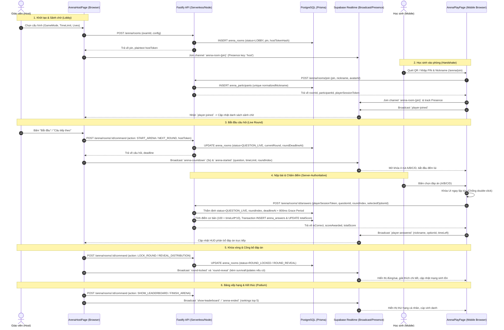

# SURVIVAL ARENA — EXISTING GAME ARCHITECTURE DISCOVERY
**Dự án:** NextBand LMS (nextband.site)  
**Thời gian khảo sát:** 18/10/2026  
**Mục tiêu:** Khảo sát kiến trúc Game Arena / Kahoot-like hiện có để chuẩn bị thiết kế chế độ **Survival Arena — Đấu trường sinh tồn (Đấu Trường 100)**.  
**Nguyên tắc tuân thủ:** Chỉ đọc và phân tích code; không sửa đổi file mã nguồn, database hay cấu hình hệ thống.

---

## 1. Sơ đồ luồng game hiện tại

Kiến trúc Game Arena của NextBand vận hành theo mô hình **Hybrid: Server-Authoritative State + Supabase Realtime Broadcast + Peer Local Sync**:



---

## 2. Danh sách file/service quan trọng và vai trò thực tế

### A. Phía Backend / Server (Fastify + Prisma)
1. [`server/routes/arena.routes.ts`](file:///d:/handover/ielts/server/routes/arena.routes.ts):
   - **Vai trò:** Khai báo các endpoint RESTful cho Arena: `POST /rooms` (tạo phòng), `GET /rooms/:pin` (thông tin phòng), `POST /rooms/join` (handshake học sinh), `POST /rooms/:pin/kick` (mời học sinh ra ngoài), `POST /rooms/:id/command` (lệnh host điều khiển vòng), `POST /rooms/:id/answers` (học sinh nộp bài), `POST /rooms/:pin/reclaim` (F5 khôi phục snapshot Host), `GET /questions` (ngân hàng câu hỏi).
   - **Trạng thái:** Đang chạy thực tế (Production).
2. [`server/services/arena-room.service.ts`](file:///d:/handover/ielts/server/services/arena-room.service.ts):
   - **Vai trò:** Quản lý vòng đời phòng đấu: Sinh mã PIN 6 số duy nhất không va chạm ([`ArenaPinService`](file:///d:/handover/ielts/server/services/arena-pin.service.ts)), hash Host Token bằng HMAC-SHA256, xác thực điều kiện vào phòng (chặn Late-Join khi phòng đã `QUESTION_LIVE`), cấp `playerSessionToken` định danh học sinh.
3. [`server/services/arena-engine.service.ts`](file:///d:/handover/ielts/server/services/arena-engine.service.ts):
   - **Vai trò:** Trái tim Game Engine phía Server. Thực thi State Machine chuẩn xác:
     - Thẩm định quyền điều khiển qua `hostToken`.
     - Chống lặp lệnh bằng `lastCommandId` (Idempotency).
     - Chấm điểm phía máy chủ: kiểm tra `status === 'QUESTION_LIVE'`, kiểm tra `roundIndex`, kiểm tra deadline với `800ms Grace Period`.
     - Transaction nguyên tử ghi nhận câu trả lời vào `arena_answers` và cộng dồn điểm số vào `arena_participants` (chống nộp 2 lần qua Database Unique Constraint `[participantId, questionId]`).
     - Tái lập toàn bộ snapshot phòng khi Host tải lại trang (`reclaimHostSnapshot`).
4. [`server/services/arena-bank.service.ts`](file:///d:/handover/ielts/server/services/arena-bank.service.ts):
   - **Vai trò:** Trích xuất và chuẩn hóa câu hỏi từ DB Exam, phân giải ngân hàng câu hỏi Lớp 8 (`GRADE8_ARENA_LESSON_QUESTIONS`), DOER, BUILDER, hoặc ngân hàng dự phòng chuẩn (`ARENA_STANDARD_QUESTIONS`). Xáo trộn ngẫu nhiên đáp án theo seed phòng chơi.

### B. Phía Frontend Client (React + Next.js/Vite Single Page)
1. [`nextband/src/pages/arena/ArenaHostPage.tsx`](file:///d:/handover/ielts/nextband/src/pages/arena/ArenaHostPage.tsx):
   - **Vai trò:** Màn hình máy chiếu của giáo viên. Quản lý trạng thái State Machine máy chiếu, kết nối Supabase Channel `arena-room-{pin}`, phát âm thanh (BGM, sound effects), tính toán hiển thị sinh tồn (mạng còn lại, số người bị loại), điều khiển trình chiếu câu hỏi và bảng xếp hạng.
2. [`nextband/src/pages/arena/ArenaJoinPage.tsx`](file:///d:/handover/ielts/nextband/src/pages/arena/ArenaJoinPage.tsx):
   - **Vai trò:** Màn hình học sinh nhập PIN và Tên (hoặc quét QR code tự điền PIN). Gọi `arenaApi.joinRoom` để bắt tay với server và lưu session token vào `sessionStorage`.
3. [`nextband/src/pages/arena/ArenaPlayPage.tsx`](file:///d:/handover/ielts/nextband/src/pages/arena/ArenaPlayPage.tsx):
   - **Vai trò:** Giao diện điều khiển trên điện thoại của học sinh (Client Game Controller). Lắng nghe Broadcast từ Host, khóa tương tác nộp bài đồng bộ (chống bấm nhiều lần), gọi `arenaApi.submitAnswer` nộp về server, đồng thời gửi Broadcast `player-answered` để Host cập nhật biểu đồ live.
4. [`nextband/src/components/arena/HostSettingsModal.tsx`](file:///d:/handover/ielts/nextband/src/components/arena/HostSettingsModal.tsx):
   - **Vai trò:** Modal thiết lập trận đấu: Chọn Game Mode (`CLASSIC`, `GOLD_QUEST`, `ARENA_100`), thời gian mỗi câu (10s, 15s, 20s, 30s), số mạng khởi đầu (1 mạng hoặc 3 mạng).
5. [`nextband/src/components/arena/ArenaFreeFireLeaderboard.tsx`](file:///d:/handover/ielts/nextband/src/components/arena/ArenaFreeFireLeaderboard.tsx) & [`ArenaPodiumView.tsx`](file:///d:/handover/ielts/nextband/src/components/arena/ArenaPodiumView.tsx):
   - **Vai trò:** Giao diện bảng xếp hạng và bục vinh danh Quán quân (Podium) trên màn chiếu máy chiếu.

---

## 3. Cơ chế lưu trạng thái, đồng bộ và tính điểm

| Tiêu chí | Cơ chế thực tế trong Code | Nơi lưu trữ / Thực thi |
| :--- | :--- | :--- |
| **Dữ liệu trong PostgreSQL** | - Phòng thi (`arena_rooms`): PIN, `status`, `currentRound`, `roundDeadlineAt`, `lastCommandId`, `config` (chứa `gameMode`, `survivalInitialLives`).<br>- Học sinh (`arena_participants`): Nickname, Avatar, `playerSessionToken`, `totalScore`, `totalGold`, `joinedAt`.<br>- Lượt nộp bài (`arena_answers`): `selectedOptionId`, `isCorrect`, `scoreAwarded`, `submittedAt`. | PostgreSQL (bền vững, SSOT cho điểm số và người chơi). |
| **Dữ liệu trong Client RAM** | - Trạng thái đếm ngược giây (`timeLeft`), cờ mở khóa UI (`isLocked`), hiệu ứng âm thanh, danh sách câu sai tạm thời để ôn tập (`wrongQuestions`).<br>- Snapshot sinh tồn tạm thời trên giao diện Host: `playerLivesMap`, `eliminatedRoundMap`, `roundProcessedIndex`. | Browser React State (`useState`, `useRef`). |
| **Kênh đồng bộ Realtime** | - **Supabase Broadcast Channel** (`arena-room-{pin}`): Phát tán sự kiện có độ trễ cực thấp (`arena-started`, `round-locked`, `round-reveal`, `show-leaderboard`, `player-answered`).<br>- **Supabase Presence**: Chỉ dùng để theo dõi học sinh đang **Online / Offline**, rớt mạng không xóa khỏi database.<br>- **HTML5 BroadcastChannel**: Hỗ trợ đồng bộ giữa các tab trên cùng trình duyệt khi test cục bộ. | Supabase Realtime Server. |
| **Nguồn có thẩm quyền (SSOT)** | - **Server (Fastify + Postgres) là thẩm quyền tối cao về Điểm số và Tính hợp lệ của câu trả lời** (`ArenaEngineService.submitAnswer`). Client hoàn toàn không có quyền tự quyết điểm.<br>- Host Browser đóng vai trò nhạc trưởng phát lệnh chuyển cảnh (`ArenaHostPage`). | Server-Authoritative Engine. |
| **Xử lý nộp bài đồng thời** | - Hai học sinh nộp cùng lúc: Xử lý độc lập qua Fastify request pipeline.<br>- Một học sinh bấm dồn dập (Burst Click): Phía Client khóa tức thì bằng `hasSubmittedRef.current = true`. Phía Server bảo vệ bằng Database Unique Constraint `@@unique([participantId, questionId])`, trả về `409 ALREADY_SUBMITTED`. | Synchronous Client Ref Lock + DB Unique Constraint. |
| **Giáo viên F5 / Mất kết nối** | - Host lưu `arena_host_token_{pin}` trong `sessionStorage`.<br>- Khi tải lại trang, Host gọi `POST /arena/rooms/:pin/reclaim` $\to$ Server trả về nguyên vẹn vòng chơi hiện tại, câu hỏi, điểm số và danh sách người chơi $\to$ Trận đấu tiếp tục bình thường. | `reclaimHostSnapshot` API. |

---

## 4. Bảng phân loại khả năng tái sử dụng cho Survival Arena

### Nhóm A: Tái sử dụng trực tiếp 100% (Không cần đụng vào)
- **Hệ thống Phòng đấu & Mã PIN:** Sinh PIN 6 số, bảo mật bằng Host Token hash HMAC-SHA256 ([`arena-pin.service.ts`](file:///d:/handover/ielts/server/services/arena-pin.service.ts)).
- **Luồng Học sinh Tham gia:** Handshake bằng QR Code, cấp `playerSessionToken`, quản lý sảnh chờ ([`ArenaJoinPage.tsx`](file:///d:/handover/ielts/nextband/src/pages/arena/ArenaJoinPage.tsx), [`ArenaLobbyKahoot.tsx`](file:///d:/handover/ielts/nextband/src/components/arena/ArenaLobbyKahoot.tsx)).
- **Ngân hàng câu hỏi:** Cơ chế load câu hỏi từ DB/Lớp 8/DOER và shuffle đáp án theo seed ([`arena-bank.service.ts`](file:///d:/handover/ielts/server/services/arena-bank.service.ts)).
- **Kênh Realtime Broadcast & Presence:** Đồng bộ sự kiện bắt đầu, khóa vòng, công bố đáp án qua Supabase Channel.
- **Xác thực Nộp bài Server-Side:** Cơ chế kiểm tra deadline, tính điểm Kahoot, chống nộp đúp ([`arena-engine.service.ts`](file:///d:/handover/ielts/server/services/arena-engine.service.ts)).
- **Bục Vinh Danh Quán Quân:** Tái sử dụng component Podium 4 giai đoạn ([`ArenaPodiumView.tsx`](file:///d:/handover/ielts/nextband/src/components/arena/ArenaPodiumView.tsx)).

### Nhóm B: Có thể mở rộng tự nhiên (Extend qua Config)
- **Cấu hình phòng đấu (`arena_rooms.config`):** Cột `config` trong Postgres có kiểu `Json?`. Ta có thể lưu `{ gameMode: 'ARENA_100', survivalInitialLives: 1 | 3, allowSuddenDeath: boolean }` vào đây mà **không cần chạy migration thêm cột mới**.
- **State Machine lệnh Host:** `executeHostCommand` đã hỗ trợ mở rộng tham số `gameMode` để điều chỉnh luồng chuyển vòng (`START_ARENA`, `NEXT_ROUND`, `SHOW_LEADERBOARD`).
- **Gói Broadcast Round Reveal:** Payload `round-reveal` có thể đính kèm dữ liệu sinh tồn `survivalUpdates: { [nickname]: { lives, delta, isEliminated } }` để học sinh tự render tim trên điện thoại.
- **Tiêu chuẩn Bảng xếp hạng:** `allRankings` có thể mở rộng ưu tiên: `isEliminated` $\to$ `lives` $\to$ `elimRound` $\to$ `totalScore`.

### Nhóm C: Cần bổ sung logic chuyên biệt cho Survival Arena
- **Logic Thu Hẹp Đấu Trường (Shrinking Arena):** Phát hiện điều kiện kết thúc sớm khi số người còn sống $\le 1$ mà không cần chờ hết toàn bộ câu hỏi.
- **Chế độ Thử Sức (Spectator / Practice Mode):** Học sinh bị loại (0 mạng) vẫn được tiếp tục bấm đáp án trên điện thoại để ôn tập, nhưng bị đánh dấu `isEliminated: true` và loại khỏi sàn đấu máy chiếu.
- **Bảo toàn Snapshot Sinh Tồn khi Host F5:** Cần lưu trạng thái mạng của từng người chơi vào snapshot tái lập phòng nếu Host tải lại trang giữa chừng.

---

## 5. Ba đến năm rủi ro quan trọng nhất (Kèm dẫn chứng mã nguồn)

1. **Rủi ro 1: Trạng thái Sinh tồn (Số Mạng) hiện tại chỉ nằm trong Client Memory của Host**
   - *Dẫn chứng:* Trong [`nextband/src/pages/arena/ArenaHostPage.tsx`](file:///d:/handover/ielts/nextband/src/pages/arena/ArenaHostPage.tsx#L914-L985), `playerLivesMap` được tính toán trong state React của Host khi công bố đáp án.
   - *Hậu quả:* Nếu Host vô tình tắt tab hoặc F5 sâu mà server không lưu `lives`, hàm `reclaimHostSnapshot` trong [`arena-engine.service.ts`](file:///d:/handover/ielts/server/services/arena-engine.service.ts#L350-L436) chỉ trả về danh sách người chơi và điểm số, số mạng sẽ bị reset về mặc định ban đầu.
   - *Giải pháp:* Cần để server tính hoặc suy diễn số mạng dựa trên lịch sử `arena_answers.isCorrect` của người chơi từ đầu trận khi khôi phục snapshot.

2. **Rủi ro 2: Số lượng câu hỏi mặc định ngắn (10 câu) gây kết thúc lửng lơ**
   - *Dẫn chứng:* Trong [`server/services/arena-bank.service.ts`](file:///d:/handover/ielts/server/services/arena-bank.service.ts#L295), nếu Host không chọn bài thi cụ thể, hệ thống trả về `ARENA_STANDARD_QUESTIONS` với đúng 10 câu.
   - *Hậu quả:* Nếu lớp có 30 học sinh chọn chế độ 3 mạng, sau 10 câu vẫn còn 15 bạn chưa bị loại, trận đấu kết thúc mà chưa tìm ra Quán Quân đơn độc.
   - *Giải pháp:* Khuyến nghị chế độ 1 Mạng (Sudden Death) khi chơi bộ 10 câu, hoặc nạp bộ câu hỏi Lớp 8/Marathon (15–20 câu) cho Survival Arena.

3. **Rủi ro 3: Bất đối xứng thời gian do độ trễ mạng Internet (Client Clock Skew)**
   - *Dẫn chứng:* Trong [`server/services/arena-engine.service.ts`](file:///d:/handover/ielts/server/services/arena-engine.service.ts#L267-L276), server áp dụng `GRACE_PERIOD_MS = 800` so với `roundDeadlineAt`.
   - *Hậu quả:* Nếu mạng 4G của học sinh bị giật quá 800ms, server sẽ từ chối với lỗi `EXPIRED_SUBMISSION` (tương đương trả lời sai/hết giờ và mất mạng).
   - *Giải pháp:* Học sinh cần nhận micro-feedback rõ ràng khi hết giờ để hiểu lý do bị trừ mạng, tránh thắc mắc.

---

## 6. Đề xuất kiến trúc Survival Arena tối thiểu (Minimal Viable Design)

Phương án tối ưu là **Zero New Database Tables, Pure Config & Event-Driven Engine**:

1. **Database:**
   - **Không tạo bảng mới.** Tận dụng cột `config` dạng `Json?` của bảng `arena_rooms` hiện có để lưu cấu hình:
     ```json
     {
       "gameMode": "ARENA_100",
       "survivalInitialLives": 1,
       "timeLimit": 15
     }
     ```
2. **Server Engine (`arena-engine.service.ts`):**
   - Giữ nguyên toàn bộ logic chấm điểm và chống nộp đúp.
   - Trong hàm `reclaimHostSnapshot`, nếu `config.gameMode === 'ARENA_100'`, tự động tính toán lại số mạng còn lại của từng học sinh bằng công thức:
     $$\text{currentLives} = \max(0, \text{initialLives} - \text{count}(\text{incorrect\_answers}))$$
     Điều này giúp khôi phục 100% trạng thái sinh tồn sau khi Host F5 mà không cần thêm cột database mới.
3. **Realtime Broadcast Payload:**
   - Trong sự kiện `round-reveal`, Host đính kèm object `survivalUpdates`:
     ```typescript
     survivalUpdates: {
       [nickname: string]: {
         lives: number;
         maxLives: number;
         delta: -1 | 0;
         isEliminated: boolean;
       }
     }
     ```
4. **Client UI Controller (`ArenaPlayPage.tsx`):**
   - Khi `lives === 0`, chuyển sang giao diện **"Chế độ Thử Sức"**:
     - Ẩn điểm số thi đua, hiển thị banner tím: *"Bạn đã dừng bước ở đấu trường, tiếp tục trả lời để ôn tập kiến thức"*.
     - Vẫn gửi nộp bài lên server bình thường để hệ thống lưu vào sổ tay lỗi sai (`wrongQuestions`).

---

## 7. Danh sách file dự kiến sửa khi triển khai

| File | Lý do cần sửa | Mức độ tác động |
| :--- | :--- | :--- |
| [`nextband/src/components/arena/HostSettingsModal.tsx`](file:///d:/handover/ielts/nextband/src/components/arena/HostSettingsModal.tsx) | Thêm radio chọn chế độ `ARENA_100` và tùy chọn số mạng ban đầu (1 mạng hoặc 3 mạng). | Thấp (chỉ UI cấu hình). |
| [`nextband/src/pages/arena/ArenaHostPage.tsx`](file:///d:/handover/ielts/nextband/src/pages/arena/ArenaHostPage.tsx) | Quản lý bảng mạng `playerLivesMap`, trừ mạng khi sai/hết giờ, tự động dừng sớm khi còn $\le 1$ người. | Trung bình (Logic hiển thị Host). |
| [`nextband/src/pages/arena/ArenaPlayPage.tsx`](file:///d:/handover/ielts/nextband/src/pages/arena/ArenaPlayPage.tsx) | Nhận broadcast `survivalUpdates`, hiển thị icon tim ❤️ và banner Chế độ Thử Sức khi hết mạng. | Thấp (UI học sinh). |
| [`server/services/arena-engine.service.ts`](file:///d:/handover/ielts/server/services/arena-engine.service.ts) | Bổ sung khôi phục số mạng trong `reclaimHostSnapshot` dựa trên lịch sử `arena_answers`. | Thấp (Chỉ mở rộng snapshot). |
| [`nextband/src/components/arena/ArenaRulesModal.tsx`](file:///d:/handover/ielts/nextband/src/components/arena/ArenaRulesModal.tsx) | Thêm tab hướng dẫn luật chơi Survival Arena cho học sinh đọc ở sảnh chờ. | Thấp (Chỉ thông tin). |

---

## 8. Các điểm chưa xác định và Kiểm thử cần thiết trước khi triển khai

1. **Trường hợp Hòa (Tie-break):**
   - *Câu hỏi:* Nếu vòng cuối cùng kết thúc mà vẫn còn $2 - 3$ học sinh cùng số mạng, hệ thống phân định thế nào?
   - *Phương án hiện tại:* Sắp xếp theo tổng điểm tốc độ (`totalScore`).
2. **Trường hợp Tất cả cùng bị loại trong một câu (Extinction):**
   - *Câu hỏi:* Nếu ở Câu số 5 gặp câu hỏi bẫy khó, toàn bộ những người còn lại đều trả lời sai $\to$ tất cả cùng về 0 mạng thì ai thắng?
   - *Phương án:* Công nhận người có điểm tốc độ cao nhất trước vòng đó hoặc xét ai trả lời đúng ở vòng gần nhất.
3. **Kiểm thử Concurrency & Disconnect:**
   - Cần chạy vitest mô phỏng 20 học sinh nộp bài đồng thời trong chế độ sinh tồn để xác nhận không có race condition làm sai lệch số mạng.
